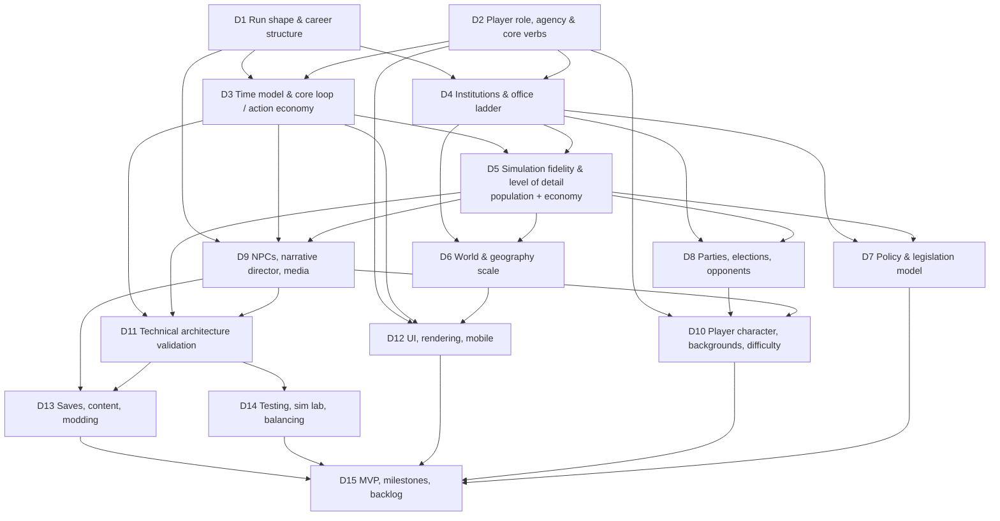

# Mandate — Discovery Synthesis, Dependency Map & Roadmap

**Status:** Living document. Produced for brief §30, Steps 1–3.
**Labels:** **Established** (accepted by the owner), **Proposed** (awaiting approval), **Assumption** (temporary working assumption), **Deferred**, **Rejected**.

---

## 1. Synthesis of the brief

### 1.1 Established vision

- **Established:** *Mandate* is a political career roguelike set in a procedurally generated, fictional country, with a deep simulation of society underneath it.
- **Established:** The player starts in local politics and can climb toward head of government. The career is continuous, not a menu of separate dashboards.
- **Established:** The simulation is authoritative. The UI explains it, and narrative presents it but never invents outcomes. An LLM may at most describe validated state.
- **Established:** Geography and environment drive settlement, economy, and political interests.
- **Established:** The simulation is deterministic and seedable: same seed, configuration, content version, engine version, and actions give the same results.
- **Established:** Rust engine → WASM → Web Worker → static, offline-first PWA on mobile and desktop. No backend.
- **Established:** A playable local vertical slice comes before any national simulation (brief §27 M6 and §31.15).
- **Established:** The owner is the final decision-maker. Decisions are documented, not improvised.

### 1.2 Major design hypotheses (to be tested in discovery)

| # | Hypothesis | Brief § | Initial view |
|---|---|---|---|
| H1 | Victory = win the midterms in year 2 of the presidency | 1.2, 3.4 | Strong climax, but it commits us to a presidential system with staggered elections, and it is an election the player is not on the ballot for. Needs a precise definition. |
| H2 | Office ladder of ~8 levels | 3.3 | Too many levels to play in detail. Compression needed (see D1). |
| H3 | Briefing → Plan → Act → Develop → Simulate → Review loop | 4.1 | Sound skeleton. Turn length and action economy are still open. |
| H4 | Hybrid population: aggregate cohorts + persistent named NPCs | 6.1 | Agree. This is close to the only viable option. |
| H5 | One fictional country | 5.2 | Agree. International relations are deferred. |
| H6 | Small sector-based economy, expanded only when gameplay needs it | 7.4 | Agree. |
| H7 | Policies as structured causal objects with a proposal → law → funding → implementation → outcome pipeline | 8.1–8.4 | Agree. This is a core differentiator. |
| H8 | Narrative director with event budgets and cooldowns | 10.6 | Essential. This is the highest-risk system for fun. |
| H9 | Conventional Rust domain models, not ECS | 20.2 | Agree. |
| H10 | Periodic snapshots plus action history, not full event sourcing | 16.3 | Agree. |
| H11 | React/Vite/Zustand/Dexie/PixiJS frontend | 15.1, 20.4 | Plausible. Validate with a map prototype on mobile. |

### 1.3 Most consequential unresolved decisions

1. **Run shape.** How a 20–40-year career is compressed into a playable run, how long a run takes, and what failure means. This one decision constrains almost everything else.
2. **The player's role and core verbs.** Is the player a politician who persuades or an administrator who allocates? This is authority vs. influence (§4.4).
3. **Time model.** Turn length, whether cadence changes by career stage, and how time skips work.
4. **Institutional model.** The fictional constitution: offices, electoral systems, presidential vs. parliamentary, appointments, and party mechanics.
5. **Simulation fidelity and level of detail.** How much detail exists at local scale vs. national scale, and how the engine changes resolution as the player rises.
6. **Narrative director design.** What earns the player's attention.

### 1.4 Potential contradictions and tensions

| # | Tension | Why it matters | Suggested resolution (proposed) |
|---|---|---|---|
| C1 | "Roguelike replayability" vs. "a full career from local office to the presidency" | Roguelike runs are usually hours long. A literal career is decades and many elections. | Compress the career into acts with time skips (see D1). |
| C2 | One deep simulation vs. a scale that changes from neighborhood to nation | Neighborhood fidelity nationwide is expensive and mostly invisible. Coarse fidelity locally is shallow. | Level-of-detail simulation: fidelity follows the player's scope. It has to be designed into the data model from the start. |
| C3 | "Fictional institutions" vs. a midterm victory condition | Midterms imply a presidential system with fixed, staggered legislative terms. | Proposed resolution: DEC-006 (Mandate Test defined by the constitution) and DEC-007 (constitution as data, archetypes plus quirks). |
| C4 | Deep economy vs. very limited agency at the local level | A local politician cannot move most economic variables, so national-scale depth may be invisible early on. | Local play is about pressures arriving from the wider economy, not about controlling it. Show the causal chains. |
| C5 | Milestones M1–M2 (world generation, economy) come before any gameplay (M3+) | This is the exact failure §32 warns about: systems first, fun later. | Add a throwaway gameplay prototype of the local loop before or alongside M1. Revisit in D15. |
| C6 | Local slice as the quality gate vs. the climb as the core fantasy | The local slice may feel small without the promise of progression. | Judge M6 on loop quality and story generation, and include a "next rung" teaser. |
| C7 | Dense, information-heavy screens vs. mobile as a first-class target | Dashboards shrink badly. | Design mobile-first for decisions, with deep data reached through progressive disclosure (D12). |

### 1.5 Major risks

| Risk | Likelihood | Impact | Mitigation |
|---|---|---|---|
| Technically impressive but not fun | High | Critical | Early gameplay prototype, game-quality gates at every milestone, narrative director as a first-class system |
| Scope explosion (8 offices × all systems) | High | Critical | Acts/level-of-detail model, strict MVP, a decision register to resist creep |
| Content volume (policies, events, per-stage actions) | High | High | Data-driven content, templates parameterized by simulation state, depth over breadth |
| Coupled systems are hard to balance (runaway feedback loops) | Medium | High | Simulation lab, Monte Carlo runs, clamped and damped update rules, canonical test worlds |
| Opaque outcomes ("why did I lose?") | Medium | High | Causal event records from day 1, explanation UI |
| Cross-platform non-determinism | Medium | Medium | No float transcendentals from `std` (use `libm`), ordered collections only (no `HashMap` iteration in the simulation), single-threaded simulation, native-vs-WASM determinism tests in CI |
| Save migration burden as the model evolves | Medium | Medium | Save schema decoupled from internal structs, versioned migrations, determinism replay tests |
| Agent drift and incoherent architecture | Medium | High | Interface-first tasks, small diffs, independent review (§23–24) |

---

## 2. Decision dependency map

Key dependency chains:

- **Run shape → time → fidelity → architecture.** How long a run is and how careers compress determines turn length. Turn length determines update cadences, and the cadences together with level of detail determine engine scheduling and the data model.
- **Institutions → policy, elections, and the world.** Office types decide which budgets, authorities, and districts exist, and so how political boundaries must be generated.
- **Narrative → persistence → saves.** How long NPCs live, what they remember, and how much causal history the director needs determine save size and structure.

### 2.1 Safely deferrable (do not block architecture)

| Item | Why it can wait | Guardrail now |
|---|---|---|
| Monetization and open-source model (§19) | Does not affect simulation structure | Prefer permissively licensed dependencies so no option is closed |
| Modding runtime (§17.3) | Data-driven content keeps the door open | Content in validated external files, stable string IDs |
| LLM-generated text | Presentation only, by constraint | Narrative layer consumes structured facts |
| Multithreaded WASM, Rayon | Profiling must justify it first | Keep the simulation single-threaded and deterministic |
| Native desktop wrapper | The PWA is the product | Engine core has no browser dependencies |
| Binary save encoding | JSON is fine until measured | Versioned schema independent of internal structs |
| Chart and table libraries | UI prototyping decides | No early commitment |
| Meta-progression details | Run design comes first | Keep run state and meta state separate |
| Localization coverage | Translation is late work | **Not deferred:** use string keys for all player-facing text from day 1 (cheap now, expensive later) |
| International relations | Single country (H5) | Model the "outside world" as exogenous shocks |

---

## 3. Discovery roadmap

One consequential question per exchange. Tightly coupled decisions are presented together.

| # | Topic | Brief § | Key decisions | Depends on | Outputs |
|---|---|---|---|---|---|
| D1 ✅ | **Run shape & career structure** (DEC-004 accepted; DEC-005/006 proposed) | 1.2, 3.3, 3.4 | Act structure, target run length, failure/continuation, victory definition (first pass) | — | DEC entries; GAME_VISION.md draft |
| D2 ✅ | Player role, agency & **presence model** (DEC-009, DEC-010, DEC-011) | 3.1, 4.4 | Politician vs. administrator balance; authority/influence/resources/legitimacy/capital model; what makes a run memorable | D1 | GAMEPLAY.md §role |
| D3 ✅ | Time model & core loop (DEC-012, DEC-013) | 4.1–4.3, 12 | Turn length per act, time skips, action economy, action taxonomy skeleton | D1, D2 | GAMEPLAY.md §loop; cadence table |
| D4 ✅ | Institutions & office ladder (DEC-007, DEC-014–017) | 3.3, 8.3, 9.2 | Fictional constitution, electoral systems per level, appointments, party switching, final victory definition | D1, D2 | POLITICAL_SYSTEMS.md |
| D5 ✅ | Simulation fidelity & LOD (DEC-018, DEC-019) | 6, 7 | Cohort dimensions, economy model, LOD transitions, numeric representation | D3, D4 | SIMULATION.md |
| D6 ✅ | World & geography (DEC-021–023) | 5 | Scale (regions, municipalities, neighborhoods), generation pipeline, map role | D4, D5 | WORLDGEN.md |
| D7 ✅ | Policy & legislation (DEC-024–026) | 8 | Policy schema, effect mechanism model, implementation gap | D4, D5 | POLICY.md |
| D8 ✅ | Parties, elections, opponents (DEC-027–030) | 9 | Party model, election pipeline, opponent AI profiles | D4, D5 | ELECTIONS.md |
| D9 ✅ | NPCs, narrative, media (DEC-031–035) | 10, 11 | NPC tiers, memory model, quest model, director budgets, media/perception split | D1, D3, D5 | NARRATIVE.md |
| D10 | Player character & difficulty | 3.2, 3.5 | Backgrounds, personal life scope, difficulty levers, complexity layers | D2, D8, D9 | GAMEPLAY.md §character |
| D11 | Technical architecture | 13, 14, 20–22 | Crate layout, protocol, scheduling, RNG streams, numerics | D3, D5, D9 | architecture/*.md |
| D12 | UI, rendering, mobile | 15 | Screen map, mobile strategy, map renderer prototype plan | D2, D3, D6 | UI.md |
| D13 | Saves, content, modding | 16, 17 | Save schema and migration, content format, validation | D9, D11 | SAVE_FORMAT.md, CONTENT.md |
| D14 | Testing & sim lab | 18 | Test strategy, lab CLI scope, canonical worlds, quality gates | D11 | TEST_STRATEGY.md |
| D15 | MVP, milestones, backlog | 19, 26–29 | MVP scope, milestone reorder (C5), backlog, deployment | all | ROADMAP.md, backlog |

After D15, an architecture review (brief §26.1) and owner approval come before any substantive implementation.

---

## 4. Idea parking lot (unratified)

- **"Mandate" as a mechanic:** a quantified electoral mandate, earned by margin of victory and clarity of campaign promises and spent pushing an agenda, which decays over a term. It could be the name for political capital. Evaluate in D2/D3.
- **Persistent cross-act NPCs:** a city council rival returns as a senator blocking your national bill. This is a strong argument for NPC persistence across levels of detail. Evaluate in D9.
