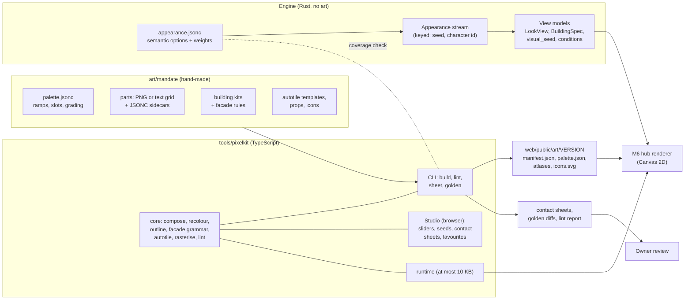

# Research and plan: a pixel-art generator for Mandate

**Purpose:** A decision-ready plan for a tool that produces attractive, consistent, tunable pixel art for Mandate (characters, buildings, tiles, props, icons), robust enough to become its own project. P0 is built (see P0 results); P1 is part of M6. The owner asked for this plan before any tool is built ("plan that before actually building the tool to ensure it's robust, provides what we need and can actually be designed to output attractive and nice pixel art").
**Date:** 2026-11-19. One research pass over web sources (listed at the end, cited as [ID]). Most are practitioner guides, modding wikis and developer interviews, not measured studies.
**Status:** Accepted (DEC-084); D16 open; P0 built; round 4 (layout v2 terrain) built. Nothing here changes an accepted decision. Section 9 lists what the owner must decide.

## Executive summary

1. A generator can't invent good pixel art; it multiplies a small library of good hand-drawn parts. Stardew Valley, RimWorld and Caves of Qud work this way [SDV-FS, RW, CoQ].
2. Recommended: **hand-drawn parts, composed by code, coloured from designed palette ramps.** Code selects, layers, recolours, outlines, autotiles and lays out facades.
3. Characters are composed on the device from the engine's stored appearance ids (DEC-031); buildings from modular kits; tiles, props and icons are built ahead of time.
4. Lighting stays pre-rendered (DEC-080): assets ship emissive layers, shadow footprints for sun-following shadows, and the palette ships day-cycle grading keyframes.
5. Tool: a TypeScript library with a CLI, a browser studio for tuning, and a small runtime the game imports, so previews and the game always match.
6. Quality: a style guide, automated lints (palette, noise, outlines, contrast, colour blindness, crowd clones), golden images, and owner-reviewed contact sheets.
7. No AI-generated pixels in shipped art: at 16 px they need a redraw anyway, and raw output can't be copyrighted in the US [AI-CLEAN, USCO].
8. First a **validation spike** (~6 agent tasks): one palette, building kit and tile set, 20 townsfolk, one street at noon and dusk, judged on a rubric. Then MVP with M6 (~16), expansion for M7–M8 (~12).
9. It lives in `tools/pixelkit/` (working name) behind a hard boundary, and splits into its own repository once its interface holds for a milestone.

## 1. What makes pixel art look good, and what makes it look like programmer art

The sources agree on a short list. Each item becomes a rule in the style guide (§6) and, where a machine can check it, a lint (§7).

| Principle | What the sources say | What "programmer art" does instead |
|---|---|---|
| Limited, designed palette | Fewer colours give cohesion and control; the count is a guideline [PJ]. Build ramps from a vivid middle colour, peak saturation mid-ramp, never 0 or 100 [SLY-1]. | Picks colours one by one (the spike's `WALLS`/`ROOFS` arrays): no shared ramps, so nothing harmonises |
| Hue-shifted ramps | Shift hue as well as brightness: shadows cooler, highlights warmer. Slynyrd uses up to 20° per step and calls "straight ramps" a beginner mistake [SLY-1]. | Darkens with black overlays (`rgba(0,0,0,0.14)`), which greys colours and flattens them |
| Value contrast | Value carries depth and readability; check forms in greyscale [PP-COL]. | Similar values everywhere; sprites sink into the ground |
| One light direction | Shade every form from one consistent light source [PJ]. | Each asset lit differently, or not at all |
| Clusters, not pixels | Judge pixels by the shapes they form; avoid stray single pixels ("noise") except for highlights and tiny essential detail [PJ]. | Random speckle (the spike's grass: random 1×2 dots) |
| No pillow shading or banding | Pillow shading darkens around the edges and ignores the light. Banding lines up pixel runs and exposes the grid [PJ]. | Concentric outlines and edge darkening |
| Hand anti-aliasing, sparingly | Apply by hand; match each AA pixel's value to how much of it the line covers; longer segments need longer AA; keep AA inside the sprite, because outer AA breaks on unknown backgrounds; on small sprites AA reads as noise [PP-AA]. | Canvas path fills, which anti-alias automatically and add off-palette colours |
| Selective outlines | A full outline with light variation holds up better than sel-out; sel-out only works when the background is known [PJ]. | Black outlines everywhere, or none |
| Dithering rules | Dither to buffer between colours, not to fill areas; never random [PJ]. LPC: "sparingly if at all" [LPC-SG]. | Dither as texture; random noise |
| One pixel scale | Mixed pixel sizes look wrong; fractional scaling makes pixels uneven and shimmer when the camera moves [MDN, JJ]. DEC-080 already snaps zoom to whole steps. | Sprites scaled by 1.5× next to 1× tiles |
| Readable silhouettes at small sizes | At 16 px, realistic proportions read as a stick figure: enlarge the head (a third to a half of the figure), and use height to tell young, old, and body types apart, in one consistent system [SLY-22]. | Realistic proportions; every figure the same height |
| Tiny walk cycles | Top-down: draw down, up and side, mirror the side view; a 4-frame walk reuses a run cycle minus the full-stride frames, played slower; 8-direction movement with 4 facings is acceptable [SLY-22, SLY-55]. | 3 frames, legs only, arms static |
| Standardised modules | Townscaper's author: tiles "have to be standardized" to get the handcrafted look; big shapes predictable, small details varied [TS]. | Every building drawn with ad-hoc rectangles |

**For Mandate:** the current placeholder art (`web/spikes/hub/src/art.ts`) shows most of the right-hand column. That is expected of placeholders. The tool's job is to make the left-hand column the default, so that code can't easily produce the right-hand one.

## 2. Existing approaches and tools

### 2.1 Layered characters (paper doll)

- **Stardew Valley's farmer** is 16×32 per frame, stacked bottom to top as body, pants, shirt, accessories, hair, hat, arms. The game recolours skin, eyes, boots, pants and sleeves by matching specific palette colours in the base sprite. Left and right are mirrors [SDV-FS]. NPC sprites are 16×32 and portraits 64×64 [SDV-SZ]. One person drew all of it and had never done pixel art before; he got better through practice [SDV-PCG]. This is the closest precedent for Mandate's scale.
- **RimWorld** overlays head and body apparel 1:1 onto heads and bodies, needs three facings for headwear (south, north, east; west mirrors east), draws apparel per body type (five), and colours apparel through masks: red marks the primary-colour area, black stays uncoloured [RW]. Layer order is a recurring modding topic: a popular mod exists only to add a hair layer behind the pawn [RW-LAYER]. Lesson: the layer order and occlusion rules need to be explicit data, and every combination needs testing.
- **Caves of Qud** draws tiles in three "colours": black takes the foreground colour, white the detail colour, transparent the background. A fourth colour blends by its red channel. Tiles are 16×24 [CoQ]. Lesson: a recolour-by-slot format makes one drawing serve hundreds of creatures.
- **LPC Universal Spritesheet Character Generator** is the largest open paper-doll library. The generator code is GPL-3.0. Each image has its own licence (CC0, CC-BY, OGA-BY, CC-BY-SA, GPL), and CC-BY-SA requires credit, no DRM, and share-alike for derivatives [LPC-GEN]. The style is a 32×32 grid [LPC-SG], with larger characters than Mandate's 16 px tiles. **Assessment:** a useful reference for animation tables and layer naming, but a poor source of art. It does not match the 16 px scale (DEC-065), share-alike conflicts with the permissive-only policy (OVERVIEW §9), and crediting hundreds of authors per sprite is a real burden.
- **Kenney** packs are CC0 [KEN]. Tiny Town is 16×16 and is DEC-065's initial art. Kenney's modular Roguelike Characters (16×16) can be assembled from parts but come without animation [KEN-RC]. They are good placeholders and proportion references, and too small and too generic to be Mandate's final look.

### 2.2 Fully procedural sprites

- **Dave Bollinger's pixel spaceships** and their many ports (zfedoran's MIT JavaScript version is the best known) start from a 2D mask, randomise it and mirror it into a symmetric template, then draw it [PSG]. This works for symmetric, abstract subjects (ships, bugs, emblems). It produces neither readable people nor architecture.
- **Assessment:** procedural *shapes* hit a low quality ceiling for people and buildings. Procedural *selection, placement and recolouring* of hand-made parts is where code adds value.

### 2.3 Palette swaps and colour ramps

All three shipped examples above recolour by slot (key colours, masks, or 3-colour tiles). The general form: parts are drawn in "slot colours" (for example skin shade 1 to 4, cloth A shade 1 to 3), and a lookup table maps each slot to a real palette colour at composition time. One drawing then covers every skin tone, hair colour and outfit colour. Palettes designed in a perceptual space (Oklab/OKLCH) give ramps whose steps look even [OK].

### 2.4 Buildings and towns

- **Shape grammars:** CGA shape [CGA] splits a facade into floors and bays, and repeats window modules, with rules. A tiny 2D version fits pixel facades: split a wall into storeys of 32 px, split storeys into 16 px bays, choose a door bay, fill the other bays with windows from the building family's kit.
- **Townscaper** places hand-made, standardised modules with wave function collapse and marching cubes [TS]. The lesson for us is the split between hand-made modules and procedural placement, not the 3D method.
- **Wave function collapse** (overlapping and simple tiled models) fills a grid with patterns consistent with a sample or with adjacency rules. Contradictions are rare but possible, and deciding whether a valid fill exists is NP-hard [WFC]. Mandate's layouts already come from the town generator, which places roads and lots. WFC is not needed for layout. It may be useful later for decorative fill (park paths, rooftop clutter). The reference repository's licence is not a standard open-source licence [WFC-LIC], so any implementation would be our own.

### 2.5 Autotiling

- Most systems are **marching squares (16 tiles, corner-based) or blob (47 tiles, 8-neighbour)**, and in practice nobody draws 47 unique tiles: most are copied or rotated [BTB-AT, BTB-RU].
- **Dual grid** puts the visible tiles on cell corners, so two terrains need 16 tiles (15 plus empty, or 6 with rotation) instead of 47 [DG].
- **Quarter tiles** (RPG Maker) need 5 source tiles if they can rotate, and assemble the 48 blob tiles from quarters ahead of time [BTB-QT].
- **For Mandate:** dual grid for terrain pairs (grass and pavement, grass and water, pavement and road kerbs), with the tool expanding 5–6 hand-drawn templates into each set at build time.

### 2.6 Shading from depth and normals

- **Dead Cells** renders 3D models "in a very small size and without antialiasing", with a normal map per frame so a toon shader adds volume. The team chose this to favour animation over hand-drawn detail [DC].
- **Eastward** (two people) hand-crafted every asset, hand-painted bump maps "one by one", and lights them with a custom engine [EW].
- **Sprite Lamp** builds normal and depth maps from a few hand-painted lighting directions [SL].
- **For Mandate:** these need per-pixel lighting, which DEC-080 rules out for Canvas 2D. Normal maps also look too smooth at 16 px unless hand-polished. One cheap idea survives: the tool can emit a *sun-facing rim mask* per asset (the pixels on the lit edge), which the renderer can add warmly at golden hour with one extra draw. This is optional and is tested in the spike.

### 2.7 Upscaling and downscaling

- Fractional scaling makes some pixels wider than others, and motion exposes it. Integer scaling with nearest-neighbour sampling avoids it [JJ, MDN]. DEC-080 already draws at CSS resolution or lower, with `image-rendering: pixelated` and whole-number zoom.
- Downscaling a large image to pixel art does not give pixel art. It gives blurred clusters and stray colours (see AI below).
- Portraits drawn at a larger size are a different asset, not an upscaled sprite.

### 2.8 AI-assisted pixel art

- **Output quality:** diffusion models paint images that resemble pixel art: most "pixels" don't land inside a grid, edges blur, and colour counts explode [AI-CLEAN]. One vendor reports a sprite asked for about 12 colours that came back with 44,725, with blocks 26 to 32 px wide [AI-RANGY]. Cleanup means detecting the grid, downscaling, quantising, then fixing noise by hand [AI-CLEAN]. Our assessment: at 16×24 there are too few pixels for a downscaled painting to keep a face or a hand, so the cleanup becomes a redraw. Dedicated tools (Retro Diffusion, an Aseprite extension) add palette control and grid snapping [RD], but each generation is still a separate drawing, so parts generated one at a time don't line up on shared anchors.
- **Consistency:** a paper doll needs every hair style aligned to the same head in three facings and four walk frames. Generation does not guarantee alignment between images, so each part would be redrawn by hand anyway.
- **Copyright:** the US Copyright Office's 2025 report says outputs generated from a prompt alone are not copyrightable, and choosing one output from several is not authorship. Human selection, arrangement, and creative modification can be protected [USCO]. Shipped AI pixels could be copied freely.
- **Stores:** Steam requires disclosure of AI-generated content that players see (rules rewritten in 2026 to cover only player-facing content) [STEAM-AI]. Mandate ships on the web, but a store release later would need the disclosure.
- **Honest assessment for a small team:** useful for mood boards and quick exploration of a building's look before someone draws it. Not useful for shipped 16 px parts.

### 2.9 What similar games did, in one line each

| Game | Art approach | Source |
|---|---|---|
| Stardew Valley | One self-taught artist; 16 px tiles, 16×32 characters, 64×64 portraits; layered, palette-matched farmer | [SDV-PCG, SDV-SZ, SDV-FS] |
| Eastward | Two-person studio; everything hand-crafted in Aseprite; hand-painted bump maps; engine lighting | [EW] |
| RimWorld | Layered pawns: body types, heads, apparel overlays, mask-based colouring | [RW] |
| Caves of Qud | 16×24 tiles recoloured from 3–4 slot colours | [CoQ] |
| Townscaper | Hand-made standardised modules, placed procedurally | [TS] |
| Dead Cells | 3D models rendered small without AA, plus normal maps and toon shading | [DC] |

## 3. Requirements from the game

### 3.1 Requirements table

| ID | Requirement | From | How we check it |
|---|---|---|---|
| R1 | Top-down three-quarter view, 16 px tiles, one pixel scale in the scene | DEC-049, DEC-065, DEC-080 | Style guide; lint rejects off-grid sizes |
| R2 | Layered characters composed from appearance parameters, 4 facings (3 drawn, 1 mirrored) | DEC-009, DEC-031, DEC-049 | Every part has down, up and side views and all frames |
| R3 | Ambient crowds must not look like clones; ambient people are generated on demand and never stored | DEC-018, DEC-009 | Clone-rate lint on sampled crowds (§7) |
| R4 | Same parameters, same sprite, on every device and every load | DEC-041 spirit, DEC-018 | Golden images; build twice gives identical pixels |
| R5 | An art update must not change a known character's look unless intended | Owner brief | Stored keys never remapped; alias table; golden diffs reviewed |
| R6 | Buildings for every place kind (23 in `PlaceKind`) and neighbourhood kind (6), plus filler housing | DEC-079, `places.jsonc`, `world.rs` | Coverage lint against the registries |
| R7 | Visible conditions from the simulation: boarded storefronts, construction, flood damage, protests | DEC-009 | Condition overlays in every shop and house kit |
| R8 | Towns feel distinct | DEC-077 | Owner side-by-side of two generated towns at the P1 review (§8) |
| R9 | Continuous day cycle with pre-rendered lighting: grading keyframes, lit windows and lamps at dusk, sun-following shadows | DEC-013, DEC-080 | Each asset ships emissive and shadow data; dusk contact sheet |
| R10 | Canvas 2D: no shaders; static layers pre-rendered; one atlas for sprites | DEC-080 | Runtime uses only `drawImage`, composite modes, and `ImageData` |
| R11 | Mobile PWA budgets: hub ≥ 30 fps on a mid-range phone; small download | DEC-048, OVERVIEW §8 | Art payload and decoded-memory budgets (§3.5) |
| R12 | Colour is never the only signal | DEC-051 | Colour-blind lint; every coloured cue has a shape cue |
| R13 | Diverse skin tones and bodies without stereotypes | Owner brief | Independence rules (§3.3); review checklist |
| R14 | No text in art; the engine emits keys, the UI draws text as HTML | DEC-054, DEC-080 | Signs are pictograms; lint for no glyph parts |
| R15 | Player appearance is editable at character creation | DEC-036 | The studio's sliders are reusable as a creator UI |
| R16 | Strategic map shares the palette in a cartographic style | DEC-049 | Map biome colours come from the palette's terrain ramps |
| R17 | Brand palette consistent with the logo and UI | DEC-081, `styles.css` | Palette anchors include the brand tokens |
| R18 | Permissive licences only for code dependencies | OVERVIEW §9 | npm licence check covers the tool |
| R19 | Engine crates stay free of art and browser code | AGENTS.md | The engine stores semantic keys only |

### 3.2 Asset inventory for v1 (M6–M8)

Counts are for the MVP (P1, M6) unless marked M7/M8. "Parts" are drawings; "variants" are what composition and recolouring produce from them.

**Tiles (16×16, built ahead of time)**

| Group | Contents | Approx. drawn tiles |
|---|---|---|
| Ground | Grass (3 base variants plus decals: flowers, worn patches), dirt path, sand, gravel, farmland rows | 12 |
| Paved | Pavement (2 patterns), plaza stone, car park, kerbs | 8 |
| Roads | Asphalt (2), lane markings (centre, edge), zebra crossing (both orientations), junction box, manholes | 10 |
| Water | River and harbour water, animated (3–4 frames), shore, quay edge | 8 |
| Parks | Lawn, flower beds, hedge, park path | 6 |
| Autotile templates | 5–6 templates per terrain pair, expanded to dual-grid sets: grass/pavement, grass/path, grass/water, pavement/road, grass/sand, plaza/lawn, hedge, fence | ~45 templates giving ~130 tiles |
| Biome swaps | Grassland, steppe/dry, boreal (palette swaps of the ground ramps, no new drawing) | 0 |
| M7/M8 | Snow, desert ground, rail track, tram lines | ~20 |

**Building kits (modular on the 16 px grid, assembled on the device)**

Buildings are wall faces and roofs in three-quarter view (as in the spike). One storey is 32 px of wall face. Kits are grouped by *family*, and each place kind gets a family plus a signature piece.

| Family | Place kinds | Signature pieces |
|---|---|---|
| Civic | town hall, council chamber; M7/M8: regional assembly, parliament, executive residence | Columns, pediment, steps, flagpole, clock, dome (M8) |
| Small commercial | diner, market, news office, party office, hotel, shops (filler) | Shopfronts, awnings (recolourable), pictogram signs, market stalls |
| Community | school, clinic, community centre, union hall, business association, university | Entrance canopies, noticeboards, playground fence, a clinic sign that avoids the legally protected red-cross emblem |
| Industrial | factory, mill, mine, port, tech campus | Sawtooth roofs, chimneys, loading doors, cranes, headframe, glass curtain wall (tech) |
| Residential (filler) | houses, terraces, apartment blocks, farmhouses | Porches, gardens, balconies, garages |

Per family: wall materials (3–4, recolourable), storey trims, 4–6 window styles, 2–4 doors, roof types (flat with parapet, gable, hip, sawtooth, mansard), chimneys and roof clutter. Every window and door has three states: day, lit (emissive), and boarded. Condition overlays: boarded shopfront, "to let" board, scaffolding, flood tide-line, fresh paint, protest banners (party colours). Approx. 180–240 drawn parts for P1.

Neighbourhood kind sets the material and density mix:

| Neighbourhood | Materials | Typical forms |
|---|---|---|
| Core | Stone, dressed brick | 2–4 storeys, civic and commercial, plazas |
| Inner | Brick, render | Terraces with shops at street level |
| Waterfront | Painted timber, brick warehouses | Quays, warehouses, cafés |
| Industrial | Corrugated metal, concrete | Sheds, yards, chimneys |
| Suburb | Render, timber, tile roofs | Detached houses, gardens, driveways |
| Rural | Stone, timber | Farmhouses, barns, fields |

**Props (built ahead of time; 16×16 to 32×48)**

Street lamps (2 styles, emissive head plus light pool), benches, bins, bollards, bus stop, post box, planters, trees (3 species × 2 sizes, recoloured by biome), bushes, fountain, statue, flagpoles (party colours), campaign posters and placards (party colours plus party symbol), market stall goods, crates, a boat, a crane, parked cars (2 body shapes × 2 facings, recolourable). About 40 drawn props for P1. Moving traffic is not in v1 (decision D13). M7/M8 adds scene props: podium, stage, ballot box, TV camera, crowd barriers, desks.

**Characters (composed on the device)**

| Item | P1 count | Notes |
|---|---|---|
| Frame | 16×24 (decision D1) | Figures 17–22 px tall by height band and age |
| Facings | down, up, side (mirrored for the other side) | [SLY-22] |
| Animations | walk 4 frames, idle 2, talk 2, sit 1 (down and up), cheer 2 | Scenes need talk, sit and cheer (DEC-009 staged scenes) |
| Body builds | 4 (slim, average, broad, heavy) × 3 heights | Independent of class and occupation |
| Age forms | adult, older (posture, gait), elderly (shorter stride, optional cane) | From `age`, already in the engine |
| Skin ramps | 10, 4 steps each | Spans the range of the Monk Skin Tone scale [MST] |
| Hair styles | ~16 (short, long, curly, coily, braids, locs, buzz, bald, bun, tied back, …) | Textures as well as lengths |
| Hair colours | 8, plus greying driven by age | |
| Facial hair | 4 | |
| Outfits | ~22: one or two per occupation in `occupations.jsonc` (15), class variants, politician suit, campaign wear | Recoloured from cloth ramps |
| Accessories | ~8: glasses, hats, lanyard, hi-vis vest, apron, hard hat, party rosette, bag | Rosette in party colour plus symbol |
| Drawn parts | ~150–200 | Each part: 3 views × the frames its layer needs |

**Portraits:** in P1 the character sheet shows a 3× crop of the sprite's head and shoulders over a background, which costs no extra art and always matches the walking sprite. Dedicated 64×64 portraits (Stardew's size [SDV-SZ]) with expressions are a P2 option (decision D11): they double the hair and head library.

**Interiors (M6 needs one or two; M7/M8 more):** council chamber and a town hall office first: floor and wall tiles, desks, chairs, benches, a dais, windows. About 30 parts. Parliament and the executive residence at M8.

**UI icons:** about 55 icons on a 16×16 grid in one colour, exported as SVG so they take the theme's `--text` or `--accent`, as the logo does (DEC-081): place kinds (23 plus home and streets), actions (~15), information services (5), pressure tracks (5), resources. Shapes must differ, because colour is never the only signal (DEC-051).

**Strategic map:** the map keeps its own data-visualisation ramps (they must stay perceptually ordered and colour-blind safe), but its biome, water and land colours come from the palette's terrain ramps, and its town markers come from the icon set.

**Total for P1:** about 200 building parts, 175 character parts, 90 tile templates and tiles, 40 props and 30 interior parts, so about 500 drawings, plus about 55 icons. Everything else comes from composition and recolouring.

### 3.3 Variety, inclusivity and accessibility

- **Independence rule:** body build, height, skin tone and hair texture are drawn independently of class, occupation and community. Only clothing and accessories depend on occupation, class, age and context. This keeps the generator from encoding stereotypes such as "poor means heavy" or "this job means this skin tone".
- **Community:** the base pack has one community (`communities.jsonc`). Should an expansion want a community-specific *distribution* of skin tones, it is a broad distribution only, never features or clothing, and it needs owner review (decision D14). Default: none.
- **Gender:** the engine has no gender and the name pools are not gendered. Appearance stays gender-neutral data: hair, facial hair, clothing cut and accessories are separate parameters with independent weights. If pronouns are added later, appearance weights can be correlated with them, by explicit decision.
- **Faith:** the clergy occupation needs a neutral "faith leader" outfit (no specific religion's symbols) unless the owner decides otherwise.
- **Skin ramps:** anchored on the ten Monk Skin Tone values (CC BY 4.0, from #f6ede4 to #292420) [MST]. Each ramp is hue-shifted so that dark skin keeps visible highlights and light skin keeps visible shadows. Each ramp gets its own contrast check against every ground tile at day and at night (§7), because dark sprites on dark ground at night is a known failure.
- **Crowd variety:** the clone-rate lint (§7) samples crowds of 20 and 40 from the engine's ambient generator and counts pairs that share 5 of 6 visible features (build, skin bucket, hair style, hair colour, top colour, outfit silhouette). Idle animations start at random phases, and walking speed varies by ±10%, so crowds don't move in step.
- **Town variety:** each town draws its material ramps (brick hue, roof colour family, trim colours), tree species and street-lamp style from its region, biome and defining industry (DEC-077), so two towns differ before any building is placed. Industry landmarks (chimneys, headframes, cranes, a glass campus) appear on the skyline.
- **Colour-blind safety:** party colours always come with the party's symbol shape (posters, rosettes, flags); lit windows differ in value as well as colour; warning conditions (boarded, flooded) have a shape cue (planks, tide line). The lint simulates protanopia and deuteranopia with Machado et al.'s model [MACH], applied in linear RGB [CVD-LIN], and tritanopia with a cruder approximation.

### 3.4 Lighting and time of day

The other agent's M6 renderer has keyframed grading, sun-following shadows, and windows and lamps that light at dusk. The tool supplies the data each of those needs.

| Renderer feature | What the tool ships | How the renderer uses it |
|---|---|---|
| Grading keyframes | `lighting.json`: keyframes (dawn, morning, noon, golden hour, dusk, night) with multiply colour, ambient add, shadow colour and alpha, sun azimuth and elevation, emissive strength; plus a lookup table every 15 minutes, interpolated in Oklab by the tool | Looks up two neighbouring entries and blends them; no colour maths at run time |
| Palette moods (optional, tested in the spike) | For each keyframe, a remapped palette (every palette colour mapped to a designed night or dusk colour, as classic pixel-art games do) | Re-colours the static layer once per keyframe at town load and cross-fades between two layers |
| Lit windows and doors | Per window: rectangle, emissive sprite, and a use tag (`home`, `office`, `shop`, `civic`) | Draws emissive sprites after grading with `lighter` or plain source-over, so lights stay bright at night; the use tag lets a schedule decide which windows are lit when (homes at dusk, offices dark after hours) |
| Lamps and light pools | Emissive lamp heads, plus pre-drawn light-pool sprites in 3–4 stepped alpha bands (banded, as pixel-art light usually is, not smooth gradients) | Draws pools onto the ground layer at night |
| Sun-following shadows | Per object: footprint polygon (px), height (px); per character: blob shadow sprite | Projects the footprint along the sun vector into a shadow layer at art resolution, then composites it once with the keyframe's shadow alpha (so overlaps don't double-darken). Re-bakes only when the shadow offset changes by a whole pixel |
| Golden-hour rim (optional) | Per asset: a 1-bit mask of the sun-facing edge pixels | Adds it in a warm colour at low alpha near sunrise and sunset |

Notes:
- Canvas 2D anti-aliases path fills, which would put soft, off-palette edges on shadows. The tool's runtime includes a small integer polygon rasteriser that writes shadow pixels into an `ImageData`, so shadow edges stay crisp.
- Baked shading in the art uses a fixed key light from the upper left, while the shadows move with the sun. The two can disagree in the late afternoon. Keeping baked shading soft (two steps on walls) and letting the grading carry the time of day keeps the disagreement small. The spike checks it at dusk.
- Day-part lighting is a stylisation of the "representative day" (DEC-013). The tool only supplies data; when lights come on is the renderer's and the schedule's business.

### 3.5 Determinism, versioning and integration

**Where each piece lives**

| Piece | Owner | Contents |
|---|---|---|
| Appearance registry | Engine content (`content/base/appearance.jsonc`, new; schema from Rust types, DEC-053) | Semantic options with weights: builds, heights, skin tones, hair styles and colours, facial hair, accessory preferences, outfit rules by occupation, class and age. Stable string ids such as `hair.coily_short` |
| Appearance genome | Engine state (`Character`, DEC-031) and protocol | The choices drawn for one character, as content ids, plus a 32-bit art seed |
| Art pack | `art/mandate/` (sources) built to `web/public/art/` | Parts, kits, tiles, palette, lighting, icons, and a map from every appearance id to parts |
| Compositor | `tools/pixelkit` core, imported by the game | Pure functions: genome plus view-model context plus art pack gives pixels |

**Rules**

1. The engine draws appearance from its own keyed stream (`Appearance`, keyed by seed and character id, DEC-041 rule 5), so adding appearance never shifts any other stream or changes a simulation result.
2. Old saves without appearance get one generated on load from the same keyed stream, so every load gives the same look.
3. Ambient people get their genome from the existing keyed ambient generation (seed, place, week, slot), as a pure function; promotion to Named stores it.
4. **Stored choices are never remapped.** A genome stores ids, not indices. Ids are never deleted: a retired id gets `replaced_by` in the registry.
5. Choices that are derived rather than stored (outfit from current occupation, greying from age, campaign rosette from party and campaign state, art-side micro-variation from the art seed) change when the underlying fact changes. That is intended: a mayor dresses differently from a shopkeeper.
6. Derived picks use **rendezvous (highest-random-weight) hashing**: each candidate gets a score from a fixed hash of (seed, candidate id), weighted, and the highest wins. Adding a new candidate only takes over the picks where it now scores highest; every other pick stays the same. The engine's weighted appearance draws should use the same method (with scores from its keyed stream), so adding a hair style to the registry reshuffles only the ambient people it now wins for.
7. Redrawing a part changes everyone who uses it. That is an art release, reviewed through golden-image diffs (§7) before merge.
8. The art pack has a version and a content hash. Saves don't record it, because looks are not simulation state.
9. The hash used by the compositor is a fixed, specified function with shared test vectors in Rust and TypeScript, so engine and UI agree where they need to.

**From appearance to layers**

| Genome field (engine, stored) | Derived at view time (art pack) | Layers it drives (bottom to top) |
|---|---|---|
| `build`, `height` | Age form from `age` (posture, stride) | Body base (per facing and frame), arms |
| `skin` | | Slot recolour of body, arms, head |
| `hair`, `hair_colour` | Greying from `age` and the art seed | Back hair (behind the body), front hair; a hat swaps in the style's "under hat" variant |
| `facial_hair` | | Face detail |
| `wear` preferences (glasses, hat liking, colour leaning) | | Accessories |
| | Outfit from occupation, class, age and context (office, campaign) | Legs, top, outer layer, sleeves (on the arms layer) |
| | Campaign rosette from party and campaign state | Accessory, in the party's colour plus symbol |
| `art_seed` | Micro-variation: cloth colour within the outfit's allowed ramps, shoe colour, small details | Slot choices only, never shape |

Layer order: shadow blob, back hair, legs, body, top, outer layer, head, face detail, front hair, hat, accessories, arms. The exterior outline is added last. Each part declares occlusion tags (`covers_hair_top`, `needs_hat_variant`, `hides_arms`) that the compositor obeys and the clash lint checks.

The space of distinct looks is large: 4 builds × 3 heights × 10 skin ramps × 16 hair styles × 8 hair colours × 22 outfits × about 12 cloth colour choices is over 8 million combinations. The risk is not running out of combinations but generating many that *read* the same at 16 px, which is what the clone-rate lint measures.

**What the renderer consumes**

```text
web/public/art/<pack-version>/
  manifest.json        pack id and version; frames and anchors; animation tables; part map
                       (appearance id -> parts, layer order, occlusion tags); building kits and
                       facade rules; autotile sets; props with shadow and emissive data; icons index
  palette.json         named ramps -> hex; slot tables; grading keyframes and 15-minute lookup table
  tiles.png            RGBA atlas, autotile sets already expanded
  props.png            RGBA atlas: albedo, emissive and light-pool sprites
  kits.png             RGBA atlas: building parts (albedo, emissive, boarded states)
  parts.png            character parts drawn in slot colours (recoloured on the device)
  icons.svg            symbol sprite; currentColor
```

A provider interface (to be reconciled with the M6 renderer's placeholder provider, which should implement the same interface):

```ts
interface ArtProvider {
  ground(kind: TerrainKind, cornerMask: number, variant: number): FrameRef;
  building(spec: BuildingSpec): BuiltBuilding;          // albedo frames, windows[], doors[], shadow footprint
  prop(key: string, variant: number): PropSprite;      // albedo, emissive?, pool?, shadow
  character(look: LookView, anim: AnimKey, facing: Facing, frame: number): FrameRef;
  grade(minuteOfDay: number): Grade;                    // multiply, add, shadow vector and alpha, emissive and pool alpha
  icon(key: string): string;                            // SVG symbol id
}
```

`BuildingSpec` combines what the engine already knows (place kind, neighbourhood kind, condition flags such as boarded, construction or flooded, from simulation state) with what the M6 town layout decides (footprint in tiles, door side, storeys), plus a `visual_seed` computed with the shared fixed hash from (world seed, place id). The look then never depends on load order or on which screen asked first.

**Build time or on the device**

| Asset | Where | Why |
|---|---|---|
| Tiles, autotile sets, props, icons | Build time | Fixed set; pre-expanded sets are cheap to draw |
| Buildings | On the device, once per town load, into the static layer | Footprints vary per town; pre-rendering every combination would be thousands of images; the static layer is pre-rendered anyway (DEC-080) |
| Characters | On the device, per character, cached | The combination space is far too large to pre-render; composing one character (3 drawn facings × ~11 frames × ~8 layers at 16×24) is about 100,000 pixel operations, well under a millisecond |
| Palette moods | On the device, at town load | If the static layer is also kept as palette indices, remapping a 1024×1024 layer is one array lookup per pixel, a few milliseconds per keyframe |

**Budgets (proposed)**

| Item | Budget |
|---|---|
| Act 1 art download | ≤ 1.0 MB (PNG is already compressed), precached by the service worker |
| Each later act | ≤ 0.5 MB, loaded on entering the act |
| Atlas size | ≤ 2048×2048 each |
| Decoded art in memory | ≤ 40 MB including palette-mood layers |
| Composed-character cache | ≤ 16 MB, least-recently-used (about 150 characters) |
| Runtime code added to the app | ≤ 10 KB gzipped |
| Compose one character | ≤ 1 ms on a mid-range phone; never more than 4 per frame |

## 4. Design options

### 4.1 How the art is made

| Option | Cost | Quality ceiling | Tunability | Licensing | Verdict |
|---|---|---|---|---|---|
| A. Hand-drawn part libraries, composed by code, coloured from palette ramps (paper doll) | Medium: ~500 parts for P1, then mostly free variety | High: as good as the parts | High: weights, ramps, rules, seeds | Clean: we own the parts | **Recommended core** |
| B. Fully procedural shapes (masks, primitives) | Low drawing cost, high tuning cost | Low for people and buildings | High, but tuning cannot fix a low ceiling | Clean | Use only for placement, layout and decoration |
| C. AI drafts cleaned by hand | Low to start, high to clean at 16 px | Medium; consistency between parts is the problem | Low: no parameters, only prompts | Unprotectable raw output [USCO]; disclosure on stores [STEAM-AI] | Not for shipped pixels; mood boards at most |
| D. Licensed packs plus recolouring | Lowest | Medium; generic look | Low to medium | Kenney: CC0, fine [KEN]. LPC: share-alike and per-asset credit [LPC-GEN]. Commercial packs often forbid redistribution of source files, which a public repository does | Kenney as placeholder and reference only |
| E. 3D models rendered to pixels (Dead Cells) | High: modelling and rigging skills | Medium at 16 px; smooth, not crisp | Medium | Clean | Not for v1; possibly for shadow masks later |

**Who draws the parts** is the real question behind option A. DEC-049 notes that art is where AI agents are weakest. Agents can write small parts as text grids (the 16×16 logo was drawn in code on a pixel grid, DEC-081), and the spike tests whether that reaches the rubric. If it doesn't, the plan changes in one place: a commissioned pixel artist draws the part library (about 500 parts for P1, not thousands of sprites), and the tool does the rest. The tool is worth building either way.

### 4.2 Tool form

- **Core library:** pure functions over indexed pixel buffers, no DOM. Palette builder (OKLCH ramps, frozen to hex), part model, compositor (layer stacking, slot recolouring, automatic outline), facade grammar, autotile expander, integer polygon rasteriser, lints, fixed hash and PRNG, manifest types and JSON schema.
- **CLI:** `build` (sources to atlases and manifest), `lint`, `sheet` (contact sheets), `golden` (render fixtures and compare), `palette` (generate and preview ramps), `grid` (text grid to PNG).
- **Studio:** a small Vite web app. Browse parts; sliders for every genome parameter; a seed browser ("next 40 townsfolk at the diner"); crowd and building contact sheets; a sample street at any minute of the day with the real grading; 1×, 2×, 3× zoom; background swatches; colour-blind simulation toggle; pin favourites and export them as fixtures; side-by-side diff of two art-pack versions. It can be published unlinked for the owner to try on a phone, like the hub spike (DEC-080).
- **Runtime:** the subset of core the game imports: manifest loader, character compositor with cache, facade builder, palette remap, shadow rasteriser.

**Source formats:** parts are indexed PNGs drawn in slot colours (Aseprite, LibreSprite or any editor), with a JSONC sidecar for anchors, layer and occlusion tags. Agents can write the same parts as text grids, which compile to identical PNGs and diff well in review. Aseprite's own files are optional masters; its file format is documented [ASE-SPEC], but Aseprite is not open source (its EULA forbids redistribution [ASE-LIC]), so CI never depends on it.

### 4.3 Language and runtime

| Option | For | Against | Verdict |
|---|---|---|---|
| TypeScript | Runs in the studio, in Node for the CLI, and in the game, so one compositor serves all three; the web app is already TypeScript; no new toolchain | Integer discipline is by convention (use typed arrays and integer maths only) | **Recommended** |
| Rust (compiled to WASM for the browser) | Shares types and hash with the engine; strong determinism habits | A second WASM module on the main thread or a worker round trip per character; the renderer is TypeScript; slower iteration on art tooling | Only the appearance registry and genome live in Rust |
| Python | Best image libraries | Cannot run in the game, so the compositor would exist twice and drift | Only for one-off analysis scripts |

### 4.4 Where it lives

- **Now:** `tools/pixelkit/` in this repository (working name), as an npm workspace package. Mandate-specific data lives in `art/mandate/` (palette, parts, kits, rules); the core contains nothing Mandate-specific. The game imports only `pixelkit/runtime` and the manifest types.
- **Boundary checks from day one:** a lint fails if core imports anything from `web/` or `art/`; the core's tests use a small sample pack (CC0, drawn for the purpose), not Mandate's art.
- **Split-out criteria:** the runtime interface has not changed for one milestone; a second use exists or the owner wants it public; the docs explain the tool without Mandate. Then the core, CLI and studio move to their own repository with the sample pack, Mandate pins a version, and `art/mandate/` stays here.

## 5. Recommended architecture



Data flow for one townsperson at dusk: the engine sends a `LookView` (genome ids, age, occupation, class, campaign state). The runtime picks parts (stored ids, plus derived outfit and greying by rendezvous hashing), stacks them in manifest layer order, recolours slots from the palette, adds the exterior outline, and caches the frames. The renderer draws the cached frame, multiplies by the dusk grade, and draws a blob shadow offset by the sun vector.

### 5.1 What the M6 renderer can rely on now

The renderer is built (`web/src/hub/render/`) with code-drawn placeholder art behind a sprite and tile provider, and `pixelkitArt.ts` implements `ArtProvider` for the pixelkit pack. These are the points the provider follows, so that the real art pack drops in without renderer changes:

1. The provider has the shape of `ArtProvider` (§3.5); the placeholder implements the same calls.
2. Character frames are 16×24 with the anchor at the feet (bottom centre); facings are down, up and side, with the side mirrored.
3. Buildings come back as albedo frames plus a list of windows and doors, each with its own emissive frame and a use tag.
4. Every shadow caster has a footprint polygon and a height in art pixels; the renderer projects shadows itself.
5. Grading comes from `grade(minuteOfDay)`; the renderer does no colour design of its own.
6. Everything is drawn at art resolution and scaled by whole numbers.
7. Layout v2 (round 4): the ground of a v2 map comes from the optional `groundCell(map, x, y, mask, variant)`, which sees the cell's neighbours, levels and connectors; plot states arrive as building conditions. See "Round 4: v2 terrain".

## 6. Style guide draft

These are starting values for the spike to confirm or change.

**Scale and view**
- One art pixel everywhere in the scene. Nothing is drawn scaled. Zoom is whole-number (DEC-080).
- Tiles 16×16. Character frames 16×24 (decision D1). One storey is 32 px of wall face; doors 22–24 px tall.
- Three-quarter top-down: the ground is seen from above, buildings show their south face and roof only. No side walls.

**Palette**
- One master palette of at most 128 colours, designed in OKLCH and frozen to hex: about 48 for the world (terrain, materials, water, foliage, asphalt, paving), 40 for skin (10 ramps × 4), 16 for hair, the rest for cloth, signage and civic colours.
- Ramps have 3–5 steps. Hue shifts 10–20° per step: shadows toward blue or purple, highlights toward yellow, except skin shadows, which shift toward red. Saturation peaks mid-ramp [SLY-1].
- Anchors: the darkest neutral is near `--bg` (#11131a); warm lights (lit windows, lamps) come from the `--accent` gold family (#e8b44c); the logo flag (#eb6834) is a signage accent; the three party colours (#2a78d6, #eb6834, #1baf7a, plus dark-theme variants) are ramps for posters, rosettes and flags.
- Colours per character after composition: at most 14 including the outline. Props: at most 8. A single tile: at most 6.
- Never pure black or pure white in the scene.

**Light**
- Baked key light from the upper left, slightly in front. Soft: two shade steps on walls, three on people. (Round 3: people are flat, with one base and at most one shade per material; see "Round 3 results (characters)".)
- Time of day comes from grading, emissives and moving shadows (§3.4), not from redrawn art.
- Night emissives: homes warm (gold), offices and shops cooler white, street lamps by town (sodium orange in older and industrial towns, white in newer cores) as a town-identity lever.

**Outlines**
- People, vehicles and props: a 1 px exterior outline added automatically after layering, in the darkest step of the touching pixel's ramp shifted cooler. Parts never contain their own outer outline, so layers never double up. (Round 3: people take a darker colour of each material's own hue, and gaps inside the figure take the shade tone.)
- Tiles and building faces: no outline. Edges come from value: a dark eave line under roofs, a dark base line where walls meet the ground.
- No sel-out on anything that moves, because its background is unknown [PJ].

**Shading and texture**
- No pillow shading. No banding: avoid parallel runs of equal length along an edge [PJ, PP-AA].
- Texture from clusters of at least 2 px. No random speckle.
- No dithering on people or buildings. A 2×2 ordered dither is allowed only in water highlights and the outer band of light pools.
- Anti-aliasing by hand, inside the silhouette only; none on the outer edge of anything that moves.

**People**
- Head about 7×7 px, a third of the figure [SLY-22]. Eyes 1 px, with a highlight only when the facing allows.
- Heights: 18, 20, 22 px figures (short, mid, tall); elderly 1 px shorter with a forward lean.
- Builds differ in shoulder and hip width (6–10 px torso), never in head size.
- Clothing reads by silhouette and value first, colour second: an apron, a suit, scrubs, a hi-vis vest, overalls must be tellable apart in greyscale.

**Animation**
- Walk: 4 frames (contact, passing, contact, passing), head and body 1 px up on passing frames, arms opposite legs. Frame advances by distance walked (one frame per 4 px) so feet don't slide.
- Idle: 2 frames, 1 px breathing, 600 ms each, random start phase per person.
- Talk: 2 frames of head or hand movement. Sit: 1 frame. Cheer: 2 frames, arms up.
- Side view is drawn facing right and mirrored for left; asymmetric details (a bag on one shoulder) use the mirror as is.

**Text and symbols**
- No letters or numbers in art. Signs are pictograms (a cup for the diner, a folded paper for the news office, a ballot for the town hall). Names are HTML labels (DEC-054, DEC-080).

## 7. Quality control

### 7.1 Automated lints (CLI and CI)

| Lint | Rule | Level |
|---|---|---|
| Palette conformance | Every opaque source pixel is a palette colour or a slot colour; every built pixel (before grading) is a palette colour | Error |
| Binary alpha | Alpha is 0 or 255, except light pools and shadows | Error |
| Orphan pixels | A pixel with no 4-neighbour of the same colour, outside allowed highlight colours (eyes, specular) | Warn above 2 per part |
| Banding heuristic | Three or more parallel equal-length runs along an edge | Warn |
| Outline consistency | Composed actors have a closed 1 px exterior outline; parts contain no outline colour on their outer boundary | Error |
| Frames and anchors | Every part has every view and frame its layer needs; feet on the baseline; nothing outside the frame | Error |
| Layer clashes | For every pair of parts that can co-occur (exhaustive for small sets, sampled otherwise), no pixel from a lower layer pokes through where an occlusion tag forbids it (hair through hats) | Error |
| Silhouette readability | Figure silhouettes per build differ (overlap below a threshold); the figure's bounding box matches its height band | Error |
| Contrast against backgrounds | Mean Oklab lightness difference between each skin and outfit combination and each ground tile, at day and at night grading, above a threshold | Error below the floor, warn near it |
| Colour-blind safety | Listed cue pairs (party colours, lit and unlit windows, boarded and normal) stay apart under protan and deutan simulation [MACH, CVD-LIN]; each has a declared shape cue | Error |
| Coverage | Every appearance id has parts; every `PlaceKind` and `NeighborhoodKind` reaches a kit or a fallback; every terrain pair has a full autotile set | Error |
| Seams | Autotile edges match their neighbours | Error |
| Clone rate | In 1,000 sampled crowds of 20, the share of pairs that match on 5 of 6 visible features stays below a threshold | Error above, report always |
| Budgets | Atlas dimensions, file sizes, decoded memory, colours per sprite | Error |
| Determinism | Building twice gives identical decoded pixels and an identical manifest | Error |
| Boundary | Core imports nothing from `web/` or `art/` | Error |

Starting thresholds, to be tuned in the spike against what the owner judges readable:

| Check | Starting threshold |
|---|---|
| Figure against ground, Oklab lightness difference (mean over the figure's edge pixels) | ≥ 0.15 by day, ≥ 0.10 at night |
| Colour-blind cue pairs, Oklab distance after simulation | ≥ 0.08 |
| Near-clone pairs (5 of 6 features) per crowd of 20 | ≤ 0.5 on average (of 190 pairs) |
| Silhouette overlap between builds (intersection over union) | ≤ 0.85 |
| Orphan pixels per part | ≤ 2, outside highlight colours |

### 7.2 Golden images

- A fixture set: 40 characters (pinned genomes covering every build, skin ramp and hair style), 12 buildings (one per family and condition), each autotile set, and one sample street at 06:00, 12:00, 18:30 and 22:00.
- Tests compare decoded pixels exactly. A failure writes a diff contact sheet (old, new, changed pixels in magenta) to the CI artifacts.
- Updating goldens needs an explicit flag and a line in the PR saying what changed and why. This is how "an art update must not silently change a known character" is enforced.

### 7.3 Human review

- The tool renders contact sheets for each review: a crowd of 40 per place kind, every building family per neighbourhood, every tile set, and the sample street at four times of day.
- They are published as an unlinked page (like the hub spike) so the owner can look on a phone at real size.
- The owner scores each sheet against the rubric (§8) and leaves comments; comments become tasks. Favourites pinned in the studio become fixtures.

## 8. Phased plan

Effort is in agent tasks (one brief per `WORKFLOW.md`, roughly one focused session each). Each phase needs owner approval to start (DEC-003, DEC-050 practice).

### P0 — Validation spike (about 6 tasks)

**Only purpose:** prove the look before investing. Code may be thrown away; the palette and style guide survive.

| Task | Output |
|---|---|
| P0-1 Palette and style numbers | Master palette (world ramps, 6 skin ramps, hair, cloth, civic colours) built in OKLCH; ramp preview sheet; style guide values confirmed or changed |
| P0-2 Core compositor and sheet CLI | Slot recolouring, layer stacking, automatic outline, contact-sheet PNG output, golden test harness |
| P0-3 Tiles and props | Grass, pavement, road, crossing with dual-grid sets from templates; lamp (with emissive and pool), bench, tree, bin, planter, parked car |
| P0-4 One building kit | Inner-neighbourhood terrace and shop family: 2 wall materials, 3 window styles (day, lit, boarded), 2 doors, 1 shopfront with awning, gable and flat roofs; facade grammar for 3–6-tile-wide footprints |
| P0-5 Twenty townsfolk | 3 builds × 2 heights, 6 skin ramps, 6 hair styles, 4 outfits (shopkeeper apron, nurse, suit, casual), walk 4 and idle 2 in 4 facings |
| P0-6 Sample street and review page | A 24×16-tile street rendered by a minimal Canvas preview at noon and dusk (grading, lit windows, lamps, sun shadows); both lighting variants (multiply only, and palette moods); contact sheets; rubric form |

**Rubric (owner, 1–5 unless stated):**
1. Reads as deliberate pixel art, not programmer art. Pass: 4 or more.
2. Cohesion: one palette, one light, nothing looks pasted in. Pass: 4 or more.
3. People readable at default phone zoom: the owner can name 4 of 5 outfits without labels, and facing is always clear.
4. Crowd variety: in the 20-person sheet, at most one pair "look like the same person".
5. Dusk is more attractive than noon, not muddier; people stay readable at night.
6. Preferred over the Kenney placeholder and the code-drawn placeholder in a side-by-side.
7. All lints pass; the street holds 30 fps on the owner's phone.

**Exit:** a pass on 1, 2 and 5 at least, and the owner's go. The spike also answers: is 16×24 enough room (otherwise 16×32)? Are agent-drawn parts good enough, or is a commissioned artist needed? Multiply-only grading or palette moods?

### P0 results (2026-11-19, agent-drawn parts, for the owner's review)

**Built.** `tools/pixelkit/` (MIT OR Apache-2.0, no dependencies; Node ≥ 22.18 runs its TypeScript directly):
- core (`src/core`): OKLCH palette builder (ramps from an anchor, hue-shifted, chroma peaking at the anchor, an outline colour per ramp, near-duplicates merged, frozen to hex); text-grid parts in slot colours; a compositor (layer order as data, recolour by slot, clip/behind, row stretching for heights, the automatic outline of D2, mirroring); quarter-tile autotiling (47 blob tiles from a 32×48 template, the template built from a hand-drawn fill and four edge profiles); the fixed hash with rendezvous picks (integer only, test vectors pinned); the P0 lints; pack JSON. The runtime (`src/runtime`) is what the game imports. A test enforces the boundary: core and runtime import nothing from `art/` or the game and use no DOM, clock or randomness.
- Mandate's pack (`tools/pixelkit/art/mandate/`; moves to `art/mandate/` in P1): a 126-colour palette (46 ramps) anchored on the brand tokens and on Monk Skin Tones 1, 4, 5, 6, 8 and 10; a town-centre building kit (brick, stone, render and four painted fronts; tiles, slates and flat parapet roofs; sash, ground and arched windows with three lit variants and a boarded state; panel, shop, civic and shutter doors; shopfront, fascia, striped awning; columns, pediment, clock turret, dome, chimney, roof clutter; 22 pictogram signs) laid out by a facade grammar (storeys of 24 and 18 px, 16 px bays); 14 terrains with fills and edge profiles, road centre lines and zebra crossings; 10 props (lamp with lit head and a banded pool, bench, two trees, pine, planter, fountain, three party flags, stall, boat, crane); a 16×24 character kit (3 builds, 3 heights, 6 skin ramps, 6 hair styles plus bald, 6 hair colours, beards, 4 outfits: tee, suit, scrubs, apron; 3 bottoms: trousers, shorts, skirt) with idle (2) and walk (4) frames in down, up and side (mirrored for left); the day's lighting every 15 minutes in both night looks.
- CLI: `node tools/pixelkit/bin/pixelkit.mjs all` writes the sheets, the lint report and the built pack to `target/pixelkit/`; `street` lays out the screenshots taken by `web/spikes/hub/pixelkit-capture.mjs`. Tests: `cd tools/pixelkit && npm run check` (33 tests, including golden pixel hashes of 41 characters, 18 buildings, every terrain and prop; `UPDATE_GOLDENS=1` rewrites them).
- The game side: `web/src/hub/render/pixelkitArt.ts` implements `ArtProvider` with the renderer unchanged. The spike (`/mandate/spike-hub/`) takes `art=pixelkit`, `night=multiply|moods` and `preset=street` (the 24×16-tile window of the centre with the most buildings; zoom 2 on desktops, 3 on phones; `zoom=` overrides). The pack is built at build time by the spike's Vite config (D10); characters and buildings are composed on the device.

**Where §5.1 and the renderer differ** (adapted in the provider; no interface change): side frames are drawn facing right (§6) and mirrored, because the renderer wants them facing left; the hub view feeds walk frames 1..2 only (`hubView.ts`), so the spike shows the two contact frames of the 4-frame walk (a one-line change there would show all four); idle frames are never requested (no idle clock); palette moods need the static layers re-baked, which the provider signals (`setClock` returns true, the page calls `renderer.dispose()`), so moods change in 15-minute steps with no cross-fade; markers and SVG icons are not in the plan and still come from the placeholder.

**Sheets** (in `target/pixelkit/`): `palette.png`, `parts-characters.png`, `parts-kit.png`, `townsfolk.png` (21 people: idle in 4 directions, walk down, up and right), `townsfolk-scale.png` (1× and 3× on four grounds), `buildings.png` and `buildings-night.png` (18 assemblies), `tiles.png`, `tile-templates.png`, `props.png`; the street: `street-desktop.png` and `street-phone.png` (placeholder against the pack, noon and dusk), `night-looks-desktop.png` and `night-looks-phone.png` (D12, side by side at golden hour, dusk and night), and every single screenshot in `street/`.

**Lints** (`target/pixelkit/lint.txt`): 1 error, 36 warnings. Passing: palette size and extremes, palette conformance, closed outlines on all 378 character frames and every prop, height bands, crowd clones (0.45 near-clone pairs per crowd of 20 over 1,000 crowds, limit 0.5; none in the 20-person sheet), contrast by day on every ground. The error: slim against average bodies overlap at IoU 0.90 (limit 0.85; measured below the chin, since heads never change with build; the whole figure gives 0.92). At 16 px the two builds differ by 2 px of torso: either the slim build is drawn narrower, or the threshold is set for 16×24 after the owner looks. Warnings: up to 18 colours per character (guide: 14; three ramps plus eyes, white and three outline colours); trees, the planter and the stall exceed 8 colours; 28 parts have more than 2 orphan pixels (mostly deliberate 1 px shading in legs and arms); at night a dark-clothed figure on asphalt (multiply, ΔL 0.080) and on grass (moods, 0.078) falls below 0.10.

**Rubric, self-assessed** (the owner's score decides):
1. Deliberate pixel art: **3–4**. Ramps, outlines, clusters and one light read as pixel art, and the town is far from programmer art at 1×. Weak: facades are very regular (one window per bay on every floor), flat roofs are large plain fields, brick and paving are uniform grids, faces are two dots, hair has little texture.
2. Cohesion: **4**. One palette and one light for everything; lit windows and lamps share the gold. Weak: party-colour awnings are the most saturated thing on screen, and the placeholder's gold markers are still drawn over the art.
3. People at phone zoom: suits (dark jacket, tie), scrubs (matching top and trousers, V neck) and aprons read at zoom 3; a tee against scrubs in similar colours is the likely confusion. Facing is clear (faces, backs of heads, profiles); in the spike walking shows only two frames.
4. Crowd variety: the lint finds no near-clone pair in the 20-person sheet; the eye may still pair two people in navy suits with dark hair.
5. Dusk more attractive than noon: lit windows, lamp pools and long shadows make dusk the better picture, but the multiply look washes everything purple and at night turns people into silhouettes. Palette moods keep people readable at night (the night ground is darker and bluer while people keep more light) at the cost of a greyer scene.
6. Against the placeholder: preferred (see `street-*.png`). Not compared with Kenney packs, which are not in the repository.
7. Lints: one error (above). Frame rate: on an emulated Pixel 7 with the CPU slowed 4×, 30 townsfolk at dusk drew at 58–60 fps with either art (about 0.7 ms a frame; 1.1 ms with moods); the owner's phone is not measured. Composing a character takes about 2 ms on a desktop (18 frames; the budget is 1 ms on a phone), so P1 should compose facings lazily.

**Answers the spike owes.**
- 16×24 is enough for 3 builds, 3 heights, 6 hair styles and 4 outfits that read; it has no room for an elderly posture, accessories at the face, or hair volume above the tallest figure (the head was dropped 1 px onto the shoulders to fit). Recommendation: keep 16×24 for M6.
- Night look (D12): **palette moods**, with the gentler multiply for people, for readability; it needs a cross-fade between two baked layers in the renderer before it ships (today it steps every 15 minutes). Multiply-only is simpler and cohesive but fails night readability on asphalt.
- Agent-drawn parts (D5): good enough to prove the tool, the palette and the pipeline, and to ship as placeholders that already beat the code-drawn art; **not good enough for the M6 quality gate in characters and building detail**. The craft that is missing (expressive faces and hair at 16 px, a walk with weight, varied facades, textured roofs, hand anti-aliasing) is what an artist adds. Recommendation: commission a pixel artist for the character library and the building kits (about 350 of the 500 P1 parts), keeping agents on the palette, tiles, props, tool, lints and integration; the owner's scores on items 1 and 2 decide it (D5).

### Round 2 results (2026-11-19, agent-drawn parts, after the owner's first look)

**What the owner said about round 1.** "Buildings don't look that different? The characters looks a little too 3d ish I think they can look more flat? Buildings should have some character and shape other than just squares, and the lamp post light looks like it is a circle even if it's next to a building." The owner also leaned toward the palette-moods night look, so it is the spike's default this round (both looks are still rendered).

**What changed.**
- **Buildings: shape.** A lot now holds one to three masses: L-shapes with a lower, set-back wing; forecourts (steps, railings, a front garden with a hedge and a path); a yard behind a low building (back wall, bins, a shed); a canted corner, often with a turret, where a row meets a street; now and then a narrow gap at the end of a row. Masses rise by their storeys (1–4; terraces mix 2 and 3, the core 3 and 4), so the skyline steps. A building may rise up to two rows above its roof row where the layout leaves the rows behind it free of buildings and doorsteps (`BuildingSpec.headroom`, from the map); the renderer culls and draws overhangs for frames up to `maxRoofRows` (3) tall.
- **Buildings: roofs.** Gabled (ridge, verges, chimneys on the party walls that stand above the ridge), front-gabled (the facade rises into a pointed gable with a round window), hipped (cut corners), mansard (lead top, dormers that light at night), flat (parapet, dentil cornice, and clutter that stands into the skyline: timber water tanks, stair bulkheads, AC units, skylights, vents), saw-tooth (industry) and lean-to (sheds). Slate in the old centre and by the water, clay tiles in the suburbs, tar or gravel on flat roofs, verdigris copper on turret caps, spires and domes.
- **Buildings: facades.** Window types and rhythms (one per bay, narrow pairs, wide casements, tall first floors, small attics, strip glazing), string courses and cornices, bay windows with lead roofs, flower boxes, drainpipes, ivy, streaks under sills. Four shopfronts: classic with a muted awning (cloth and material ramps one step darker; round 1's party colours are gone from awnings), plate glass in iron frames, a signboard front with a shutter box and a hanging sign, and the landmarks' own.
- **Landmarks.** The town hall: steps across the front, giant columns, a pediment and a clock tower with a belfry and a copper spire. The council chamber: the same portico with a dome. The newspaper: plate glass, tall arched windows and a blade sign. The diner: one storey, a striped band and a sign on posts above the roof. The party office: posters in its windows and a flag off the first floor in its party's colour. The union hall: a front gable with a round window, steps and a banner. The market: an open canopy on iron posts over stalls of produce. The clinic: render, strip windows, an entrance canopy and planters. The school: railings, a hipped roof and a bell cupola.
- **Neighbours never copy.** A building knows the one on its left (`BuildingSpec.left`, from the map) and re-rolls its design (deterministically) while it would share 9 of 12 roof and facade features with it. New lint, "neighbour similarity", over 280 neighbouring pairs in 40 sample rows: 0 pairs sharing 9 or more features, mean 0.50, worst 0.67; 0 pairs with more than 80% equal pixels.
- **People: flat.** One base per material and one shadow (the hem, far limbs in the side view, a cel edge down the right of the face); no highlight steps on skin or cloth (the skin ramps lost theirs); a single small highlight on hair. Hair shapes stay inside the head (fringes, a side parting, a centre parting, a pulled-back bun) instead of round 1's helmet. Faces have 1 px eyes and a 1 px mouth; light skin is outlined in a mid-brown contrast tone, so a pale face no longer reads as a blank mask; other materials take softer outline colours unless they are darker than the soft line (four soft line colours, `SOFT_LINES`). The slim build is drawn narrower (sloped 5 px shoulders, 1 px legs).
- **Walk.** The hub view feeds every walk frame the art has, one per 4 px walked (`hubView.ts`); the pack's four-frame walk now shows.
- **Lamp light.** Each lamp's pool is fitted to the town once, when its chunk bakes: banded light on the ground it can reach, never on a roof and not past a wall (line of sight through building cells), the outer band dithered; on a wall that faces it, a splash that fades with height, so a lamp by a facade casts a half-pool on the pavement and lights the wall above. Lit ground-floor windows and doors throw short stepped rectangles of light onto the pavement or forecourt in front. The art supplies the light's shape and bands (`LightShape`, `windowLight`) and each building a per-pixel receiver map (ground, roof, wall face and its height); the placeholder keeps its plain sprites.
- **Night.** Palette moods cross-fade over 0.9 s between their 15-minute steps (`TownRenderer.crossFade`) instead of switching. The multiply night is a little lighter, so people stay above the contrast floor on asphalt.
- **Layout.** No change: shapes are drawn inside each lot, and corners, headroom and neighbours are read from the existing map, so `LAYOUT_VERSION` stays 1 and DEC-085's pinned hashes are untouched. A layout version 2 is only needed if alleys and yards must become walkable.

**Sheets** (in `target/pixelkit/`, regenerated): `buildings.png`, `buildings-night.png`, `townsfolk.png`, `townsfolk-scale.png`, `street-desktop.png`, `street-phone.png` (placeholder against the pack, palette moods), `night-looks-desktop.png`, `night-looks-phone.png`; new: `round2-vs-round1.png` and `round2-vs-round1-phone.png` (the same street, seed and look, round 1 left, round 2 right, at noon and dusk), `buildings-variety.png` (24 buildings: terraces, houses, shops, every landmark above, industry, rural), `neighbour-rows.png` (seven rows of eight neighbours), `lamp-light.png` (lamps beside walls, at corners and in the open, at dusk and night).

**Lints** (`target/pixelkit/lint.txt`): 0 errors, 32 warnings. Round 1's error is fixed: slim against average bodies overlap at IoU 0.83 (limit 0.85; was 0.90), average against broad 0.83, slim against broad 0.68. Warnings: up to 16 colours in a character frame (guide 14; was 18); orphan pixels in the character suit and scrubs details, in 14 kit parts (windows, doors, the bay window, dormer, dome, cupola, clock, tank: mostly 1 px glints and fixings) and in 7 tile fills; trees, the planter and the stall above 8 colours; the garden tile at 7 colours; night contrast below 0.10 for a dark-clothed figure on asphalt in the multiply look (0.072) and in the moods look on pavement (0.087) and grass (0.076). Goldens were updated deliberately twice (flat characters and the palette; the new facade grammar, with the 24 variety buildings added as fixtures); the light shapes change no pixels of the pack. PACK_VERSION `mandate-p0.3`.

**Frame rate.** Emulated Pixel 7, CPU slowed 4×, 30 townsfolk, from 19:30 with the clock running (so frames are not capped as ambient): multiply 57.5 fps, 0.62 ms a frame; palette moods 55.7 fps, 1.33 ms a frame on average including the mood re-bakes and cross-fades the running clock crosses (round 1: 58–60 fps, 0.7 ms and 1.1 ms). Shaped pools and window light cost one blit each, as round 1's pools did; their shapes are made once.

**Rubric, self-assessed** (the owner's score decides):
1. Deliberate pixel art: **4**. The street now reads as a town: stepped rooflines, chimneys, gables and turrets break the skyline, and no two neighbours match. Weak: the roofs are code-drawn from textures and still look regular up close; brickwork and paving are uniform grids; some flat roofs in the core are still large plain fields; the masses are rectangles with decorations, not drawn silhouettes.
2. Cohesion: **4**. One palette, one light; awnings no longer shout. Weak: the core district is mostly cream stone, which flattens its colour; the placeholder's gold markers are still drawn over the art.
3. People at phone zoom: flatter and calmer; faces read on every skin tone. The outfits read as in round 1; flat cloth makes a tee and scrubs in similar colours easier to confuse, not harder.
4. Crowd variety: unchanged by the redraw (0.45 near-clone pairs per crowd of 20; none in the sheet).
5. Dusk: better than round 1: pools no longer sit on roofs, walls catch the light, shopfronts light the pavement, and moods fade instead of stepping.
6–7. As round 1; all lints pass.

**Where agent-drawn art stands.** Round 2 is what code can add to a small part library: structure, variety, rules and light. It answers the owner's three points at the level of the street. What it cannot add is the hand: drawn silhouettes rather than rectangles with parts, roofs with real material texture and wear, expressive faces and hair at 16 px, a walk with weight, hand anti-aliasing. Those are still the artist's. The recommendation stands: commission the character library and a drawn building kit (silhouette pieces, roof sets, landmark set pieces) for P1, and keep agents on the grammar, palette, tiles, props, light, lints and integration; the grammar, receiver maps and light shapes built here take an artist's parts without change.

### Round 3 results (characters) (2026-11-19, agent-drawn parts)

**What the owner and reviewers said.** Round 1's people looked "a little too 3d ish ... can look more flat". Round 2 changed them only slightly: reviewers still saw rounded, shaded heads, and a few heads that read as white blobs or helmets (seeds 3, 14 and 16 in the 21-person sheet), with faces that were two dots. The owner: "let's do one more round of characters. Even if they aren't perfect after we can still use for our tester play." Round 3 changes characters only. Buildings, tiles, props and lighting are untouched: their golden hashes and the palette's hash are unchanged.

**Sources (one short pass).**
- Coloured outlines [LOS-OL]: outline an object in a darker shade of its own colour. Black outlines "can be very versatile, but sometimes they're a bit overpowering or too retro feeling". An outline "should always increase contrast, and never decrease it". On unknown backgrounds, lean darker.
- Flat, graphic sprites [IKF]: Ikenfell borrows Mother 3's "dark outlines, bold colours" and flat blocks of colour. Inside a sprite it uses a light edge, not a dark line, because dark lines throughout an object "tend to look really messy and ugly when done at such a low resolution". Overworld characters are too small for expressive eyes, so portraits carry expression.
- Faces at this size [BC-PPL]: EarthBound's Ness is a 16×24 figure (head about 54% of the height) with 1×2 eyes and no mouth, and Pokémon's overworld sprites use the same face. A "one-by-two mark is the smallest thing that reads as an eye at any distance".
- Edges without black [BC-WLD]: measured edge pixels of Ness are 0% near-black, "dark brown and navy edges".

**What changed** (`characterParts.ts`, `characters.ts`; PACK_VERSION `mandate-p0.4`).
- **Shading.**
  - Every material (skin, hair, top, bottoms, shoes, accent, hat, bag) has one flat colour and at most one darker tone. The darker tone is used only as a hard shape: a fringe's cut, a parting, curls, a bun's wrap, the hem, a pocket, the hood, the far limb in the side view.
  - No highlights anywhere. Round 2's hair glint and every highlight slot are gone.
  - The light rule of §6 holds as flat shapes: the far side (the far arm and leg in profile) is the shade.
- **Outlines (D2 kept, softened).**
  - Each material's outline is a palette colour of its own hue family, about 0.2 darker (Oklab L) than its darkest tone and never lighter than L 0.36 (`peopleLines`). Pale skin, blonde and grey hair, white shirts and mustard get a coloured brown, grey or blue edge. Navy, charcoal and black keep a near-black edge.
  - One-pixel gaps inside the figure (between an arm and the body, between the legs) take the shade tone instead of the outline (`innerGaps`), so only the silhouette is outlined [IKF].
  - No palette colours were added (124 of 128).
  - A first try at a lighter cap (L 0.5) read softer but failed the night contrast lint on asphalt (multiply look, ΔL 0.052). The cap was lowered until the lint passed (0.080, better than round 2's 0.072).
- **Faces.**
  - 1×2 eyes [BC-PPL] and a 1 px mouth in the skin's shade, facing down only. Side views show one eye, a 1 px nose and an ear where the hair leaves it bare. Nothing shows from behind.
  - On light skins (MST 1, 4 and 5) the top of the eye is the skin's shade, a soft brow over a 1 px eye: two dark pixels on a pale face read as sockets. On MST 6 and 8 the eye is two dark pixels.
  - On the darkest skin (MST 10) the top of the eye is a light catch (chalk), because a dark eye vanishes there.
- **Blob and helmet heads, fixed explicitly.**
  - Contrast rule (`hairSteps`): hair must sit at least ΔE 0.10 from the skin, or it moves one step away from it. Black hair on MST 10, which is exactly the skin's colour, is drawn as a soft charcoal black.
  - Seed 3 (pale, grey buzz, beard) and seed 16 (pale, black buzz) now have a brown outline, a soft brow and a 1 px eye. They read as faces.
  - The bald style no longer has side tufts at eye level. Those tufts made seed 14 read as a skull. It keeps only a band of hair at the back.
  - The bob lost its blunt shaded visor and square corners (the "helmet") for a swept fringe and tucked ends.
  - Grey hair is now tied to age: 12% of people are old, with grey hair and a stoop, rather than a random 1 in 13; three grey heads show in the 21-person sheet.
- **Shapes first.**
  - Hair: crop (a flat top), buzz, bob, long, bun, coily, ponytail and bald. A cap goes over any hair that fits under it; a headscarf replaces the hair.
  - Beards sit on the jaw.
  - Glasses: a frame with lens glints.
  - Clothing cuts: suit (shirt V and tie), scrubs (V-neck, pocket), apron, tee, hoodie (hood, strings, pocket; the hood on the back), overalls (bib and straps), hi-vis vest (a reflective band) and dress (a long skirt in the top's colour).
  - Carried things: a lanyard with a card, and a backpack. The backpack shows straps from the front, the pack from behind and a bump in the side view.
  - Occupations by outfit: office (suit, lanyard), clinic (scrubs, lanyard), shop (apron), work (overalls, hi-vis), students (hoodie, backpack).
- **Proportions and walk.** 16×24 frames, builds and heights as in round 2. Older people stoop: the head sits 1 px lower, and 1 px forward in profile. The walk keeps its four frames, and its 1 px body bob (passing frames are 1 px higher) is unchanged and visible in the sheets.

**Lints** (`target/pixelkit/lint.txt`): 0 errors, 30 warnings (round 2: 32).
- New lints:
  - **flatness**: tones per material in every frame of 200 looks. Worst 2, limit 2 (error above).
  - **head contrast**: hair against skin over every skin × hair colour, worst ΔE 0.103 (MST 10, black), limit 0.10. Eye against skin, worst ΔL 0.219 (MST 8), limit 0.2.
  - **outline softness** (reported only): mean outline L 0.23, and 22% of outline pixels lighter than L 0.30. Round 2's lines were almost all near-black or one of four soft colours.
- Outline consistency is now checked against each look's own line colours: 0 open edges.
- Crowd clones: 0.12 near-clone pairs per crowd of 20 (round 2: 0.45), none in the sheet. The six compared features now include hats, glasses and what people carry.
- Silhouettes by build: IoU 0.83, 0.83, 0.69. Heights: 16, 17, 18 px.
- Contrast against the ground:
  - By day: all pass. The worst is 0.165 on asphalt.
  - Moods night: all pass.
  - Multiply night on asphalt: warns (0.080).
- Warnings that remain:
  - Up to 17 colours in a frame (guide 14). Per-material outlines and hats or bags add colours.
  - Orphan pixels in the suit (4) and scrubs (3) details: the tie and the V-neck.
- Goldens: only the 41 characters changed (deliberately).
- Composing a character takes about 0.46 ms on a desktop (18 frames).

**Sheets** (in `target/pixelkit/`):
- `townsfolk.png` and `townsfolk-scale.png`, regenerated.
- New: `characters-r2-vs-r3.png`, the same 21 seeds with round 2 on the left and round 3 on the right, idle facing down and the walk facing right, at 1× and 3×. Round 2's frames were dumped to `round2/characters.json` before its code was replaced.
- New: `street-characters.png`, the sample street with 30 people at noon and dusk, zoom 2 and 3, on desktop and phone. The capture script's `PARTS=people` centres each shot on the busiest part of the street, because 30 people spread over a whole town.

**Honest assessment.**
- **Good enough for M6 testers: yes.**
  - The people now read as a deliberate flat style: flat colour blocks, coloured edges, no shine.
  - Every skin tone has a face, and no head reads as a blob or a helmet in the 21-person sheet.
  - Outfits and ages are told apart by shape: a hi-vis vest, overalls, scrubs with a lanyard, a suit and tie, a hoodie with a backpack, a headscarf, a cap, grey hair with a stoop.
  - The step from round 2 is clear in the side-by-side but not dramatic. Round 2 was already mostly flat; round 3 takes out the shine, the heavy lines and the problem heads, and adds variety.
- **What an artist would still improve:**
  - Hand-drawn hair silhouettes per style and facing, rather than one grid per style.
  - Heads drawn to the style instead of one shared oval.
  - Faces with a little expression for the bust portraits (D11).
  - A walk with weight: the arms and the head lagging, and a contact pose that compresses.
  - Colour choices per outfit, rather than ramps picked by rule. A pale bald man with a dark beard still looks stark at 4×.
  - A palette slot or two for people's lines: the 128-colour budget forced lines from existing colours, so up to 17 colours show in one frame.
- The recommendation of rounds 1 and 2 is unchanged: commission the character library for P1. Round 3's rules (one shade per material, per-material lines, the contrast and flatness lints, 1×2 eyes) are the brief an artist can draw to, and the compositor takes their parts unchanged.

### Round 4: v2 terrain (2026-11-19, agent-drawn parts)

**Why.** Town layout v2 (DEC-090; `TOWN_GENERATION.md` §7.7) adds terrain codes (creek, rock, embankment, rail, reeds, bridge, ford, pit, steps), ground levels 0–3 (`TownMap.elevation`), connectors (bridge, footbridge, ford, viaduct, level crossing; `TownMap.connectors`), plot states (`TownBuilding.state`) and four props (headframe, spoil heap, reeds, stepping stones). The vocabulary is fixed in `web/src/hub/townLayout.ts`. This round gives the pack art for all of it in the flat three-quarter style of rounds 1–3, so v2 towns render with real art and not fallbacks. It also frees palette headroom (D11). `PACK_VERSION` is `mandate-p0.5`.

**Palette headroom (D11).**
- Before: 124 colours in 47 ramp entries (43 ramps and 4 outline colours). The P0 count of 126 in 46 ramps that `TOWN_GENERATION.md` §7.4 quotes is from before round 3.
- After: 114 colours, so 14 are free. The ramp entries are unchanged and round 4 adds no colour: every new look reuses ramps.
- How: each ramp can now take its own merge limit (`RampSpec.merge`, `RAMP_MERGES` in `art/mandate/palette.ts`). Below that limit, a step reuses the nearest colour already in the palette. Ramps keep their names, so no part or kit changes. The merges, all below Oklab ΔE 0.031:
  - foliage's shade becomes grass's base (ΔE 0.016);
  - glass's shade becomes slate's light (0.016);
  - earth's base and light become wood's light and stone's base (0.018 and 0.016);
  - grey hair becomes the warm greys of paving and chalk (0.018–0.026);
  - mustard cloth becomes blonde hair's ramp (0.025–0.030);
  - sky cloth's base becomes water's light (0.018).
- **v1 towns change only by these merges**, measured by RGB over every pinned fixture (3,526 images):
  - tiles: 15.3% of pixels, almost all of them the earth of paths, lanes and field furrows (ΔE ≤ 0.018);
  - buildings: 3.8% (glass shade, mustard and sky walls and awnings);
  - people: 9.0% (grey and blonde hair, mustard and sky cloth). About 1,100 outline pixels over 41 people take a near-black line where a navy or dark-brown one used to be picked.
  - The one deliberate drawing change to a v1 golden is the boarded sample shop: its doors and half its upper windows are now boarded too.
  - v1 maps never take the v2 drawing path (below).
- Lints unchanged: 0 errors. The 30 round-3 warnings remain; round 4 adds 5 (below).

**What was built.**
- **Terrain painter** (`art/mandate/terrain.ts`, `TerrainPainter`). It draws a cell from what the map says around it, in map pixels, so pieces join across cells. Everything is integer pixel rules over palette indices, deterministic for the map.
  - *Water edges by shore.* Each quarter of a water tile takes the edge of the neighbour it touches: an earth bank under grass; reeds standing in the water beside a reed bed; wet sand and a line of foam on a beach; a grey rock edge; a quay's dark lap; the deep shade at the foot of an embankment wall. Where two shores meet at a corner, the harder one draws it. Six shore templates are built by round 1's edge-profile method.
  - *Creek.* A one-tile channel 6 px wide, drawn from the four sides it joins, with a pool when it joins none. The north bank's earth face shows and the water darkens under it; the south bank has a light lap; the current shows as a light dash. Creeks join rivers. A **ford** is the channel made shallow with a track's ruts across it, or shallow water with pebbles where it crosses a river. **Stepping stones** are a prop.
  - *Levels.* A south-facing change is drawn at the top of the lower cell, 8, 12 or 16 px tall for 1, 2 or 3 levels:
    - an earth bank under grass, with turf overhanging, stones and a dark foot;
    - a coursed stone retaining wall under paving, with a light coping and its shadow;
    - a rock face under rock or beside a pit.
    - `Embankment` and `Rock` cells below a change are whole faces, so walls and cliffs run one to three tiles tall, with a top lip and a foot.
    - Face ends slope (banks) or square off with a lit or shaded edge (walls, rock).
    - A north-facing change is only a lip line (dark, then light); east and west drops are a shade or light line; the crest above a south face catches the light.
    - Every two levels up lift the ground one tone step (each colour to its ramp's next step). There are no gradients and no hillshade.
    - Steps are stone treads rising north, with cheeks where no steps continue beside them. Water dropping a level runs over a weir.
  - *Rail.* Track drawn link by link from cell centre to cell centre: orthogonal links, and 45° links where no orthogonal path turns the corner. Each link is a band of ballast with sleepers and two rails, each rail a polished head over a shadow. A diagonal link crosses the shared corner of two other cells, which draw their part, so diagonals have no seams. Rail, creek and ford cells stand on grass, so grass beside them draws no tile edge.
    - **Platforms:** paving beside the track with a yellow line, a coping, and a face toward rail to the south.
    - **Level crossings:** the road with the rails set in it, flangeways, a dashed stop line each side, and red-and-white posts at the corners.
  - *Bridges,* one kit per connector kind, in both axes. A bridge cell no connector covers is drawn as a stone bridge along its run, so a generator that leaves connectors out still gets a bridge.
    - **Stone road bridge:** asphalt between stone parapets. Running east–west, its south face shows the parapet, a string course, the spandrel's courses, arches with a lit and shaded ring and a dark intrados, piers with ripples, and abutments; its shade falls on the water below.
    - **Timber footbridge:** planks and handrails, open at the sides. Running east–west: a beam and trestles.
    - **Brick viaduct:** the track on a ballasted deck between brick parapets, two tiers of tall arches (a single low arch when it is one or two tiles long, as over a creek).
    - **North–south (every kind):** the deck and parapets with end posts, a 5 px shadow on the water to the east, and cutwaters with ripples on both sides.
  - *Grounds:* rock tops (slabs with cracks), pit floors (rubble), reed beds (clumps of golden and green stems with seed heads, seamless), shallow water.
- **Props** (`art/mandate/props2.ts`), laid out by shape rules into the same text grids, so they get the automatic outline, shadows and lints:
  - a **headframe**: red-painted steel on tapering legs braced in open panels (wide enough that the outline leaves sky between the members), two winding wheels, the ropes and cage, and a stone banksman's house; 28 × 62;
  - **spoil heaps** in three sizes: shale lit on the left, wandering gullies, scrub at the foot;
  - two **reed** clumps and two sets of **stepping stones**;
  - **market stalls:** round 1's stall stays variant 0 (v1 emits no stalls), then four muted awnings over fruit, vegetables, fish and bread, and a closed stall under a tied canvas.
- **Plot states** (`buildings.ts`), in every family, in the built building's frame and anchor. Vacant plots are never lit.
  - *Reserved:* rough grass and bare earth inside a low timber fence, a gate at the door, a board on posts with a house pictogram, a heap of spoil.
  - *Construction:* a slab, and walls rising about a storey in the design's own material with ragged tops; openings without glass; scaffolding (standards, ledgers, boards, a brace, a ladder, netting on the top lift); materials on the slab; a skip.
  - *Boarded:* the building, its ground floor, doors and about half its upper windows boarded.
  - *Derelict:* boarded below, broken panes above, ragged holes in the roof with rafters showing, a crack down the wall, ivy, and weeds at the foot of the walls and through forecourts and yards.
  - Five kit slots were added (earth, netting, hazard paint), all from existing ramps.
- **The game side.**
  - `ArtProvider` gains one optional method, `groundCell(map, x, y, cornerMask, variant)`; `PixelkitArt` implements it.
  - A v1 map always gets `ground()`'s tiles, and so do v2 cells that look as v1 draws them: a v1 terrain, flat, nothing v2 within a cell.
  - Other cells are drawn once per map and cached. Identical drawings share one frame: 334 frames for the 711 drawn cells of the test scene.
  - The frames are painted as static art, so the palette-moods night repaints them like any ground tile.
  - `ground()` also draws every v2 code from its mask alone (flat, no connectors), so a renderer that never calls `groundCell` still shows v2 art.
  - Unknown terrain codes draw as grass, levels above 3 count as 3, unknown connector kinds as stone bridges, and unknown props as the placeholder's.
  - `buildingSpec()` passes `TownBuilding.state` as a condition.
- **Integration still needed (outside this round's files).** The hub renderer bakes ground through `ground()`. For v2 towns it should call `art.groundCell?.(map, x, y, mask, variant) ?? art.ground(...)` in `TownRenderer.bakeBase`, and draw no faces, decks or water edges of its own when the art has `groundCell`. Until then, v2 codes draw flat through `ground()`.

**Night and lamp light.**
- All v2 ground is static art in palette indices, so the moods look recolours it like any other tile, and the multiply look grades it.
- Vacant plots and building sites have no emissive openings. Built neighbours still light their windows and pavements.
- Lamp pools are shaped by the renderer as in round 2. Faces are ground, not walls, so a pool at the foot of a retaining wall lights the ground and does not splash up the wall.
- Edge contrast is measured by a new lint, by day and in the moods night at 22:30 (Oklab ΔE). Every pair passes ≥ 0.05. The weakest is an earth bank against grass at night (0.051), which also reads by its dark foot (0.063).

**Lints** (`target/pixelkit/lint.txt`): 0 errors, 35 warnings (round 3: 30). New lints:
- **palette headroom:** 14 free (limit ≥ 10).
- **v2 coverage:**
  - every v2 code through `ground()` over 47 masks × 2 variants: 16×16, opaque, palette colours;
  - every cell of the review pieces and the test scene (2,038 cells), with every code shown;
  - an unknown code and an out-of-range level draw a fallback.
- **connector kits:** each of bridge, footbridge and viaduct in both axes draws a deck, plus a south face (east–west) or a shadow (north–south); the three kits differ; the ford differs from the creek; the level crossing has rails.
- **plot states:** reserved, construction, boarded and derelict in civic, shop, house, industrial and institution. Each keeps the built frame, has a door, shadow and receivers, is unlit and on the palette, and changes at least 5% of its pixels (boarded 1.5%).
- **v2 seams:**
  - creek water matches across all 20 joined cell edges (a creek dropping a level crosses a weir and is not checked);
  - no rail-head pixel is isolated on rail cells.
- **colours per v2 tile:** reported, limit 8 (v1 tiles: 6); creek, rail and ford reach 8.
- **v2 edge contrast:** 10 pairs, all ≥ 0.05.

The five new warnings are colours per prop (limit 8):
- the headframe, 12;
- market stalls 1–4, 10–13 each (round 1's stall has 14).

**Tests and goldens.**
- pixelkit (`npm run check`): 47 tests, round 3 had 38. New tests cover:
  - headroom;
  - every code drawn from its mask;
  - a v2 cell matching v1 exactly where nothing v2 is near;
  - no throws on unknown codes, levels or connectors;
  - determinism and seams;
  - distinct kits per connector;
  - plot-state contracts in every family;
  - the new props;
  - the terrain codes.
- Goldens add 64 entries: every review piece's ground, the scene's ground, every v2 code's 47 tiles, every family in every plot state (51), and the 13 new prop variants. The palette merge rewrote every hash (indices moved). The RGB comparison above is the check that looks did not move.
- Web (`pixelkitArt.test.ts`), 7 new tests:
  - the pack's codes equal `Terrain`;
  - every cell of the test scene as a `TownMap` through `groundCell`, with frames shared;
  - a v1 town gets exactly `ground()`'s tiles;
  - fallbacks;
  - the new props come from the pack;
  - plot states arrive as conditions and stay unlit;
  - a v2 map renders through the renderer at noon and night.

**Sheets** (`node tools/pixelkit/bin/pixelkit.mjs v2`, in `target/pixelkit/`):
- `v2-scene-day.png`, `v2-scene-dusk.png`, `v2-scene-night.png`: the hand-authored test town (`art/mandate/v2scene.ts`, 40 × 28 tiles) at 2×. It holds every v2 code, an upland at level 2 over the town at 0, every connector kind (stone bridges in both axes, a viaduct, a rail bridge over the creek, a footbridge, a ford, a level crossing), the mine and the market, and plots in every state. The sheets are drawn by `src/cli/scene.ts`, a small compositor that follows the hub: the moods night, lit windows and lamp heads unmoved, banded pools under everything that stands (the hub also clips them to the ground), and simple day shadows.
- `v2-terrain.png` and `v2-terrain-night.png` (3×): water against each shore; the creek with stepping stones, a ford and footbridges; rail with 45° pieces, platforms and a level crossing; levels (bank, retaining wall, cliff, embankment, steps, lips); the mine.
- `v2-bridges.png`: each kit in both axes.
- `v2-plot-states-day.png` and `v2-plot-states-night.png`: five families × five states.
- `v2-props.png`.

**Cost.** Drawing a v2 cell takes about 35 µs on a desktop; 711 of the scene's 1,120 cells need drawing, about 25 ms. The provider draws a cell only when its chunk first bakes and caches it per map, so a phone (about 4× slower) spends up to about 140 ms baking a 32 × 32 chunk that is all v2 (rivers, rail, levels). The built pack grows by 36 KB, to 215 KB of JSON: the shore and ground templates, and the new props.

**Honest assessment.**
- **Good enough for v2 towns to ship to testers: yes.** Every vocabulary item has art in the established style, in one palette and one light. Nothing is a placeholder. Every check passes, and v1 towns look the same apart from the documented merges.
- **What reads well:**
  - the viaduct and stone bridges (arches, piers and parapets read at 1×);
  - rail with clean 45° pieces and the level crossing;
  - creek, ford and footbridge;
  - the retaining wall and the steps;
  - the headframe as a landmark;
  - the plot states (the reserved lot, the scaffolded site, boarded and derelict buildings) by day, and dark at night.
- **What is weak:**
  - **Rock faces** are vertical prisms with staggered ledges: better than round 4's first try, which read as coursed masonry, but closer to standing stones than to a natural cliff, and the quarry face is too regular.
  - **Banks** are thin earth bands. They read by their dark foot more than by their face.
  - **Reed beds** are a little striped.
  - **Spoil heaps** are plain cones.
  - **Rock tops and pit floors** use the same slab texture, which can read as crazy paving.
  - **Rail** has no switches: crossing or branching lines overlap. Track ends have no buffer stops, and bends are a single 45° kink, not a curve.
  - **Occlusion:** faces and bridge parapets are ground, so walkers are never hidden behind a retaining wall or a parapet.
  - **Levels and buildings:** faces show only on south sides, by design. Buildings do not sit differently on higher ground, beyond the lighter ground tone.
  - **Colour counts:** the market stalls and the headframe are over the prop colour guide (warnings).
- **What an artist would add:** hand-drawn rock and cliff sets with real strata, curved track and switches, bridge set pieces with more character (a hump-backed stone bridge, an iron girder bridge), a drawn mine (winding house, ore bins, wagons), and textured banks with grass tufts and roots.
- The recommendation of rounds 1–3 stands: commission the drawn sets for P1. The painter's rules (shores per quarter, links per track, faces per level, kits per connector) take an artist's tiles without change, as the facade grammar takes their building parts.

### Round 5: diagonal streets (2026-11-19, agent-drawn parts)

**Why.** DEC-090's D5 is amended to "A + B": layout v2 grows its streets (A) and adds 45° streets wherever terrain or radial roads call for them (B), with buildings staying square and stepping along the diagonals, and wedges at the junctions made into greens, yards or small squares (`town-gen-sketches/streets-3-option-b.png`). The vocabulary is fixed in `web/src/hub/townLayout.ts`: `StreetAxis` (0 orthogonal, 1 `/`, 2 `\`, 3 junction) and `TownMap.streetAxis`, which marks the road, crossing and pavement cells of a diagonal street. A diagonal street is a 45° staircase of cells. This round draws those staircases as smooth 45° streets in the flat three-quarter style of rounds 1–4. `PACK_VERSION` is `mandate-p0.6`.

**How it draws** (`art/mandate/streets.ts`, used by the terrain painter).
- **Corners, not tiles.** A cell's corner is cut by a 45° line from the middle of one side to the middle of the next when:
  - both neighbours toward that corner are one other material (carriageway, pavement, square, yard, green, garden, grass, path, open ground, field);
  - the cells around the corner carry a diagonal street of that corner's orientation, or a junction;
  - the levels match.
  - At a saddle (the cell's own material again across the corner) the higher-ranked material keeps the corner: carriageway, then pavement, then square, then yard and path.
- **The neighbours' cuts dissolve the staircase's sides,** so every edge of a staircase becomes one straight line through the middles of the cell sides. A band of R cells a row stays R × 16 px wide across a row (R × 11.3 px square to the street): the staircase's area. Pixels on a line belong to its upper side, so both cells a line crosses agree on them. The material of each map pixel is a function of the map alone, so cells join without seams.
- **Buildings and doors are never cut.** Their cells count as pavement, so the pavement fills the triangles in front of square buildings stepping along a diagonal, as in the sketch.
- **Off the map, a diagonal street runs on** (a `/` street is the same one row up and one column right), so a street leaving the town keeps its 45° edges to the map's border.
- **Edges.** A 45° edge takes the material's own edge profile from round 1, measured vertically, as faces are in the three-quarter view:
  - the upper pavement shows its kerb top and its face over the gutter (`/` streets: the north-west side; `\`: the north-east);
  - the lower pavement shows its gutter and kerb edge;
  - greens, squares and yards keep their own edging.
  - Orthogonal edges stay as the autotile draws them. Where a neighbour's cut dissolves a side, that quarter is taken from the autotile as if the neighbour were the same material. So diagonal kerbs run into orthogonal kerbs, squares and yards with the same profiles.
- **Markings.**
  - A **dashed centre line** on diagonal carriageways three or more cells a row wide. Two-cell streets (22.6 px across) have none, like one-tile lanes. A dash is drawn whole or not at all: only where the carriageway runs on at 45° over every row it covers, on cells marked diagonal, and clear of a zebra's approach.
  - A **zebra** on diagonal crossing cells: stripes along the street, 3 px a row apart, kept 2 px off the kerbs, cut square to the street. Its position along the street is the mean of its crossing cells, so it reads the same whether the generator marks a crossing as one row of cells or as a line across the street.
  - A **level crossing** set into a diagonal road: rails and flangeways as in round 4; stop lines only where carriageway meets it; barrier posts on the corners where the verge, not the road, continues.
  - Orthogonal decals (dashes, zebras) are never drawn on diagonal cells.
- **Isolation.** Only cells with a diagonal street at or beside them are drawn by this module. All other cells, every v1 map and any map whose `streetAxis` is absent or all orthogonal draw exactly as before (lint and tests). A diagonal street's pavement beside rail is not drawn as a platform.

**The game side.** `PixelkitArt.groundCell` treats a map whose `streetAxis` marks any cell diagonal as v2 (one scan per map) and draws it through the painter, which reads `map.streetAxis`. v1 maps and orthogonal output are unchanged: no golden image of rounds 1–4 moved.

**The test town** (`art/mandate/diagscene.ts`, 56 × 36 tiles), hand-authored in the layout's vocabulary. It does not depend on the generator. It holds:
- diagonal streets on both axes, 2, 3 and 4 cells a row (and a one-cell back lane without pavements);
- a radial leaving the square's corner, with a small square in the acute wedge where it meets Market Street;
- X and offset junctions where the radial and the high street meet Market Street, and an X where the narrow street crosses North Road;
- T junctions into North Road and the quay road;
- the high street running down to a stone bridge;
- zebras on both axes, and a level crossing with a siding into a goods yard;
- a green, a paved yard and a small square as wedges;
- square buildings stepping along four diagonals;
- lamps on diagonal pavements on both sides of every street, and benches and planters in the wedges.

**Lints** (`target/pixelkit/lint.txt`): 0 errors, 37 warnings (round 4: 35). New lints (`src/cli/lintDiag.ts`):
- **diagonal coverage:** every cell of the test town drawn, opaque, on the palette. It shows widths `/` 2, 3, 4 and `\` 1, 2, 3, 4, zebras on both axes, a level crossing, 42 junction cells, a bridge, and green, yard and square wedges.
- **diagonal seams:**
  - Across 218 cell edges along diagonal streets (away from their ends, junctions and crossings), no edge changes surface on more than 3 of its 16 rows; the worst is 1. A staircase riser would be 8–16.
  - All 1,776 kerb pixel pairs on 45° edges between pavement and carriageway are drawn as the kerb: the face over the gutter, or the gutter over the kerb edge. Sharp tips, where two kerbs meet within 4 px, are not checked.
- **diagonal isolation:** the round 4 scene with an all-orthogonal axis changes 0 pixels, and the test town's cells away from its diagonals match the town drawn without an axis.
- **diagonal palette:** no colour that no ground drew before; the palette stays at 114 (14 free). No colour was added.
- **diagonal edge contrast,** Oklab ΔE by day / at night (moods, 22:30), for what meets at the new edges and the markings. All are ≥ 0.05 except one:
  - carriageway / pavement 0.289 / 0.118;
  - upper kerb face / gutter 0.180 / 0.074;
  - lower kerb gutter / edge 0.278 / 0.112;
  - kerb top / carriageway 0.366 / 0.147;
  - pavement / grass 0.152 / 0.062;
  - pavement / green 0.208 / 0.079;
  - lane / grass 0.240 / 0.100;
  - centre line 0.495 / 0.198;
  - zebra end 0.407 / 0.162;
  - barrier post 0.310 / 0.128;
  - **square / pavement 0.118 / 0.044 (warning):** the same pair as on orthogonal streets, where the square's edge reads by its stone edging.
- The other new warning is colours per tile: 11 in the most colourful diagonal cell (a pavement cell with carriageway, kerbs and grass in it; guide ≤ 8).

**Tests and goldens.**
- pixelkit (`npm run check`): 54 tests, round 4 had 47. The new tests cover:
  - the axis codes;
  - nothing changing away from diagonals;
  - every width 1, 2, 3, 4 and 6 on both axes, with and without pavements, as a smooth band exactly R × 16 px across a row, with no staircase and every kerb drawn;
  - seams, kerbs and colours in the test town;
  - whole centre dashes (every dash 14 px), none on two-cell streets;
  - zebras on both axes, and the level crossing's rails and posts;
  - determinism, and odd input (unknown axis codes, diagonal marks off streets, a 1 × 1 map).
- Goldens add 9 entries: the test town's ground, and one street of each width 1–4 on each axis. No existing hash changed.
- Web (`pixelkitArt.test.ts`), 4 new tests:
  - the pack's axis codes equal `StreetAxis`;
  - every cell of the test town as a `TownMap` through `groundCell`, where every cell away from the diagonals gets the very frame it gets without `streetAxis`;
  - a v1 town with an all-orthogonal axis gets `ground()`'s tiles;
  - the renderer draws the town at noon and at night.
- The hub Playwright specs (`hub-pixelkit`, `hub-town`, `hub-town-v2`) pass unchanged.

**Sheets** (`node tools/pixelkit/bin/pixelkit.mjs diag`, in `target/pixelkit/`):
- `diag-scene-day.png`, `diag-scene-dusk.png`, `diag-scene-night.png`: the test town at 2×.
- `diag-details.png` and `diag-details-night.png`: close-ups at 4× of the radial and the square's wedge, the junctions at Market Street, the zebra and level crossing, the high street to the bridge, the narrow street across North Road, and the wide street with its zebra.

**Cost.**
- A diagonal cell takes about 50 µs once the JIT is warm, and 120–220 µs on the first pass, on a desktop. Round 4's cells take about 35 µs.
- The test town draws 724 of its 2,016 cells this way, and 202 distinct frames come out.
- A phone (about 4× slower) spends roughly 70–300 ms (warm to cold) on a 32 × 32 chunk that is a third diagonal streets, once per chunk bake.

**Honest assessment.**
- **Good enough for v2 towns with 45° streets to ship to testers: yes.** The diagonals read as the sketch's option B:
  - smooth 45° carriageways with kerbs on both sides;
  - centre lines and zebras that follow the street;
  - chamfered corners at every junction;
  - square buildings stepping along the street behind pavement triangles;
  - wedges that read as a green, a yard or a small square.
  - Nothing is a placeholder, nothing new was added to the palette, and the style, light and night looks are those of rounds 1–4.
- **What reads well:**
  - straight diagonals of every width;
  - X and T junctions, whose pointed pavement tips look deliberate;
  - zebras on both axes;
  - the street's run into a bridge;
  - wedges bordered by the street's pavement;
  - the night look, where kerbs and markings stay legible.
- **What is weak:**
  - **One pavement cell a row is thin:** 11 px square to the street, against 16 px on orthogonal streets. A lamp on such a pavement stands on the kerb line. The generator can lay two pavement cells a row on busy streets; the art handles any number.
  - **Paving slabs stay square to the grid** on diagonal pavements. This reads as paving, but not as paving laid along the street.
  - **Street ends are square.** Where a diagonal stops (against a square's pavement, at the quay, at the deck of a bridge whose columns it meets), its last row ends in a short orthogonal step. It is plausible, not designed. The radial dead-ending into the pedestrian square is the clearest case.
  - **The level crossing is axis-aligned:** the road panel is the rail row's rectangle, and the crossing's pavements stop at the rails.
  - **Colours per cell** reach 11 where three materials meet in one cell.
  - **The test town is hand-made.** The generator's real streets (junction marking, pavement widths, how crossings are laid) have not been drawn yet. The rules depend only on the vocabulary, but the first generated towns should be reviewed with these sheets beside them.
- **What an artist would add:** paving laid along the street (diamond or running bond), kerb stones with joints, worn wheel tracks and repairs along carriageways, drawn corner pieces for the sharpest junction tips, and a diagonal set for the level crossing.

### Round 6: street ends (2026-11-19, agent-drawn parts)

**Why.** DEC-090's D5 amendment adds street ends: "roads have terminations instead of just ending abruptly". Only declared links, rail, rivers and the coast cross the map edge. Every other street ends in a junction or in one of six kinds of termination. The vocabulary is fixed in `web/src/hub/townLayout.ts`:
- `StreetEndKind`;
- `TownStreetEnd {kind, x, y, w, h, facing}`: the end's last road cells, and the way the street runs into them (n, e, s, w, ne, nw, se, sw);
- `TownMap.streetEnds`;
- three props: `bollards`, `field_gate` and `railing`.

This round draws every kind in the flat three-quarter style of rounds 1–5, on orthogonal and 45° streets. DEC-084's addendum applies: no artist is commissioned, so this is our own art round. `PACK_VERSION` is `mandate-p0.7`.

**How it draws** (`art/mandate/ends.ts`, called by the terrain painter after a cell's own ground):
- **Each end is a shape in its own frame:** u runs along the street toward the end, v across it.
  - The frame is measured from the street the map draws, so it works whether or not the street is diagonal. Several lines are scanned across the street just behind the end, and the narrowest carriageway found gives the street's centre line and width. Its pavements give the pavement width.
  - The end line runs through the middle of the end's farthest road cell.
- **Inside the end's zone** (its cells and one cell round them; two on diagonals and across a field gate's hedge), the shape decides each map pixel's material.
  - Only cells of open terrain change: streets, squares, greens, yards, paths, fields and quays. Water, buildings, rail, bridges and crossings never do.
  - Pixels whose material changes, and those within 4 px of a change (an edge profile's reach), are repainted from the materials' own fills and round 1 edge profiles: kerbs, gutters and edgings.
  - The edges follow the autotile templates' rule. The north or south profile applies where another material lies within its reach, else the west or east one, and inner corners wrap. So curved and 45° kerbs join the orthogonal ones unchanged.
  - Centre dashes in an end's cells are removed.
  - Every other pixel keeps what the map draws without street ends. The material of a map pixel is a function of the map alone, so cells join without seams.
- **The kinds:**
  - **Turning circle.** A disc inscribed in the end's cells (the generator's (w + 2)² block), centred on the street's line. The street joins it through fillets: a morphological closing, radius 12 px.
    - A pavement ring as wide as the street's pavement runs round it. The kerb shows its face on the upper half, as on every kerb in the town.
    - Bulbs of five cells or more (streets 3 and 4 cells wide) get a planted island: its own kerb, a ring of shrubs, and flowers in the middle.
  - **Hammerhead.** The T or L head the generator lays (on orthogonal streets, the end's cells; on 45° streets, a bar square to the street reaching the end's cells, arms up to 32 px past the carriageway).
    - Outer corners are chamfered 6 px at 45° (a morphological opening with a diamond, or a square on diagonals). Inner corners are filled at 45° (a closing).
    - The pavement and kerb follow.
  - **Bollards.** The carriageway stops at the end line with a dark gutter line, then flush kerb stones: a light top, a second course and joints every 8 px, with no kerb face. Paving beyond meets the footpath (`Path` cells).
  - **Plaza.** The asphalt gives way to two staggered courses of grey granite setts, then the square's paving. There is no kerb or edging across, and the pavements run into the square.
  - **Field gate.**
    - The asphalt edge breaks up raggedly in 2 px clusters, with chunks of asphalt in the first rows of an earth track.
    - The track narrows toward the gate.
    - The pavements give way to grass verges.
    - A hedge 8 px deep crosses the end: an uneven top in 3 px clumps, a lit top, a dark body and foot, and a shadow below. It has a 16 px gap where the gate stands (the `field_gate` prop's cell when one is beside the end).
  - **Railing.** The carriageway stops at a raised kerb, and a paved apron runs on to the water's edge. On a 45° street the apron fills the triangle between the end line and the orthogonal quay. The quay's own stone is kept.
- **Isolation.**
  - A map without `streetEnds` builds no end painter, so no pixel changes. This is checked on the round 4 and 5 scenes.
  - Cells away from every end draw exactly as without them (lint and tests).
  - `PixelkitArt` treats a map with street ends as v2.

**The props** (`art/mandate/props3.ts`), laid out by shape rules into text grids. They get the automatic outline and the lints like any other prop.
- **The variant is the index of the end's facing** in `n, e, s, w, ne, nw, se, sw` (`endPropVariant(facing, second)` in `ends.ts`), plus 8 for the second look. The generator needs this contract (see the follow-ups).
- **Bollards:** cast-iron posts 3 × 8 px, lit from the left, with a white reflective band. They stand on the dropped kerb.
  - Two a cell across a street running north–south.
  - One a cell across a street running east–west: seen end on, two would read as a fence.
  - Two a cell along a 45° line.
  - **Lit bollards** (+8) have a glowing head (emissive) and cast their own small pool: 22 × 10 px, fainter bands, 6 px up a wall. Lamp light behaves as in round 2: the renderer shapes the pool to the town, and the head stays bright over the grade.
- **Field gate:** two posts and a barred gate (three rails and a brace) in the hedge's gap. In timber, or galvanised steel (+8). Across a north–south line it is seen end on, as a strip of rails.
- **Railing:** iron, two rails on posts every 4 px, 7 px tall, the top rail catching the light. It runs along the side of its cell where the water is (n, e, s, w), or along a 45° line.
- By day and at night the props take the palette moods like every static prop. Only the lit bollards glow.

**The game side** (`web/src/hub/render/pixelkitArt.ts`):
- `isV2` counts `streetEnds`, so a map with street ends is drawn through the painter. The painter reads `map.streetEnds` and `map.props`.
- A prop's pool comes from the prop: a lit bollard's own, else the lamp's. Pool frames are cached per pool.
- v1 maps, and v2 maps without `streetEnds`, are unchanged: no existing golden moved, and the web tests compare frames.

**The test town** (`art/mandate/endscene.ts`, 80 × 93 tiles), hand-made in the layout's vocabulary and independent of the generator.
- It holds 36 ends: every kind facing n, s, e and w, and facing se (a "\" street) and ne (a "/" street). Street widths are 2, 3 and 4 cells, and every kind has each width.
- Streets branch off avenues and end in pairs facing each other, sharing what lies between them:
  - a footpath through a green (bollards);
  - a square with a fountain and a stall;
  - a field with a track from gate to gate;
  - a basin with a stone quay;
  - houses round the turning heads.
- It also has one L-shaped hammerhead on each axis, lit bollards and steel gates, and lamps beside every end.

**Lints** (`target/pixelkit/lint.txt`): 0 errors, 38 warnings (round 5: 37). New lints (`src/cli/lintEnds.ts`):
- **street-end coverage:**
  - every cell of the test town drawn, opaque, on the palette;
  - every kind in all six facings, widths 2, 3 and 4;
  - all 36 ends laid out;
  - the three props in every facing.
- **street-end kerbs:** all 4,734 pixel pairs where carriageway meets pavement round the bulbs and heads are drawn as gutter beside kerb. The kerb runs unbroken round every bulb, island and head.
- **street-end seams:**
  - no repainted pixel shows another surface (ramp) than without street ends, unless a material within an edge's reach changed or the end draws a detail there;
  - every repainted pixel shows a colour of its own material's fill and edges, or a detail.
- **street-end isolation:** no cell away from the ends changes.
- **street-end palette:** no colour that no ground drew before. The palette stays at 114 (14 free); no colour was added.
- **colours per prop:** bollards 7, field gates 8, railings 4 (guide ≤ 8).
- **colours per tile (warning):** 12 in the most colourful end cell (guide ≤ 8). A cell holding a hedge, a gate's track, broken asphalt and grass, or an island with its flowers, is busy.
- **street-end edge contrast,** Oklab ΔE by day / at night (moods, 22:30); all ≥ 0.05:
  - dropped kerb stone / carriageway 0.484 / 0.193;
  - dropped kerb stone / pavement 0.196 / 0.076;
  - setts / carriageway 0.366 / 0.147;
  - setts / square 0.276 / 0.111;
  - hedge body / grass 0.171 / 0.063;
  - hedge top / body 0.249 / 0.088;
  - track / grass 0.122 / 0.051;
  - track / carriageway 0.177 / 0.072;
  - island kerb / carriageway 0.366 / 0.147;
  - island / carriageway 0.240 / 0.100.

**Tests and goldens.**
- pixelkit (`npm run check`): 62 tests; round 5 had 54. The new tests cover:
  - kind and facing names;
  - nothing changing without ends or away from them;
  - seams, kerbs and colours in the test town;
  - round bulbs, measured on 16 rays and checked against the island rule;
  - chamfered heads, with no square corner left and the head reaching past the street;
  - each kind's end line: no carriageway past it; a dropped kerb and no raised one at bollards; setts and no kerb into a square; a kerb before a railing; a track and a hedge at a field gate;
  - the props (a variant per facing, the second look, lit bollards with a smaller pool than the lamp's);
  - determinism and odd ends: unknown kinds and facings, ends off the map, empty ends, ends on a 1 × 1 map.
- Goldens add 41 entries: the test town's ground and the 40 new prop variants. No existing hash changed.
- Web (`pixelkitArt.test.ts`), 5 new tests:
  - the pack's kinds and facings equal `StreetEndKind` and `TownStreetEnd["facing"]`;
  - every cell of the test town through `groundCell`, where every cell away from the ends gets the very frame it gets without `streetEnds`;
  - a v1 town with an empty `streetEnds` gets `ground()`'s tiles;
  - the new props come from the pack, and the lit bollards' pool is smaller than the lamp's and shared between them;
  - the renderer draws the town at noon and at night.
- The hub Playwright specs (`hub-pixelkit`, `hub-town`, `hub-town-v2`) pass unchanged.

**Sheets** (`node tools/pixelkit/bin/pixelkit.mjs ends`, in `target/pixelkit/`):
- `ends-scene-day.png`, `ends-scene-dusk.png`, `ends-scene-night.png`: the test town at 2×.
- `ends-details-sn.png`, `ends-details-ew.png`, `ends-details-diag.png`, each with a `-night` twin: close-ups at 4× of every kind facing s and n, e and w, and se and ne.
- `ends-props.png`: every variant of the three props, with the lit parts.

**Cost.** An end cell takes about 100 µs once the JIT is warm, and about 250 µs on the first pass, which builds each end's material grid and its shape operations. The test town draws 2,195 cells near its 36 ends, and 733 distinct frames come out. A real town has far fewer ends per chunk. A phone (about 4× slower) spends roughly 0.4–1 ms per end cell, once per chunk bake.

**Honest assessment.**
- **Good enough for v2 towns to ship to testers: yes, for the orthogonal ends; the 45° ends are plausible but plainer.** Every kind has art in the established style, palette and light, and nothing is a placeholder. No street in the test town just stops, every check passes, and nothing else moved.
- **What reads well:**
  - turning circles: round bulbs with continuous kerbs, a fillet where the street joins, and planted islands;
  - orthogonal T and L hammerheads with chamfered corners;
  - bollard closures with a footpath beyond, and the lit bollards at night;
  - streets running into a square through a band of setts;
  - the railing at a basin;
  - the field gate's hedge line with the asphalt giving way to a track.
- **What is weak:**
  - **The hedge is ground.** Like round 4's faces and parapets, walkers are never hidden behind it. It reads as a dark band with a lit top more than as a hedge with depth, and its ends are cut, not rounded. The gate is small at 1×.
  - **The field gate's track** is drawn only inside the end's zone. Beyond it the generator's `Dirt` cells carry on. If the generator lays `Field` there, the track stops at the zone's edge.
  - **45° hammerheads** are bars square to the street. They read as a T at 2× but are heavy where the street is four cells wide, and the generator's square pavements round them leave stepped outer edges.
  - **45° turning circles** sit in the generator's square pavement, so the outer pavement edge is a staircase while the kerb is round.
  - **Paths and tracks beyond 45° ends** are staircases of cells. They are the generator's cells, not drawn as 45° paths.
  - **Bollards across east–west streets** are one a cell, against two across north–south streets. It looks deliberate at 2× but is uneven.
  - **The plaza transition** is a straight band of setts. It is subtle but regular; a real square's edge would have a pattern change or a gutter line in stone.
  - **Colours per cell** reach 12 in the busiest end cells.
  - **Zones are fixed in size:** the end's cells and one cell round them, two on diagonals. A junction or a second street within a cell of an end would have its carriageway turned to pavement there. The generator should keep ends at least two cells from other streets; the hand-made town does.
  - **The props' variants** must follow the facing rule. A generator that passes another variant gets a prop drawn for another facing.
  - **The test town is hand-made.** The generator's real end cells have not been drawn yet, in particular how it lays a 45° end's rectangle (taken here as the bounding box of the end's cells). The rules depend only on the vocabulary, but the first generated towns should be reviewed with these sheets beside them.
- **What a later art round should add** (DEC-084: these are art-round tasks, not an artist's):
  - a hedge drawn as a standing prop set, with ends and occlusion;
  - rounded hedge ends and gate posts set into them;
  - 45° path and track pieces;
  - paving laid round a turning circle's island;
  - a drawn kerb-stone texture for dropped kerbs;
  - a stone gutter line at plaza edges;
  - a quay coping with mooring rings where a railing meets water.

### P1 — MVP for M6 (about 16 tasks)

| Task | Output | Tasks |
|---|---|---|
| P1-1 Palette and style guide | Full palette (10 skin ramps, all materials); the style guide moves to `docs/design/` as an accepted reference | 1 |
| P1-2 Appearance in the engine | `appearance.jsonc` registry, the genome on `Character`, the `Appearance` keyed stream, `LookView` in the protocol, a save format bump with a load-time fill for old saves, a coverage check in `content validate` | 2 |
| P1-3 Runtime and integration | Character compositor with cache, facade builder, shadow rasteriser; the real provider behind the M6 renderer's interface, replacing the placeholder; lighting data wired to the day cycle | 2 |
| P1-4 Building kits | Small commercial and residential (2), civic and community (1), industrial (1); all six neighbourhood material sets; condition overlays | 4 |
| P1-5 Tiles and props | All terrain pairs as autotile sets; ~40 props | 2 |
| P1-6 Character library | Bodies, age forms and animations (1); hair, outfits and accessories (1) | 2 |
| P1-7 Interiors | Council chamber and town hall office | 1 |
| P1-8 Icons | ~55 UI icons as SVG | 1 |
| P1-9 Studio and CI | Studio app; all lints, goldens and budgets in CI | 1 |

**Exit:** the M6 game-quality gate (owner plus testers) judges the town's art; two generated towns side by side are told apart (R8); clone-rate and contrast lints pass; budgets hold on a real phone. If an artist is commissioned (D5), they replace most of P1-4 to P1-8 drawing work, and agents keep the tool, integration and lint tasks.

### P2 — Expansion for M7–M8 (about 12 tasks)

Regional and national capital kits (denser cores, grander civic buildings, regional assembly, parliament, executive residence); more interiors; scene props (podium, stage, ballot boxes, cameras); biome kits (dry, boreal, snow); weather overlays (rain, snow); optional 64×64 portraits with expressions (decision D11); optional moving traffic (decision D13).
**Exit:** every hub in Acts 2–4 renders with no placeholder art.

### P3 — Spin-out (about 4 tasks, when the criteria in §4.4 hold)

Generic documentation, a CC0 sample pack, a public repository, a published package; Mandate pins a version.

**Total:** about 38 agent tasks across P0–P3, plus the owner's review time at the end of each phase.

## 9. Decisions for the owner

| ID | Decision | Options | Recommendation |
|---|---|---|---|
| D1 | Character frame size | 16×24 (as the spike; more town visible on a phone; less to draw) or 16×32 (Stardew; more room for detail and height differences; storeys must grow to about 40 px) | **16×24**, confirmed or overturned by the spike's readability item |
| D2 | Outline policy | Black outlines; automatic dark-tone exterior outline on things that move and props, none on the world; no outlines | **Automatic dark-tone outline on people, vehicles and props; none on tiles and buildings** |
| D3 | Palette | Our own, designed from the brand tokens; an existing Lospec palette | **Our own**, at most 128 colours, built in OKLCH, anchored on the brand colours |
| D4 | AI image generation | None; reference and mood boards only; drafts cleaned by hand | **None in shipped art.** Mood boards only if the owner wants them |
| D5 | Who draws the parts | Agents (text grids and PNGs); the owner; a commissioned pixel artist | **Agents for the spike**; commission an artist for P1 if the spike's rubric item 1 or 2 fails |
| D6 | Own repository | Now; after M6 when the criteria in §4.4 hold; never | **Later (P3)**, with the boundary enforced from day one |
| D7 | Tool licence | MIT, Apache-2.0, MIT OR Apache-2.0, or closed | **MIT OR Apache-2.0** (matches the dependency policy and keeps the spin-out simple) |
| D8 | Licence of Mandate's own art | All rights reserved; CC BY-NC; CC BY | **All rights reserved** for Mandate's pack; a separate CC0 sample pack ships with the tool |
| D9 | Language | TypeScript; Rust; Python | **TypeScript**; the appearance registry and genome in Rust content |
| D10 | Where composition happens | All at build time; characters and buildings on the device, the rest at build time | **Characters and buildings on the device**, tiles, props and icons at build time |
| D11 | Portraits in v1 | Sprite-bust crops (no extra art); dedicated 64×64 portraits with expressions | **Sprite-bust crops in M6**; decide on 64×64 after seeing the town |
| D12 | Night look | Multiply grading only; palette moods for static layers plus multiply for sprites | **Decide from the spike**, which renders both |
| D13 | Moving traffic in v1 | None; parked cars only; simple traffic | **Parked cars only** in M6 |
| D14 | Community-specific appearance | Never; broad skin-tone distributions only, by owner review; full | **None by default**; broad distributions only, with owner review, if an expansion asks |
| D15 | Timing | Post-v1 (current roadmap note); spike now, MVP with M6 art integration | **Spike before M6 art integration**, MVP as part of M6, because M6 already needs final-quality art for its game-quality gate and the "source of final art" decision is due then (ROADMAP open items) |
| D16 | Name | `pixelkit` (working name) or another | Owner's choice before spin-out |

## 10. Risks

| Risk | Likelihood | Effect | Mitigation |
|---|---|---|---|
| Parts drawn by agents look amateur, and the tool multiplies the amateurishness | High | High | The spike tests exactly this; fallback is a commissioned artist for ~500 parts |
| Layering bugs (hair through hats, sleeves over bags), a recurring topic in RimWorld modding [RW-LAYER] | High | Medium | Explicit layer order and occlusion tags; exhaustive or sampled clash lint |
| Baked light direction disagrees with moving shadows | Medium | Low–medium | Soft baked shading; the spike reviews dusk |
| Canvas anti-aliasing softens shadow edges | Certain without care | Low | Integer rasteriser into `ImageData` |
| Memory on low-end phones (palette-mood layers, character cache) | Medium | Medium | Budgets in §3.5; drop palette moods on low memory; least-recently-used cache |
| Stereotyped or narrow depiction of people | Medium | High | Independence rule; neutral faith outfit; skin-ramp contrast checks; owner and tester review of crowd sheets |
| An art update changes known characters unnoticed | Medium | Medium | Stored ids; rendezvous hashing for derived picks; goldens with diff sheets |
| Hash or RNG differs between Rust and TypeScript | Low | Medium | One specified hash with shared test vectors |
| Licence contamination (share-alike art, commercial packs in a public repository) | Low | High | No third-party art except CC0; licence notes in `ASSETS.md`; npm licence check |
| The tool grows into a product before the game's needs are met | Medium | Medium | Spin-out only in P3; P0–P2 scope is set by Mandate's inventory |
| Fractional zoom during pinch gestures shows uneven pixels | Medium | Low | DEC-080 whole-number zoom steps; the spike checks gestures |

## Sources

- [LOS-OL] Lospec, "Pixel Art Outlines Part 2: Using Color": https://lospec.com/articles/pixel-art-outlines-part-2-using-color
- [IKF] Game Developer, "The art & visual language of Ikenfell": https://gamedeveloper.com/design/the-art-visual-language-of-ikenfell
- [BC-PPL] Blake Crosley, "Pixel-Art People: Characters and a Creator on iPhone" (measured sprite proportions and faces): https://blakecrosley.com/blog/pixel-art-characters-on-iphone
- [BC-WLD] Blake Crosley, "Pixel-Art Worlds on iPhone: What the 16-Bit Masters Knew" (measured edge colours): https://blakecrosley.com/blog/pixel-art-world-on-iphone
- [PJ] PixelJoint forum, "Pixel Art Tutorial" (classic thread, things to avoid and core advice): https://pixeljoint.com/forum/forum_posts.asp?TID=11299
- [PP-AA] Pixel Parmesan, "Anti-Aliasing Fundamentals for Pixel Artists": https://pixelparmesan.com/anti-aliasing-fundamentals-for-pixel-artists
- [PP-COL] Pixel Parmesan, "Color Theory for Pixel Artists: It's All Relative": https://pixelparmesan.com/color-theory-for-pixel-artists-its-all-relative/
- [SLY-1] Raymond Schlitter (Slynyrd), "Pixelblog 1 – Color Palettes": https://www.slynyrd.com/blog/2018/1/10/pixelblog-1-color-palettes
- [SLY-22] Slynyrd, "Pixelblog 22 – Top Down Character Sprites": https://www.slynyrd.com/blog/2019/10/21/pixelblog-22-top-down-character-sprites
- [SLY-55] Slynyrd, "Pixelblog 55 – Top Down Character Animation": https://slynyrd.com/blog/2025/3/24/pixelblog-55-top-down-character-animation
- [MDN] MDN, "Crisp pixel art look with image-rendering": https://developer.mozilla.org/en-US/docs/Games/Techniques/Crisp_pixel_art_look
- [JJ] Gabriel Sassone, "Pixel art filtering": https://jorenjoestar.github.io/post/pixel_art_filtering
- [LPC-GEN] Universal LPC Spritesheet Character Generator (code and per-asset licences): https://github.com/LiberatedPixelCup/Universal-LPC-Spritesheet-Character-Generator
- [LPC-SG] LPC Style Guide: https://lpc.opengameart.org/static/LPC-Style-Guide/build/styleguide.html
- [KEN] Kenney, "Tiny Town" (16×16, CC0): https://kenney.nl/assets/tiny-town
- [KEN-RC] Kenney, "Roguelike Character Pack" (OpenGameArt mirror): https://opengameart.org/content/roguelike-character-pack
- [PSG] zfedoran, pixel-sprite-generator (after Dave Bollinger): https://github.com/zfedoran/pixel-sprite-generator
- [SDV-FS] Stardew Valley Wiki, "Modding:Farmer sprite": https://stardewvalleywiki.com/Modding:Farmer_sprite
- [SDV-SZ] Stardew Valley forums, "Sprite size (First time modding SV)": https://forums.stardewvalley.net/threads/sprite-size-first-time-modding-sv.7128/latest
- [SDV-PCG] PC Gamer, Stardew Valley interview with Eric Barone: https://pcgamer.com/stardew-valley-interview
- [RW] RimWorld Wiki, "Modding Tutorials/Textures": https://rimworldwiki.com/wiki/Modding_Tutorials/Textures
- [RW-LAYER] Nexus Mods, RimWorld back-hair layer mod (layering notes): https://www.nexusmods.com/rimworld/mods/339
- [CoQ] Caves of Qud Wiki, "Modding:Tiles": https://wiki.cavesofqud.com/wiki/Modding:Tiles
- [TS] Game Developer, "How Townscaper works: a story four games in the making": https://www.gamedeveloper.com/game-platforms/how-townscaper-works-a-story-four-games-in-the-making
- [EW] Game Developer, "Eastward's creators share insights on making pixel art adventures": https://www.gamedeveloper.com/art/eastward-s-creators-share-insights-on-making-pixel-art-adventures
- [DC] Game Developer, "Art Design Deep Dive: Using a 3D pipeline for 2D animation in Dead Cells": https://www.gamedeveloper.com/production/art-design-deep-dive-using-a-3d-pipeline-for-2d-animation-in-i-dead-cells-i-
- [SL] Sprite Lamp (Steam): https://store.steampowered.com/app/316830/Sprite_Lamp/
- [CGA] Müller, Wonka, Haegler, Ulmer, Van Gool, "Procedural Modeling of Buildings", SIGGRAPH 2006: https://course.ccs.neu.edu/cs5150f13/readings/muller_buildings.pdf
- [WFC] Maxim Gumin, WaveFunctionCollapse (README): https://github.com/mxgmn/WaveFunctionCollapse
- [WFC-LIC] ecosyste.ms listing of the repository (licence shown as "other"): https://awesome.ecosyste.ms/projects/github.com%2Fmxgmn%2FWaveFunctionCollapse
- [BTB-AT] Boris the Brave, "Beyond Basic Autotiling": https://www.boristhebrave.com/2021/09/12/beyond-basic-autotiling/
- [BTB-RU] Boris the Brave, "Tileset Roundup": https://www.boristhebrave.com/2013/07/14/tileset-roundup
- [BTB-QT] Boris the Brave, "Quarter-Tile Autotiling": https://www.boristhebrave.com/2023/05/31/quarter-tile-autotiling/
- [DG] Dual-grid tilemap system (credits jess::codes and Oskar Stålberg): https://github.com/jamesplease/dual-grid-tilemap-system-godot-gdscript
- [OK] Björn Ottosson, "A perceptual color space for image processing" (Oklab): https://bottosson.github.io/posts/oklab/
- [MACH] Machado, Oliveira, Fernandes, "A Physiologically-based Model for Simulation of Color Vision Deficiency", IEEE TVCG 2009: https://www.inf.ufrgs.br/~oliveira/gmmachado.html
- [CVD-LIN] colorspace R package, `simulate_cvd` (notes the model assumes linear RGB): https://www.rdocumentation.org/packages/colorspace/versions/2.1-0/topics/simulate_cvd
- [MST] Google, "Improving skin tone representation" (Monk Skin Tone scale): https://blog.google/products/search/monk-skin-tone-scale/ ; values and licence: https://en.wikipedia.org/wiki/Monk_Skin_Tone_Scale
- [AI-CLEAN] "How to tame your AI pixel art" (DEV Community): https://dev.to/jenissimo/how-to-tame-your-ai-pixel-art-3pk5 ; Sprite Fusion, Pixel Snapper: https://www.spritefusion.com/pixel-snapper
- [AI-RANGY] Rangy (an AI tool vendor), "AI Pixel Art: Why It Isn't Really Pixel Art": https://rangy.ai/blog/ai-pixel-art
- [RD] Astropulse, Retro Diffusion: https://astropulse.itch.io/retrodiffusion
- [USCO] Jones Day, "Copyrightability of AI Outputs: U.S. Copyright Office Analyzes Human Authorship Requirement" (2025): https://www.jonesday.com/en/insights/2025/02/copyrightability-of-ai-outputs-us-copyright-office-analyzes-human-authorship-requirement ; the report: https://www.copyright.gov/ai/
- [STEAM-AI] Video Games Chronicle, "Valve has 'significantly' rewritten Steam's rules for how developers must disclose AI use": https://www.videogameschronicle.com/news/valve-has-significantly-rewritten-steams-rules-for-how-developers-much-disclose-ai-use
- [ASE-SPEC] Aseprite file format specification: https://github.com/aseprite/aseprite/blob/main/docs/ase-file-specs.md
- [ASE-LIC] Wikipedia, "Aseprite" (EULA since v1.1.8; LibreSprite fork): https://en.wikipedia.org/wiki/Aseprite
