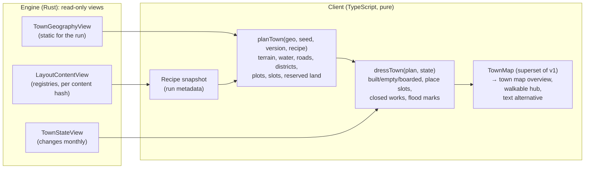
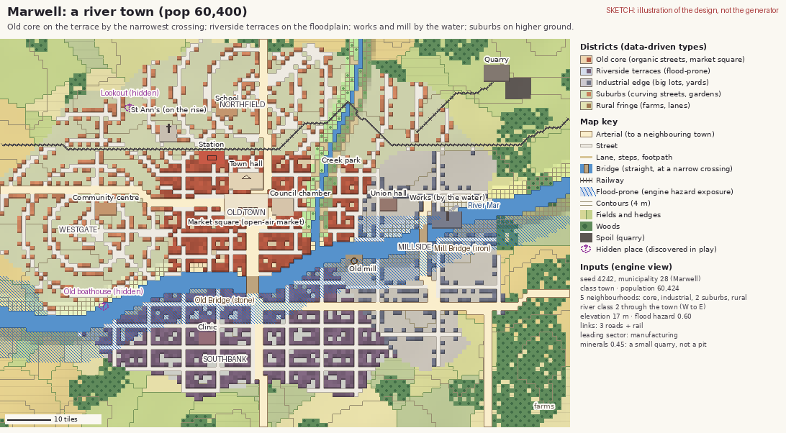
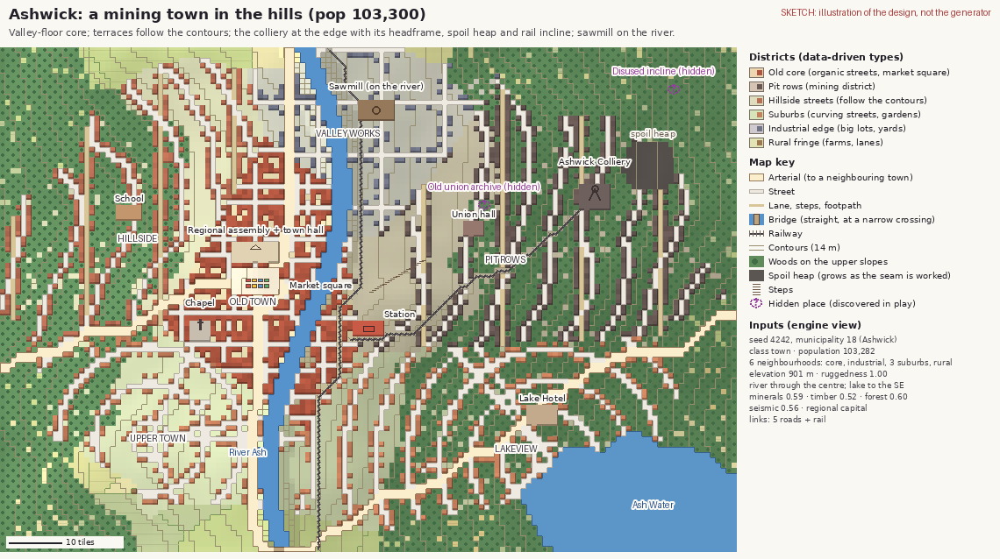
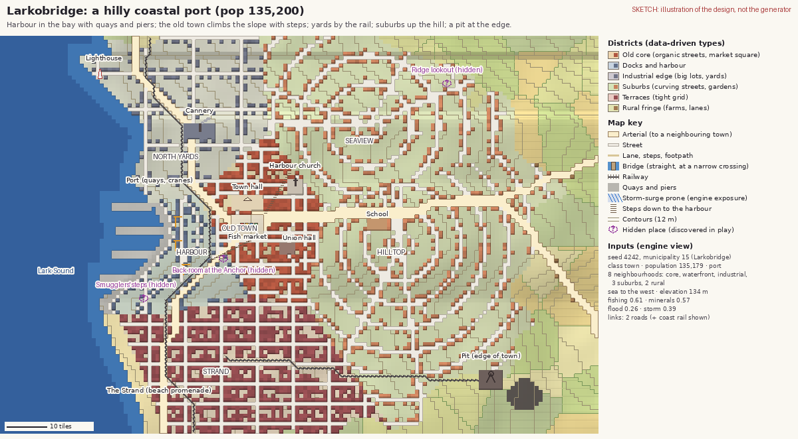
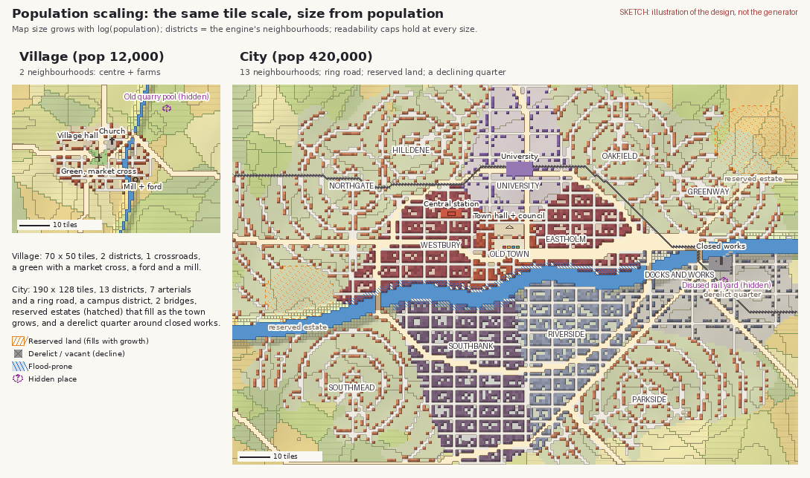

# Research and design: town layout v2 (towns grown from their geography)

Status: accepted (owner, 2026-11-19; DEC-090, all §16 recommendations). Nothing here is built yet; it starts M6. Sketches: `town-gen-sketches/` (illustrations made by a throwaway script, not the generator).

## Executive summary

- **The request.** The owner wants towns that are "real but readable": rivers with bridges, creeks, hills, actual mines, open-air markets. Town size should follow population and the simulation. The layout should link to gameplay and hold hidden places to discover. Today's layout (v1) is a grid of blocks around a square.
- **What the data shows.** In a real generated world (seed 4242), 31 of 56 towns sit on a river, but v1 draws water only for the 7 with a waterfront neighbourhood. The place list is nearly the same everywhere: a mine in 47 towns, a factory in 55, a farm in 1. Distinctness has to come from geography, history and the sector mix, not from the place list.
- **The approach.** A hybrid generator on the existing 16 px tile grid:
  - terrain and water first;
  - terrain-aware arterials toward the real neighbouring towns, with bridges at narrow crossings;
  - districts chosen from content registries (old core, terraces, pit rows, docks, estates…), each with its own street pattern and plot grain;
  - plots, then landmarks placed by rules (civic buildings on the square, the church on high ground, the mill by the water).
- **Never rearranges.** A static plan is made once from fixed geography. A cheap "dress" pass then shows the simulation each month: reserved estates fill as the town grows, buildings are boarded up as it shrinks, a closed works shows as closed. A town still never rearranges (DEC-085).
- **Engine work is small.** One read-only geography view, a state view, baselines, and places marked closed instead of deleted. Gameplay links need more, such as per-district flood exposure, discovery state, and mine status. Each is marked in §10.
- **Built to extend.** District types, terrain features, connectors and optional places are content with art keys and fallbacks. A pack can add a "fishing harbour" with no code. A per-town recipe snapshot keeps content updates from moving existing towns.
- **Size and timing.** About 24 agent tasks, at the start of M6, before the walkable town reaches testers. The town map overview (DEC-086) shows it first. 12 decisions for the owner are in §16.

---

## 1. Where we start: v1 and the real data

**Layout v1** (`web/src/hub/townLayout.ts`, DEC-085) lays out a grid of rectangular blocks. Districts are groups of blocks and the civic buildings stand on a central square. Water is one straight band on one side, drawn only when the town has a waterfront neighbourhood or a port. Measured on the committed fixtures (Node, desktop, cold):

| Town | Tiles | Buildings (filler) | Water | Time |
|---|---|---|---|---|
| Typical town (10 fixtures) | 95–125 × 61–66 | 43–70 (29–56) | none in 7 of 10 | 13–30 ms |
| Capital (Fenoport, 3.1 M people, 22 neighbourhoods) | 258 × 157 | 453 (433) | none, though it is on a river | 97 ms |

**What the engine knows about a town** (worldgen, `crates/mandate-worldgen`, `mandate-sim/src/world.rs`):

- The terrain raster has 2.5 km cells with elevation, biome, cover (sea, lake, land), river class 0–3, the owning municipality, temperature and rainfall. It is derived from the seed and checked by `terrain_hash`.
- Each municipality has a centre cell, a class (metro, city, town, rural), and flags for coastal, on a river and port. Its geo profile holds elevation, ruggedness, forest, fertility, timber, minerals, fishing, energy, scenic value, and hazard indexes for flood, drought, wildfire, seismic and storm.
- Transport links (road, highway, rail) carry their cell paths. Neighbourhoods have a kind (core, inner, waterfront, industrial, suburb, rural) and a population. There are places.
- The economy keeps per-sector jobs and capacity per municipality, housing stock, vacancy and a 36-month history.

**Findings that shape the design** (seed 4242, medium world):

1. **Towns differ a lot in geography.** Populations run from about 60,000 to 3.1 million; elevations from 11 m to 1,556 m; ruggedness from 0.10 to 1.00. Flood indexes reach 0.60 (Marwell, Corriwell). 31 of 56 towns are on a river, 7 are coastal and 6 have a port. v1 shows almost none of this.
2. **The place list hardly varies.** Every town has the same nine civic places. 55 have a factory and a union hall, 47 a mine (worldgen adds one whenever `minerals > 0.45`), 5 a mill and 1 a farm. In the layout fixtures, 9 of 11 towns have a mine. A mine in every town is not distinctive, so this is a worldgen tuning question (decision D9).
3. **A town is about one terrain cell.** A 100 × 70 tile town is roughly 1.5 km across at walking scale, smaller than a 2.5 km cell. The client therefore needs a summary of what crosses or surrounds the centre, not the raster itself: which way the river runs, where the sea and the high ground are, which way each road leaves.
4. **Hazards hit whole towns.** Flood damage is a town-wide housing-damage effect, so no district is "the flood-prone one" in the simulation yet. Drawing one as flood-prone needs engine support to be honest (D8).
5. **Some names promise geography the town lacks.** Calport sits 1,032 m up, inland, and Larkobridge has no river. A small worldgen fix would make suffixes follow geography (D10).
6. **The fixtures look alike.** Ten of the eleven have 7–8 neighbourhoods and the same places. v2 needs fixtures picked by geography: river, coast, hills, flat steppe, capital, rural.

## 2. Research: how towns are generated, and what fits Mandate

| Approach | What it is | Good at | Weak at | Fit for a 16 px phone town |
|---|---|---|---|---|
| **L-system road growth** (Parish & Müller 2001; CityEngine) [PM01, PM-S] | Roads grow like branches under global goals (density, pattern) and local constraints (water, slope, snapping to nearby junctions); then blocks, lots, buildings | Plausible street networks from population and terrain maps; the classic pipeline | Many rules to tune; free angles | **The constraint ideas**: snap to junctions, stop at water, avoid steep ground. Our streets stay on the tile grid |
| **Tensor-field streets** (Chen et al. 2008) [CHEN08]; open-source JS demo [PT] | Streets traced along a field of preferred directions, blended from grid, radial and boundary fields | Smooth, varied, city-like patterns; editable | Free-angle streets need many art tiles; hard to keep readable; heavy for a phone | **No** for streets. The idea of blending directions (grid near the centre, along the river elsewhere) informs block orientation |
| **Voronoi wards** (Watabou's Medieval Fantasy City Generator) [WB-MFCG, WB-FL] | Space split into Voronoi cells (wards), each given a type, then filled with buildings | Very readable district structure; fast; looks good | Wards look arbitrary unless grouped; medieval walled form | **The ward → district typing**, and the lesson that districts need their own identity (Watabou added district names for this reason) |
| **Village generator** (Watabou) [WB-VG, WB-VG-R] | Roads first (Parish–Müller style), then houses, which are removed if a road needs the space; rivers and bridges | Small settlements that read; roads take priority | Bridges were hard to get right: early versions crossed the river back and forth; rivers and coasts are not mixed | **Roads first; one clear crossing; cap the number of bridges** |
| **WFC / modules** (Gumin's WaveFunctionCollapse; Stålberg's Townscaper, Bad North) [WFC, TS-POD, BTB] | Fill a grid with hand-made modules that obey adjacency rules | Beautiful local detail; designer control | Global structure (a centre, through-roads) is not its strength; contradictions; costly | **Decoration only** (roofscapes, yard clutter), as PIXEL_ART_TOOL §2.4 already concluded. The lesson from Townscaper: hand-made modules, placed by code |
| **Agent-based growth** (Lechner et al. 2003; Introversion's Subversion) [LEC03, SUB] | "Developer" agents build roads and zone land over simulated time | Land use that reads as history (old core, later rings) | Slow; hard to control; results vary | **Growth order as data**: old core → terraces along roads → industry by rail and water → suburbs → estates. We fake the history in one pass, ordered by era |
| **Space colonisation** (Runions et al. 2007) [RUN07, SC-ROAD] | Branches grow toward attractor points, competing for space | Lanes reaching farms, tracks to a mine, footpaths | Not a whole street network | **Rural lanes and service tracks** (to the mine, the farms, the lookout) |
| **Parcels and lots** (Vanegas et al. 2012) [VAN12] | Blocks split into lots by oriented-bounding-box or straight-skeleton subdivision | Plot grain that matches real towns; different per district | Geometric code | **OBB splitting on tiles**: frontage and depth ranges per district type |
| **Terrain-aware roads** (Galin et al. 2010; Emilien et al. 2012) [GAL10, EMI12] | Roads as weighted shortest paths over terrain, with costs for slope, water and forest; bridges and tunnels where they pay off; villages sited on terrain | Roads that follow valleys and contours, cross rivers at sensible points, climb in hairpins | Cost tuning | **The core of v2's arterials**: A* on our grid with slope and water costs, straight bridges, reuse of existing crossings |
| **Rivers** (O'Leary's flow maps; Vagabond) [OL, VAG] | Rivers follow flow; on tile maps, a road crossing a river gets a straight bridge | Rivers that make sense | — | The engine already routes rivers. We take its direction and class, meander inside the town, and keep **bridges straight and perpendicular** |
| **Readability** (Lynch's paths, edges, districts, nodes and landmarks; Breath of the Wild) [LYNCH, GD-LEG, WEL] | People map a city by a few routes, boundaries, areas, gathering points and landmarks | A vocabulary and test for "can I find my way" | Players weigh landmarks, edges and people more than paths (a Wellesley study) | **§8 rules.** One centre, few main roads, districts that differ, landmarks seen from afar, and people at places |
| **Variety that matters** (Compton's "10,000 bowls of oatmeal") [OAT] | Unique is not the same as distinct | — | — | Vary **what players notice** (water, hills, a pit head, the street pattern), not noise |
| **Hidden places** (BotW's triangle rule; Stardew's Secret Woods; Outer Wilds' rumour log) [BOTW, SDV-SW, OW] | Hide things behind terrain and reveal them gradually; a visible but blocked way in; knowledge as progress | Discovery that feels earned, not like a checklist | Can frustrate; screen-reader parity | **§11**: glimpses (a path up the hill, a gate), tips from people, a list of leads; never critical |

**Practical constraints for Mandate:**

- **Determinism in JavaScript.** `Math.sin`, `Math.cos`, `Math.exp` and `Math.pow` are "implementation-approximated" in ECMAScript and differ between engines [ES-MATH]. v1 already avoids `Math.hypot`. v2 uses integers throughout: fixed-point heights, squared distances, compass lookup tables and a fixed hash for noise. The hash is the one pixelkit already pins with test vectors.
- **Budget.** Under ~150 ms on a mid-range phone (v1 spends 13–30 ms on a desktop for a town and 97 ms for the capital). Plan in a worker and cache in memory; the dress pass takes under 10 ms.
- **The tile grid stays.** Pathfinding, autotiling, the pixel-art kits and the renderer all assume 16 px tiles and footprints in whole tiles. v2 changes how the grid is filled, not the grid itself.

**What we take:** a terrain-first hybrid. Galin-style terrain-aware arterials; Watabou-style typed districts; per-district street patterns that echo L-system rules on tiles; OBB plots; space-colonisation lanes; rules for landmarks; Lynch-based caps for readability. Tensor fields and WFC are not used for layout.

## 3. Design overview



- **Plan** (static): computed once per town per run from inputs that cannot change during the run: geography, baseline population, the baseline sector mix, the town seed, `LAYOUT_VERSION` and the recipe snapshot. It holds every street, plot, reserved slot and landmark site the town will ever use.
- **Dress** (dynamic): a pure function of the plan and the current state. It decides which reserved plots are built, which buildings are boarded or derelict, which slot each place occupies, and which art condition each building shows. It never moves anything.
- **Output**: a `TownMap` that extends v1's structure, with more terrain codes, an elevation level per cell, bridges, district outlines and slot states. `pathfinding.ts`, the renderer, the overview (DEC-086) and the text alternative keep working with it.
- **v1 stays callable** for runs that started with it (DEC-085). New runs get v2.

## 4. Inputs: the engine views

All three views are **read-only presentation data**. They never feed back into the simulation, and the layout never decides an outcome.

### 4.1 `TownGeographyView` (new, static for a run)

Computed from the terrain raster (already rebuilt and checked by `terrain_hash` on load), the world, the transport links and the baselines. Values are quantised integers, so tiny engine changes in floating point never move a town.

```ts
type Compass16 = number; // 0 = north, clockwise in 22.5° steps; 255 = none

type TownGeographyView = {
  municipality: number;
  name: string;
  class: "metro" | "city" | "town" | "rural";
  regional_capital: boolean;
  national_capital: boolean;
  /** At world generation; never changes (needs a small engine addition, §15 E1). */
  baseline_population: number;
  neighborhoods: { id: number; kind: string; baseline_population: number; adjacent: number[] }[];
  /** Baseline jobs per sector (content key), at world generation. */
  baseline_sectors: { sector: string; driver: string; jobs: number }[];
  /** The 5×5 terrain cells around the centre, row-major. */
  patch: {
    elevation_m: number[];   // integers
    cover: number[];         // 0 sea, 1 foreign, 2 country, 3 lake
    biome: number[];
    river: number[];         // class 0–3
    downstream: number[];    // Compass16 of the flow
    forest_pm: number[];     // per mille
    minerals_pm: number[];
  };
  /** Summaries the layout uses directly (derived from the patch and the river network). */
  river: { class: 1 | 2 | 3; enters: Compass16; leaves: Compass16; through_centre: boolean } | null;
  creeks: { enters: Compass16; joins_river: boolean }[];   // class-1 streams in the 3×3 around the centre
  coast: { sea: Compass16; shore: "beach" | "rocky" | "cliff"; bay: boolean } | null;
  lake: { bearing: Compass16; near: boolean } | null;
  relief: { ruggedness_pm: number; uphill: Compass16; high_ground: Compass16; relief_m: number };
  woods: { share_pm: number; bearing: Compass16 };
  minerals: { value_pm: number; bearing: Compass16 };
  links: { mode: "road" | "highway" | "rail"; bearing: Compass16; to: number; to_name: string; foreign: boolean }[];
  hazards_pm: { flood: number; storm: number; wildfire: number; seismic: number; drought: number };
  climate: { temperature_c: number; precipitation_mm: number; biome: string; snow: boolean };
  wind_from: Compass16;
  /** Scenario era tag, if any (district types can depend on it). */
  era: string | null;
};
```

Notes:

- `links[].foreign` prepares for DEC-087 (neighbouring nations from M7: border towns get a road "to the border").
- Today the client could derive part of this from the map query's rasters, but that is fragile: the map view is shaped for the national map, has hillshade rather than elevation, and may change. A dedicated, versioned view is small and testable.

### 4.2 `TownStateView` (new, changes monthly; mostly existing data)

| Field | Source today | Drives |
|---|---|---|
| Population per neighbourhood | Population domain | Growth and decline per district |
| Housing stock, baseline stock, vacancy, units in the pipeline | `economy.housing` (baseline: new field) | Reserved plots filling; boarded houses; cranes on plots due next |
| Jobs per sector, now and at baseline | `economy.sectors` | Busy or idle works and docks; the market's size |
| Place status: open, closed, new | New: places are marked closed, never deleted (D3) | Closed works; new places taking reserved slots |
| Optional places, discovered or not | New (§11) | Hidden places drawn plainly until discovered |
| Protections: flood and storm defences | Policy modifiers (`flood_protection`) | Levee or flood wall on the river edge |
| Last disaster: kind, months ago, neighbourhood | Events; per neighbourhood needs D8 | Tide-lines, tarps, scaffolding |
| Mineral stock left (region) | `environment.regions[].mineral_stock` | Spoil heap size; a pit that is worked out |
| Pollution (coarse), wind | Environment | Smoke plume downwind |
| Top concern per neighbourhood (coarse) | Concerns (overheard keys exist per neighbourhood) | Concern overlay on the map |
| Live crisis and defining industry | Town character (DEC-077 §1) | Emphasis on the map: the threatened plant, the squeezed district |
| Recent trend (36 months of jobs, rent, unemployment) | `MuniEcon.history` | Which districts look busy or tired |

The state view follows the information-depth rules of DEC-079: anything precise (exact vacancy, the exact concern level) is rounded unless the player is at the town hall. The map must never become a way to read data the player isn't entitled to.

### 4.3 `LayoutContentView` (new, per content hash)

The layout registries of §6, sent once and cached by content hash. The engine validates them like any content (DEC-053) but never interprets them.

## 5. The pipeline

Deterministic from (world seed, municipality, `LAYOUT_VERSION`, recipe). Every stage draws from its own keyed stream (`stream(seed, "stage", key…)`), so changing one stage does not shift another's draws. A failed stage retries with relaxed parameters, as v1 does, and the last resort is a v1-style grid for that district. All maths is integer.

| # | Stage | What it does | Main rules |
|---|---|---|---|
| 0 | **Size** | Map size, district count, building budget from population (§9) | `side ≈ 40 + 22·log2(pop / 5,000)` tiles, clamped to 56–240; aspect 1.4:1 |
| 1 | **Terrain** | Heights at 1 sample per 4 tiles, from the 5×5 patch (bilinear in fixed point) plus integer value noise; quantised into **levels** of about one storey for art (§7.7) | The relief keeps the engine's uphill direction; a flat town stays flat |
| 2 | **Water** | River polyline from `enters` to `leaves`, meandering with keyed midpoint displacement and carving a valley. Width by class: creek 1–2 tiles, river 4–6, major river 7–10. Creeks from high ground to the river; the coast as a shoreline curve on the sea side (beach, rocks or cliff by slope; a bay if `bay`); a lake at its bearing | Water never makes a district unreachable: every land component with a district gets a crossing |
| 3 | **Centre** | Picks the old core's site by score | Flat; above the floodplain (on a terrace); at the narrowest crossing of the river, or at the harbour's head; near where the arterials meet. Real towns grew at fords, bridges and harbours |
| 4 | **Arterials and crossings** | A* from the centre to each link's bearing at the map edge, on the grid, with costs for slope, water and forest; a road that exists already is cheaper (so roads share bridges). Rail on a gentler grade, with a station at the core's edge | Bridges straight and perpendicular; at most 1–5 by size (§8); a crossing reused before a new one is built; switchbacks on steep slopes |
| 5 | **Districts** | Each engine neighbourhood becomes one district. A registry type is chosen per neighbourhood (§6), by its kind and its eligibility rules, with rendezvous hashing [PIX §3.5]. Land is shared out by a weighted, quota-limited flood fill from each district's seed site, in **growth order**: old core, terraces along the arterials, industry by rail and water, docks on the shore, the pit at the mineral side, suburbs on gentle slopes, estates, rural fringe | Areas ∝ baseline population^0.7; rivers, rail and parks preferred as boundaries (Lynch edges); every district touches an arterial |
| 6 | **Streets** | Each district runs its type's **street pattern** | `organic` (core: short irregular blocks, bends, T-junctions, lanes); `grid` (terraces, oriented to their arterial); `curvy` (suburbs: loops, crescents, cul-de-sacs); `contour` (hill districts: streets along contours, steps or lanes down the slope); `yards` (industry: few roads, big lots); `quay` (docks: a road behind the quay, piers); `ribbon` (rural: lanes with farms along them, space-colonisation tracks to farms and the mine) |
| 7 | **Blocks and plots** | Blocks are the land between streets, split into plots by OBB subdivision with the type's frontage, depth and setback | No plot on water, on a slope over the type's limit, or across a level change |
| 8 | **Slots and landmarks** | Places go into **slots** by placement rules from the place registry (§6.3): town hall and council chamber on the square; the market as open-air stalls on the square, or a market hall in a city; the church or chapel on the highest ground in sight of the square; the mill and works by water; the mine at the edge on its mineral side, with headframe, spoil heap and rail spur; the port at the docks; the school and community centre in the largest residential districts | Slots for **all possible place kinds** are reserved now (§9.2), including optional ones (§11) |
| 9 | **Reserved land** | Infill gaps, edge estates (fields today, streets reserved), a brownfield site by the works | 25–40% headroom over baseline housing, by type |
| 10 | **Filler buildings** | The type's building mix on the remaining plots, each with a **fill rank** (the order plots get built) and a **decline rank** (the order they empty) | Ranks are fixed in the plan, so growth and decline are monotonic |
| 11 | **Props and greenery** | Trees along the river and in parks, hedges between fields, lamps by district era, stalls, boats, cranes | Props never block a door or a route |
| 12 | **Checks** | §13 validity checks | A failure retries the stage, never ships a broken town |

## 6. Data-driven building blocks (content registries)

The owner asked that town sections be data-driven so that new kinds are easy to add. v2 follows the registry pattern of DEC-075 and DEC-078: JSONC content, typed in Rust (`mandate-content`), schemas generated from the types (DEC-053), validated by `mandate-cli content validate`, loaded in pack order.

### 6.1 The registries

| Registry | File (base pack) | Each entry defines |
|---|---|---|
| **District types** | `content/base/town_districts.jsonc` | When it appears (neighbourhood kinds; geography such as coast, river, relief, minerals or fishing; sector shares from the baseline; population band; town class; era; weight); siting preferences (shore, high ground, flat land, near rail, downwind); street pattern and its parameters; plot sizes; building mix and density; landmarks it hosts; growth behaviour (reserve share, how decline shows); gameplay tags (`flood_prone`, `storm_surge`, `mine_risk`, `pollution_downwind`); art keys (§7) |
| **Terrain features** | `content/base/terrain_features.jsonc` | River, creek, coast, lake, hills, cliff, woods, marsh, beach: the generator key, its conditions (from the geography view), its parameters (width by class, meander, carve depth, woods density by forest share) and art keys |
| **Connectors** | `content/base/connectors.jsonc` | Bridge types (stone arch, iron girder, timber footbridge, rail viaduct, ford, causeway), rail, footpaths, steps: maximum span, which road classes may use them, era and town class, art keys |
| **Place layout** (extends `places.jsonc`) | `content/base/places.jsonc` | Per place kind: a `layout` block (footprint range, slot kind, placement rules, landmark flag, signature prop) and, for optional kinds, an `optional` block (§11) |

### 6.2 Sample: a district type

```jsonc
// content/base/town_districts.jsonc (excerpt)
{
  "kind": "town_districts",
  "items": [
    {
      "id": "district.fishing_harbour",
      "name_key": "district-fishing_harbour",
      // When the generator may choose this type for a neighbourhood.
      "appears": {
        "hood_kinds": ["waterfront"],
        "geo": { "coast": true, "fishing_pm": { "min": 450 } },
        "population": { "max": 300000 },
        "weight": 3                       // rendezvous weight among eligible types
      },
      "site": { "prefers": ["shore", "low_slope"], "avoids": ["cliff"], "anchor": "harbour" },
      "streets": { "pattern": "quay", "block": [6, 10], "lanes": "stepped", "max_dead_ends": 2 },
      "plots": { "frontage": [2, 4], "depth": [2, 3], "setback": 0, "joined": 0.8 },
      "buildings": { "mix": [["cottage", 5], ["net_loft", 2], ["shop", 1], ["pub", 0.5]], "storeys": [1, 3], "density": 0.75 },
      "hosts": ["port", "market", "diner"],
      "growth": { "reserve": 0.10, "fill": "infill_first", "decline": "boarded" },
      "tags": ["storm_surge"],
      "art": {
        "kit": "kit.harbour_cottage",
        "family": "residential",
        "ground": "ground.cobble",
        "roof": "roof.pantile",
        "walls": ["wall.painted_timber", "wall.render"],
        "trim_ramps": ["ramp.harbour_blue", "ramp.chalk", "ramp.ochre"],
        "lamps": "lamp.white",
        "props": "props.fishing_harbour"
      }
    }
  ]
}
```

### 6.3 Sample: a place kind's layout block

```jsonc
{
  "id": "place.mine", "key": "mine", "name_key": "place-mine",
  "actions": [],
  "layout": {
    "slot": "works", "footprint": [[5, 4], [8, 6]],
    "place": ["edge", "toward:minerals", "near_rail"],   // placement predicates, in order of preference
    "signature": "headframe",                              // the landmark silhouette
    "with": ["spoil_heap", "rail_spur", "winding_house"],  // companion features the plan reserves
    "landmark": true,
    "art": { "kit": "kit.colliery", "family": "industrial" }
  }
}
```

### 6.4 Adding a type with no code change

A content pack that adds a **fishing harbour** or a **university quarter**:

1. Adds a `town_districts` entry like §6.2: when it appears, its street pattern (from the existing list), plots, building mix, the places it hosts, tags and art keys.
2. Adds Fluent strings (`district-fishing_harbour`).
3. Uses existing art keys, or ships new parts in its art pack (§7.5).
4. Runs `mandate-cli content validate` and `pixelkit lint`.

New runs can then pick the type wherever its `appears` rules match. Existing runs never change (§6.6).

### 6.5 What still needs code (extension points)

As for sectors in `docs/development/EXTENDING.md`, each of these is a closed list on purpose, because new behaviour needs code: one variant, one function, its parameter schema and a test.

| Extension point | Where (proposed) | A new one needs |
|---|---|---|
| Street pattern (a new growth algorithm, e.g. `radial`, `canal`) | `web/src/hub/layout/streets/` (`StreetPattern`) | The pattern function, its parameter schema in `mandate-content`, validity and determinism tests |
| Terrain feature generator (e.g. `canal`, `glacier`, `dunes`) | `web/src/hub/layout/terrain/` | The generator, its conditions, autotile art keys |
| Placement predicate (`high_ground`, `by_water`, `on_square`, `edge`, `toward:<bearing>`) | `web/src/hub/layout/place.ts` | The predicate and a test |
| Geography condition in `appears` | `mandate-content` types, plus a view field if the data is new | A field in `TownGeographyView` |
| Connector behaviour (a ferry, a tunnel) | `web/src/hub/layout/connectors.ts` | Routing cost and art |
| Building condition (how state shows: `boarded`, `closed`, `flood_tide_line`, `construction`) | `BuildingSpec` conditions | Art for the condition in every family (lint, §7.2) |
| Discovery trigger for optional places | Engine (`DiscoveryRule`) | Engine handler, validation, a test (§11) |

### 6.6 Content changes and `LAYOUT_VERSION`

Adding a type must not rearrange an existing town. Options:

| Option | How | Problem |
|---|---|---|
| A. Content hash feeds the version | Any content change gives a new layout | Every content update would rearrange every town. Rejected |
| B. New types only in new runs | The run records the type ids it knew; layout filters the registries to them | Edits to an existing entry still move towns |
| **C. Recipe snapshot (recommended)** | When a town is first shown, the app stores the registry entries that town's plan used (its district types, features, connectors and place layout blocks, a few KB) in the run's metadata beside `LAYOUT_VERSION`. Later layouts of that town use the snapshot | A little storage per town shown |

With C, `planTown(geo, seed, version, recipe)` stays a pure function (DEC-085). Content edits and new types reach new runs and towns not yet visited. Mods can't break a saved town. CI still pins map hashes of the fixtures under the base content, so an accidental change to a base entry is caught in review. Changing the generator code still bumps `LAYOUT_VERSION`.

## 7. Reconciling data-driven types with the pixel art

This follows DEC-084 and `PIXEL_ART_TOOL.md`: art is hand-drawn parts composed by code (kits, facade grammar, autotiles, slot recolouring), behind the `ArtProvider` interface, with lints, goldens and contact sheets.

### 7.1 Art keys, never files

- Every content type names its art by **key**: a kit (`kit.harbour_cottage`), a family (`family.residential`), a roof family (`roof.pantile`), a ground autotile set (`ground.cobble`), wall materials, trim and accent ramps from the shared palette (`ramp.harbour_blue`), a lamp style, a prop set, and for terrain and connectors, autotile and bridge kits.
- The **art pack declares what it provides**: its `manifest.json` gains a `provides` table, listing each key, its kind, its fallback parent and its status (`drawn`, `placeholder`).
- `BuildingSpec` (PIXEL_ART_TOOL §3.5) gains the district type's art block and the building's conditions. The renderer never reads a file name from content.

### 7.2 Validation in both directions

| Check | Where it runs | Rule |
|---|---|---|
| Keys are well formed; every type names a `family` (the required last-resort parent) | `mandate-cli content validate` (always; no art needed) | Error |
| Content keys exist in the pack | `mandate-cli content validate --art <manifest>` (optional) and `pixelkit lint --content content/` | Error for the base pack; warning for third-party packs |
| Types that resolve only to the generic kit or a placeholder | `pixelkit lint` coverage report | Warning, listed by type, so gaps are visible |
| Pack keys no content uses | `pixelkit lint` | Info |
| Every building condition (`boarded`, `closed`, `flood_tide_line`, `construction`) exists in every family | `pixelkit lint` (extends the existing coverage lint) | Error |
| Every terrain pair the registries can produce has a full autotile set; every connector has its kit in both orientations | `pixelkit lint` (extends the seams and coverage lints) | Error |
| Both directions for the base game | CI: `content validate` and `pixelkit lint --content` on every change to `content/` or `art/` | Errors fail the build |

### 7.3 Fallbacks, so a new type always renders

The resolver walks a fixed chain: **specific kit → family kit for the neighbourhood kind (`family.residential.waterfront`) → family kit → generic kit → placeholder**. The walk is deterministic and depends only on keys, never on load order. A **dev overlay** (`?artdebug=1`) tints each building by how far down the chain it fell (none, family, generic, placeholder) and lists the missing keys, so gaps get noticed while playing.

### 7.4 Variety and cohesion

- **One palette.** Every district takes its colours from the shared palette (DEC-084 D3: at most 128 colours; the P0 palette has 126 in 46 ramps). A type chooses ramps; it never brings its own hex values. With 126 of 128 used, new looks must reuse ramps. **Free about 10 colours of headroom in P1** (D11) and treat any new ramp as a palette change reviewed against the budget.
- **What all districts share:** the ground, road, water and foliage ramps; the lighting and grading; the outline and shading rules; the signage pictograms. This is what makes a new fishing harbour belong.
- **What a district varies:** its roof family and roof ramp, wall materials, trim and accent ramps, plot grain and street pattern, ground set (cobble, asphalt, gravel), lamp style (sodium in older and industrial districts, white in newer ones, as the style guide already says) and props. A district type should differ from any type it can border in at least two of these.
- **Lints across district borders.** The P0 neighbour-similarity lint re-rolls a building while it shares 9 or more of 12 features with its left neighbour. v2 adds two lints over sample towns:
  - **border contrast:** over about 200 pairs straddling a district border, roof ramp or wall material differs in at least 70% of pairs, so borders read;
  - **district cohesion:** inside a district, the mean similarity of neighbouring buildings is between 0.35 and 0.7, so it does not look random.

### 7.5 The art workflow for a new type

| Who | Does |
|---|---|
| A modder, with existing parts only | Writes the type's `art` block from existing keys: a kit composed from existing walls, roofs, windows, doors and signs by kit rules; existing ramps; existing prop sets. JSONC only, no drawing. The lint and the dev overlay show what fell back |
| An artist or an agent, for a new look | Draws parts in slot colours (indexed PNG or text grids) with JSONC sidecars, writes the kit rules (facade grammar: storey heights, bay rhythm, roof forms, width range), registers keys and their fallback parent in the manifest, runs `pixelkit sheet --district fishing_harbour` (a contact sheet of 12 sample blocks at four times of day, plus a border with each type it can meet), passes the lints, gets the owner's review, bumps `PACK_VERSION` and updates the goldens |

### 7.6 Versioning: art never moves the layout

- Geometry comes from the layout (`LAYOUT_VERSION` plus the recipe). Looks come from the art pack (`PACK_VERSION`). No art data feeds the plan: footprints, doors and building counts never depend on the pack, and the facade grammar fills any footprint width the layout gives (2–12 tiles).
- A type's art can be upgraded (placeholder to drawn, new roofs) in a pack release, reviewed through goldens, without moving a building.
- Layout fields (footprint ranges, plot sizes) live in the layout registry, never in the pack.

### 7.7 Terrain art

| Need | How it reads in the flat three-quarter style |
|---|---|
| Water edges | Autotile sets (the pixelkit quarter-tile blob method) for water against grass, sand, rock, quay stone and embankment wall; reeds on rural banks, stone walls on urban ones |
| Creeks | A narrow one-tile water set of its own, with stepping stones and a ford variant |
| Hills | Heights are quantised into **levels** of about one storey. A level change facing south is drawn as a visible bank, retaining wall or rock face (8–16 px tall, like a building's south face: the view sees south faces). A north-facing change is only a lip line. Each two levels up shift the ground ramp one tone step. No gradients, no hillshade |
| Contour cues | Streets, hedges, walls and terrace rows follow levels; steps and ramps where a path crosses a level |
| Cliffs and quarries | Tall rock faces (2–3 tiles) on the coast and in the pit or quarry, with a top lip |
| Bridges | One kit per connector type (abutments, span modules, parapets, piers). A bridge running east–west shows its south face (arches); one running north–south shows its deck, parapets and a shadow on the water. Both are drawn |
| Rail | A track autotile with 45° pieces; platforms; a level crossing; a viaduct from the bridge kit |

**Matching pack entry for the sample type (§6.2):**

```jsonc
// art/mandate/kits/harbour_cottage.jsonc (pixel-art pack source)
{
  "key": "kit.harbour_cottage",
  "kind": "building_kit",
  "fallback": "family.residential.waterfront",
  "status": "drawn",                       // or "placeholder"
  "parts": ["wall.painted_timber", "wall.render", "roof.pantile", "window.small_sash",
            "door.plank", "sign.fish", "chimney.stack"],
  "facade": { "storey_px": [24, 18], "rhythm": ["pair", "bay"], "roofs": ["gable", "lean_to"], "width_tiles": [2, 5] },
  "ramps": { "wall": ["ramp.harbour_blue", "ramp.chalk", "ramp.ochre", "ramp.sage"], "roof": ["ramp.terracotta"] },
  "conditions": ["day", "lit", "boarded", "flood_tide_line", "construction"]
}
// and in manifest.json "provides":
// { "kit.harbour_cottage": { "kind": "building_kit", "parent": "family.residential.waterfront", "status": "drawn" } }
```

## 8. Readability rules (Lynch, for a phone)

| Element | Rule | Cap or check |
|---|---|---|
| **Node: one centre** | The square is the largest open space, where the arterials meet; the town hall faces it; the market is on it | Every place within a walking-detour factor of 1.6 from the square (2.2 across water) |
| **Paths: few main roads** | Arterials are wider (3 tiles), named ("High Street", "Station Road"), and lead toward the real neighbouring towns | 2–4 arterials in a village, up to 6–8 in a capital (plus a ring road) |
| **Districts: visibly distinct** | Each differs from its neighbours in ground, roof and wall material, plot grain and street pattern (≥ 2 of these, §7.4); its name is on the map | Areas follow population; even the smallest district holds at least one street of buildings |
| **Edges** | River, rail, park belts and steep slopes are preferred as district borders | — |
| **Landmarks** | 3–12 landmarks with unique silhouettes (town hall, church spire, headframe, cranes, chimney, station, lighthouse); civic and church landmarks visible from the square at the default zoom | Labels: at most 12 at once on the overview |
| **Crossings** | Bridges are straight and perpendicular, on arterials or main streets; one style per era; footbridges look different | 1 bridge (village) to 5 (capital); at least 40 tiles of river between bridges unless the town is a city |
| **Grain** | No street shorter than 3 tiles; minimum block of 6 × 5 tiles; dead ends only as cul-de-sacs in suburbs or lanes in rural districts | Checked |
| **Phone** | At the overview's default zoom, a 360 px portrait screen shows the centre, its labels and the main roads; landmark icons are 44 px tap targets | Snapshot test |
| **Terrain restraint** | Relief is expressed in at most 4–6 levels; woods and fields are calm textures so districts read first | — |
| **Text alternative (DEC-051)** | The plan also yields text: each district's type, neighbours and edges ("Southbank: riverside terraces across the Old Bridge from the Old Town; prone to floods"), landmarks, and routes ("home to the town hall: over the Old Bridge, a short walk") as Fluent keys with facts | Generated from the same plan, so the text and the map always agree |

## 9. Scaling with population and the simulation

### 9.1 Size from population

The town is **stylised**: a 3-million capital is not drawn at 1:1. It shows its centre and every neighbourhood as a district, with outer districts compressed.

| Band | Population | Map (tiles) | Districts | Buildings | Arterials | Bridges (max) | Landmarks |
|---|---|---|---|---|---|---|---|
| Village | < 30,000 | 64 × 48 to 84 × 60 | 1–3 | 40–100 | 2–4 | 1 | 3–5 |
| Small town | 30,000–100,000 | 100 × 70 to 135 × 95 | 3–6 | 120–260 | 3–5 | 2 | 5–8 |
| Town | 100,000–300,000 | 135 × 95 to 165 × 115 | 6–10 | 250–450 | 4–6 | 3 | 6–10 |
| City | 300,000–1 M | 165 × 115 to 200 × 135 | 10–16 | 400–700 | 5–7 + ring | 4 | 8–12 |
| Metro / capital | > 1 M | 200 × 135 to 240 × 160 (cap) | 16–22 | 600–900 | 6–8 + ring | 5 | 10–12 |

Engine neighbourhood counts already scale this way (`count_for(pop) = round(√pop / 50)`, 1–22).

### 9.2 Growth and decline without rearranging (DEC-085)

| Change in the simulation | What the plan reserved | What the dress pass shows |
|---|---|---|
| Housing stock grows | Infill plots and edge estates with fixed **fill ranks** | The next plots by rank are built; plots due from the pipeline show foundations and a crane; an estate's streets open when its first plots fill |
| Population falls, vacancy rises | Fixed **decline ranks**, weighted toward districts losing people | Above about 5% vacancy, boarded windows by rank; after a sustained fall of about 20% in a district, derelict buildings and overgrown lots |
| Growth beyond the reserve | Plots marked as redevelopable | Houses become flats on the same footprint (a building variant, not a new footprint) |
| A plant closes | The works' slot | Closed gates, no smoke, broken windows; nearby shops boarded by rank |
| A new place opens (a clinic from a policy, a new factory) | A slot for every possible place kind (civic, works, community, hotel, campus) | The place takes its slot, chosen from places sorted by id. Because places are never deleted (D3), the assignment is stable |
| The seam is worked | The spoil heap site | The heap grows with cumulative extraction; the headframe stops when the pit closes |
| A flood strikes a district (needs D8) | The district's flood tag | Tide-lines, sandbags and tarps for some months; a levee or flood wall once defences are funded |

Why this stays deterministic and versioned:

- The plan does not depend on the current state.
- The dress pass is a pure function of the plan and quantised state, using monotonic thresholds. Rising stock only adds built plots and rising vacancy only adds boarded ones, the same ones in the same order, so nothing flickers from month to month.
- The run's `LAYOUT_VERSION` and recipe pin the plan.
- Dress rules are versioned with the layout.

## 10. Gameplay links

The layout presents; the engine decides. Each link is marked by what it needs.

| Link | What the player sees | Needs |
|---|---|---|
| Flood-prone riverside district | The floodplain drawn low by the river, tagged on the map, with tide-lines after a flood | **Engine support** (D8): per-neighbourhood flood exposure, so damage and displacement hit that district. Without it, only town-wide signs are honest |
| Flood defences | A levee or flood wall along the river once the policy is funded | **Small engine**: expose protection in the state view |
| The mine | A headframe, spoil heap, rail spur and pit rows; the heap grows as the stock falls; a mine-safety dilemma and union politics at the union hall nearby | **Engine and content**: mine status (working, idle, closed) and stock in the view; dilemma content (the dilemma system exists, DEC-077 §4); D9 so mines are distinctive |
| A closed plant | The works closed; the streets around it decline | **Small engine**: place status (D3) |
| The market as the town's mood | Stalls and crowd size follow coarse retail and confidence figures; overheard talk there (exists) | **Presentation only** (coarse data the pocket already shows) |
| Concerns on the map | An overlay of each district's top concern (icon and pattern, not only colour) | **Small engine**: per-neighbourhood top concern in the view, coarse away from the town hall |
| Growth and housing policy | New estates on reserved land; cranes on plots in the pipeline | **Presentation only**, given baseline and pipeline fields in the view |
| Decline | Boarded and derelict buildings where people are leaving | **Presentation only**, given baseline population per neighbourhood |
| Pollution | A smoke plume downwind of working industry; cleaner when it closes or rules bite | **Presentation only** (wind and coarse pollution in the view) |
| Canvassing a district | The district's streets are where you canvass (exists, DEC-079) | Exists |
| A bridge or road closed, cutting a district off | A barrier and a detour; canvassing or meetings there cost more until it is repaired | **Engine support**: infrastructure state, repair budget, access effects. Later (M7 or after) |
| The station | Travel to other towns from the station | **Engine support**: travel (deferred in DEC-079; M7 with the regional map) |
| Campaign posters and flags | More posters where a party campaigns | **Presentation**, but only from public facts (campaign activity), never poll detail |

## 11. Hidden and optional places

**Kinds** (optional place kinds in `places.jsonc`; each town gets 1–4, chosen by its geography and history):

| Kind | Typical site | What it gives |
|---|---|---|
| Lookout | Highest point, a ridge or headland | A clear view of the town: the concern overlay at better precision for a while; a "clear your head" rest variant; a story scene |
| Old union archive | The union hall's basement or the old pit offices | History (past strikes, past results) as information; a retired organiser (a contact); storyline hooks |
| Back room (club) | Behind the diner or a harbour pub | Late-night lobbying with local power brokers; gossip about rivals (leads, not proof) |
| Disused rail yard or old works | The industrial edge | A private meeting place away from the press; regeneration or dumping storylines |
| Community kitchen | A run-down quarter | Overheard concerns of the poorest, at better precision |
| Allotments | The edge of the terraces | Older voters' talk; small favours |
| Boathouse or fishermen's hut | River bank or harbour | Local news early; a contact |
| Pit memorial | Near the mine | Memory of a past disaster; a safety-dilemma hook |

**How they are discovered** (engine-owned; the client only draws):

- **Walking.** Visiting the streets of the district that holds one, under its conditions (daylight, a season, a storyline step). The trigger is the existing `MoveTo` to the district's streets, so a player in the list view triggers the same discovery with "walk the streets of …" (DEC-051 parity).
- **Tips.** An NPC or overheard line mentions it (a `RevealPlace` narrative effect).
- **Storylines.** A storyline step reveals it; a condition `knows_place` gates later steps.
- **Visible hints.** The plan reserves a glimpse: a path up the hill, a gate in an alley, steps down to the shore. The building is drawn as an ordinary building until discovered, so discovery never rearranges anything.

**Rules:**

- Nothing critical lives only at a hidden place (DEC-079). Validation: an optional kind may offer only actions also offered by a non-optional kind, or **depth** services (better precision, history, contacts, story).
- Once discovered, a place appears in the place list and the agenda, and is reachable by auto-routing (DEC-051, DEC-079).
- A short "leads" list in the pocket shows tips heard but not followed (the Outer Wilds idea), so discovery isn't a hunt for pixels.

**Engine support needed:**

- discovery state (`PlayerState.known_places`, append-only, saved);
- optional place kinds in the registry (`optional: { appears, discovery, max_per_town }`);
- worldgen or run start creating them after all regular places, so existing place ids don't shift;
- a `RevealPlace` effect and a `knows_place` condition for narrative content;
- the `discovered` flag in the state view.

## 12. Art parts list (additions to pixel-art P1)

| Group | Parts | Approx. drawn parts |
|---|---|---|
| Water edges | River, creek and coast autotile sets against grass, sand, rock, quay and embankment; reeds; stepping stones; ford; shallow water | 30 |
| Bridges | Stone arch, iron girder, timber footbridge, rail viaduct: abutments, spans, parapets, piers, in both orientations | 24 |
| Slopes and hills | Banks, retaining walls, rock faces (2 heights), lips, steps, ramps, terrace-level ground tone steps (palette, no drawing) | 20 |
| Woods and farms | Canopy autotile, 3 crops plus fallow, hedge, dry-stone wall, barn, silo, farmhouse variant | 16 |
| Mine | Headframe (animated wheel), winding house, spoil heap (3 sizes), ore bins, rail spur with wagons, pit gates (open and closed) | 14 |
| Market | Stall with awnings (4 recolourable), produce and goods crates, closed stall, market hall (city) | 8 |
| Rail | Track autotile with 45° pieces, platform, station kit, level crossing, signal, goods shed | 14 |
| Docks | Quay edge, bollards, crane, warehouse, slipway, fishing boats (2), pontoon, lighthouse | 14 |
| Conditions | Derelict (collapsed roof, overgrown yard, fencing), construction (foundations, scaffold, crane), flood (tide-line, sandbags, tarp), closed works (gates, no smoke) | 18 |
| Landmarks | Church spire and tower, chapel, clock, war memorial, pit memorial | 10 |
| Hidden-place cues | Alley gate, basement steps, overgrown path, lookout bench and telescope | 8 |
| District kits | Pit rows, harbour cottages, estates, campus | 40 |
| **Total** | | **≈ 215** |

## 13. Performance and testing

**Performance:**

- Planning runs in a worker or idle time, once per town per session, cached in memory. A persistent cache keyed by (town seed, version, recipe hash, geography hash) is safe because the plan is pure.
- Budgets: plan ≤ 60 ms on a desktop and ≤ 150 ms on a mid-range phone (CPU slowed 4×) for the capital; dress ≤ 10 ms; stage timings are reported.
- A* is bounded (at most 8 arterials and 2 rail lines) and runs on a coarse grid (4×4 tiles) before refinement.

**Validity checks** (extending `townCheck.ts`):

- Every place has exactly one building in its district, with its door on a walkable cell; every door, district street and the start cell are reachable from each other (v1's checks).
- Every land component holding a district is connected by a bridge or ford. Every bridge is straight, has both ends on land, joins the street network, and is no longer than its connector's maximum span.
- Nothing is built on water, on a slope beyond the type's limit, or across a level change. Roofs never cover a doorstep (v1).
- Rail is continuous from edge to edge; the station is reachable; the mine's spur reaches the mine.
- Districts are contiguous and touch an arterial; the detour factor from the square is within §8's bound.
- Readability caps hold: arterials, bridges, labels, minimum block and street sizes.
- Reserved slots exist for every place kind that could appear, and for every optional kind the town can have.

**Determinism and versions:**

- Map hashes per version pinned for the fixtures, for the plan and for the dress under four states (start, +30% housing, −25% population, plant closed).
- Property tests over seeded random geographies (river × coast × relief × class): validity, determinism, input-order independence, and monotonic dressing (more stock means a superset of built plots).
- A cross-engine test runs the same fixtures in Node and in Chromium, Firefox and WebKit through Playwright, checking identical hashes.

**Fixtures and review:**

- `dump-towns.mjs` is extended to dump the geography and state views, and to pick about 12 towns across seeds by geography (river, coast, hills, flat, capital, rural, mining).
- A contact sheet of all fixture towns as overview images goes to owner review, like the pixel-art sheets, with golden images for the overview.

## 14. Sketches

Illustrations from `town-gen-sketches/sketch_towns.py` (a throwaway Python script, hand-tuned per picture; it is not the generator). Each borrows its inputs from a real town in seed 4242.

**1. River town (Marwell, 60,400 people, river class 2, flood 0.60).** The old core sits on the terrace at the narrowest crossing, with the market square and the Old Bridge. Riverside terraces lie on the flood-prone floodplain (hatched), and the works and old mill stand by the water. Suburbs sit on higher ground, a creek park runs to the river, and there is a small quarry (minerals only 0.45). The lookout and the old boathouse are hidden places.



**2. Mining town in the hills (Ashwick, 103,300 people, 901 m, ruggedness 1.0).** The core is on the valley floor. Pit rows and hillside streets follow the contours. The colliery sits at the eastern edge with its headframe, spoil heap and rail incline, the sawmill is on the river, and woods cover the upper slopes. The lake district holds the hotel. Hidden: the old union archive and a disused incline.



**3. Hilly coastal port (Larkobridge, 135,200 people, sea to the west).** Quays and piers fill the bay, with cranes and a fish market on the square. The old town climbs the slope with steps. The cannery and yards sit by the coast railway, and the suburbs climb the hill. The pit is at the edge, and the beach terraces are prone to storm surge. Hidden: smugglers' steps, a back room at the Anchor, and a ridge lookout.



**4. Population scaling.** A 12,000-person village (two districts, a green with a market cross, a ford and a mill) beside a 420,000-person city at the same tile scale. The city has 13 districts including a campus type, a ring road, reserved estates (hatched orange) that fill as it grows, and a derelict quarter around closed works.



## 15. Phased plan

| Phase | Tasks | Content | When |
|---|---|---|---|
| **E. Engine inputs** | 3 | E1: baselines stored at generation (population per neighbourhood, sector jobs, housing stock; additive fields). E2: `TownGeographyView` (quantised; tests that it survives save and load and matches between native and WASM). E3: `TownStateView`, places marked closed instead of deleted, protections exposed | Start of M6 |
| **C. Content registries** | 2 | Rust types, schemas and validation for district types, terrain features, connectors, and the place `layout` and `optional` blocks; base entries (about 12 district types, 8 features, 7 connectors); `LayoutContentView`; an `EXTENDING.md` section | Start of M6 |
| **L. Generator v2 (client)** | 8 | L1: integer maths kit, noise, compass tables, the stage framework, recipe snapshot, `LAYOUT_VERSION` 2 beside v1. L2: terrain and water. L3: centre, arterials, bridges, rail. L4: districts. L5: street patterns. L6: plots, slots and landmarks. L7: reserved land and the dress pass. L8: props, validity checks, performance, goldens, property tests, new fixtures | M6, after E and C |
| **O. Overview on v2** | 2 | The town map overview (DEC-086) draws v2 with district labels, landmarks, bridges and overlays; the text alternative from the plan | M6, after L |
| **A. Art** | 4 | Terrain autotiles, bridge kits, district kits, mine, market, rail, docks and farm parts, condition variants; art keys, fallback chain, the new lints, the dev overlay (within pixel-art P1) | M6, with pixel-art P1 |
| **G. Gameplay links (engine)** | 5 | G1: per-neighbourhood hazard exposure (D8). G2: optional places, discovery state, `RevealPlace`, four optional kinds, list parity. G3: mine status, a safety dilemma and union content. G4: per-neighbourhood concerns, wind and pollution in the view. G5 (with D9 and D10): mine threshold and geographic names | M6; closures and travel in M7 |
| **Total** | **≈ 24** | | |

**Where it fits:** at the start of M6, before the walkable town goes to testers. Testers then meet real towns, and the landing-page refresh (DEC-083) shows them.

The town map overview (DEC-086) is queued before M6 on layout v1. Two options:

- let it ship on v1 as planned (it is presentation only, and v1 runs keep v1), then move it to v2 when L lands;
- or hold it for v2.

Recommended: ship on v1, because v2's output is a superset of v1's `TownMap`.

## 16. Decisions for the owner

| # | Decision | Recommendation |
|---|---|---|
| D1 | The generator approach: a terrain-first hybrid (terrain-aware arterials, registry district types with per-district street patterns, OBB plots, rules for landmarks) on the 16 px tile grid. No tensor fields, no WFC for layout | **Yes** |
| D2 | Plan and dress: a static plan from fixed geography, and a dress pass from the simulation. Growth and decline only fill or empty reserved plots and change building states, never move anything | **Yes** |
| D3 | Small engine work: `TownGeographyView`, `TownStateView`, baselines; places marked closed instead of deleted during a run | **Yes** (3 tasks) |
| D4 | Registries for district types, terrain features, connectors and place layout and optional blocks; a recipe snapshot per town in run metadata, so content changes never rearrange a town and new types reach new runs | **Yes**, option C in §6.6 |
| D5 | Street geometry: orthogonal streets; 45° only for arterials and rail; free-form water and coast. Organic look from irregular blocks, bends, contour-following streets and terrain | **Yes** (keeps art, pathfinding and readability simple) |
| D6 | Scale: map size from log(population), capped at 240 × 160 tiles; every neighbourhood appears as a district; outer districts of big cities compressed | **Yes** |
| D7 | Hidden places: engine discovery state and optional place kinds; discovered by visiting a district (the same command in the list view), tips and storylines; never critical; listed once found | **Yes**, starting with 4 kinds in M6 |
| D8 | Per-neighbourhood hazard exposure, so a flood hits the flood-prone district, not the whole town | **Yes, in M6** (otherwise the map would show a risk the simulation doesn't have) |
| D9 | Mines: today worldgen gives 47 of 56 towns a mine (`minerals > 0.45`). Raise the threshold or tie it to the resources sector, so a mine defines a town | **Yes**, with a balance check (it changes worlds for a seed) |
| D10 | Names that follow geography: `-port` and `-mouth` only on the coast, `-bridge` and `-ford` on a river | **Yes**, bundled with D9 (it changes names for a seed) |
| D11 | Palette headroom: new district looks reuse ramps; free about 10 of the 128 colours in pixel-art P1 for future districts | **Yes** |
| D12 | Timing: start of M6, before the walkable town goes to testers; the DEC-086 overview ships on v1 and moves to v2 | **Yes** |

## 17. Risks

| Risk | Likelihood | Impact | Mitigation |
|---|---|---|---|
| Realism hurts readability on a phone (too many bends, too much terrain) | Medium | High | §8 caps as tests; terrain restraint; owner review of contact sheets before art |
| Bridges become choke points with long walks | Medium | Medium | Detour-factor check; a footbridge where the detour is long; walking is free anyway (DEC-079) |
| Determinism differs between browsers | Low | High | Integer-only maths, pinned hashes, cross-browser Playwright test |
| A registry-driven generator has too many combinations to test | Medium | Medium | Property tests over random geographies and every base type; validity checks at runtime with a v1-style fallback per district |
| Performance on low-end phones | Medium | Medium | Coarse-then-fine routing, worker, per-stage budgets in CI, caching |
| The art budget grows (≈ 215 more parts) | High | Medium | Fallback chain renders everything from day one; draw in order of how often a part appears |
| Palette budget (126 of 128 used) blocks new district looks | High | Low | D11; ramps reused by design |
| The town map and the national map disagree (a river on one, not the other) | Low | Medium | Both come from the same terrain; a test checks that a river town draws a river crossing its map in the right direction |
| Players read a flood-prone district as a simulation fact when it isn't | Medium | Medium | D8; until then, no district-specific flood marks |
| Hidden places frustrate or exclude screen-reader players | Medium | Medium | Same commands in the list; leads in the pocket; nothing critical (validation) |
| Old v1 runs and v2 runs both need maintaining | Certain | Low | v1 is frozen code; retire it at a save-format break |
| A 3-million capital drawn as a small town disappoints | Low | Low | Label the map "central districts"; the regional map (M7) carries the scale |

## Stage A built (2026-11-19)

A working client-side v2 (plan + dress) in `web/src/hub/layoutV2/`, viewable in the walkable town prototype with `?layout=v2` (also `town=<name>|largest|smallest` to visit another town, `dress=start|grow|shrink|closed`). **v1 stays the default everywhere**; its output and pinned hashes are unchanged.

- **Inputs.** The engine views (D3) and content registries in Rust (D4) are not built yet. `web/src/hub/townGeoAdapter.ts` (TODO D3) derives the §4.1 shape from the municipality view and the national map's rasters and links: river axis and class, creeks, sea side, shore, lake, relief from the hillshade, links with their bearings and neighbour names, resources, hazards. Known gaps: no elevation raster (uphill is only SE or NW, refined by the sea), no flow direction, current populations stand in for baselines (E1), no adjacency or sector jobs. The four registries of §6 are JSONC in `layoutV2/registry/` (17 district types, 9 terrain features, 6 connectors, 23 place layout blocks), typed and validated in `registry.ts`, in the shape stage B moves into `mandate-content`. The plan records its recipe snapshot (§6.6 option C); a plan made from the snapshot equals one made from the full registry (tested).
- **Pipeline** (`plan.ts`; integer maths, keyed streams per stage, retries with more room): size from log₂(population) (240 × 160 cap, grown when a small town holds many places); levels 0–3 from ruggedness (value noise + uphill ramp, small specks merged); river (meandering, width by class, floodplain by flood hazard, valley carved), creeks, coast (beach, rocks or cliff, bay), lake; the centre on the terrace beside the crossing or at the harbour; arterials by A* on a 4-tile grid toward the real neighbouring towns (water, slope, rock costs; existing roads cheaper so roads share bridges; a road over the river in river towns), named straight bridges, a ring road in cities, the railway with level crossings and a viaduct; districts (one per neighbourhood, type by weighted rendezvous among eligible types, seeds by siting predicates, quota flood fill ∝ pop^0.7 with rivers, rail and slopes as edges, a main street to every district the arterials miss); streets by cutting each district's land into blocks by its pattern (organic, grid, curvy with jogs and cul-de-sacs, contour on level changes, yards, quay, ribbon); terraces (blocks on one level, streets take the level north of them: level changes run along streets as walls and up them as ramps); back lanes in deep blocks; places in slots by the place layout rules (civic row on the square, market stalls, church on high ground near the square, station by the line, mine with headframe and spoil heap toward the minerals, port with a pier and cranes, park around its lodge); fillers by the type's mix and grain; fill and decline ranks with reserved land; props (woods toward their bearing, river-bank trees, reeds, boats, lamps); checks (every door reachable, desire-line paths and footbridges where a place is a long way round).
- **Dress** (`dress.ts`): built, reserved (open, pegged-out land), construction, boarded and derelict from population, vacancy and closed places, monotonic by the plan's ranks; the home in the player's neighbourhood. `stateFromViews` reads what the game sends today; housing stock, pipeline, place status and disasters wait for `TownStateView` (E3).
- **Text alternative** (`text.ts`): summary, each district's type, edges (street, river and its bridge, rail, creek) and tags, landmarks, and a route from home (or the square) to every place with its bridge and length, as Fluent keys with facts. The FTL strings come with stage B.
- **Rendering.** The renderer uses the art's optional `groundCell` (the pixel-art pack's v2 terrain, merged from the pixel-art work); the placeholder implements it too (lips, level tone, creek channels) and draws every new terrain code, the new props, plot states, church and station. The town map overview draws v2 (level lines, rail, bridges, plot states, headframe, spoil heap). Hub labels no longer pile up when zoomed out (greedy collision, at most 12 at once below zoom 2).
- **Tests.** Validity on 13 real towns and 120 random geographies (places, doors, roofs, no building on water or across a level, no street on water except bridges, bridges landing on the streets, spans within their connector, contiguous districts, reachability); §8 readability (arterials, bridges and spacing, 3–12 landmarks, ≤ 4 levels, no street under 3 tiles, built blocks ≥ 6 × 5, walking detour ≤ 1.6 or 2.2 across water, every district on a main road) holds on every real town and on 90%+ of the random ones; determinism and input-order independence; pinned plan and dress hashes for the four §13 states (refreshable until v2 reaches a saved run); dress monotonicity; budgets. Playwright: the prototype with `?layout=v2` loads three towns with no console errors, and the player walks across a bridge; v1 stays the default.
- **Timings** (cold, Chromium, desktop container under load): geography 3–9 ms; plan 105–120 ms for a 135,000-person town, 256 ms for Fenoport (3.1 M, 240 × 160; districts 93, streets 45, arterials 25); dress 2.5–3.3 ms. In Node, warm, the capital plans in about 125 ms. **Over the 60 ms desktop budget**: stage B work (district growth and seeding, then streets) and a worker.
- **Not yet:** hidden places (§11), flood-exposure marks (D8), mine status, a footbridge where only a long way round the river exists for streets (it exists for places), 45° arterials, the engine views (E1–E3) and Rust registries (C), FTL strings.

## Sources

- [PM01] Parish, Müller, "Procedural modeling of cities", SIGGRAPH 2001: <https://history.siggraph.org/?p=116923>
- [PM-S] Watson, Müller, Wonka et al., "Procedural Urban Modeling in Practice" (course notes, Purdue): <https://www.cs.purdue.edu/cgvlab/urban/sg_2011_course/umc_SG11_02_urban_layouts.pdf>; tutorial: <https://peterwonka.net/Publications/pdfs/2008.CGA.Watson.ProceduralModelingTutorial.pdf>
- [CHEN08] Chen, Esch, Wonka, Müller, Zhang, "Interactive procedural street modeling", ACM TOG 27(3), 2008: <https://www.sci.utah.edu/~chengu/street_sig08/street_project.htm>; paper: <https://web.engr.oregonstate.edu/~zhange/images/street_sig08.pdf>
- [PT] ProbableTrain, City Generator (tensor fields, open source): <https://probabletrain.itch.io/city-generator>
- [WB-MFCG] Watabou, Medieval Fantasy City Generator: <https://watabou.itch.io/medieval-fantasy-city-generator>; district names devlog: <https://itch.io/post/805794/view-in-topic>; GeoJSON and Voronoi devlog: <https://watabou.itch.io/medieval-fantasy-city-generator/devlog/112574/073-bug-fixes-geojson-export>
- [WB-FL] Watabou, devlog on rivers: <https://watabou.itch.io/medieval-fantasy-city-generator/devlog/11802/050-rivers-and-basic-house-shapes>
- [WB-VG] Watabou, Village Generator: <https://watabou.itch.io/village-generator>
- [WB-VG-R] Watabou, "1.5.2: improved rivers and bridges": <https://watabou.itch.io/village-generator/devlog/589997/152-improved-rivers-and-bridges>
- [WFC] Gumin, WaveFunctionCollapse: <https://github.com/mxgmn/WaveFunctionCollapse>
- [BTB] Boris the Brave, "WFC tips and tricks": <https://boristhebrave.com/2020/02/08/wave-function-collapse-tips-and-tricks>
- [TS-POD] "Math and Art, with Oskar Stålberg" (podcast): <https://etao.blog/2020/10/13/podcast-94/>; Bad North WFC dioramas: <https://80.lv/articles/using-wave-function-collapse-algorithm-for-dioramas/>
- [LEC03] Lechner, Watson, Wilensky, "Procedural City Modeling" (2003) and land-use follow-up: <https://ccl.northwestern.edu/papers/2006/TR-2007-33.pdf>; <https://history.siggraph.org/learning/procedural-modeling-of-urban-land-use/>
- [SUB] Introversion's Subversion city generator: <https://www.eightbar.com/2008/02/07/building-cities-by-generation-introversion/index.html>; <https://bldgblog.com/2009/08/procedural-destruction-and-the-algorithmic-fiction-of-the-city/>
- [RUN07] Runions, Lane, Prusinkiewicz, "Modeling Trees with a Space Colonization Algorithm", 2007: <https://algorithmicbotany.org/papers/colonization.egwnp2007.html>
- [SC-ROAD] Space colonisation for road networks: <https://rc.cplp.org/Record/rcaap_9e54a0998bc88a6c4dc32bc2b2ddd390/Description>
- [VAN12] Vanegas, Kelly, Weber, Halatsch, Aliaga, Müller, "Procedural Generation of Parcels in Urban Modeling", CGF 2012: <https://www.cs.purdue.edu/cgvlab/papers/aliaga/eg2012.pdf>
- [GAL10] Galin, Peytavie, Maréchal, Guérin, "Procedural Generation of Roads", CGF 2010: <https://perso.liris.cnrs.fr/egalin/Articles/2010-roads.pdf>
- [EMI12] Emilien, Bernhardt, Peytavie, Cani, Galin, "Procedural generation of villages on arbitrary terrains", The Visual Computer 2012: <https://perso.liris.cnrs.fr/egalin/Articles/2012-villages.pdf>
- [OL] Martin O'Leary's map generator (flow, rivers), as described in: <https://www.atlasobscura.com/articles/uncharted-atlas-twitter-bot>
- [VAG] pvigier, "Vagabond: rasterizing roads and rivers": <https://pvigier.github.io/2019/06/02/vagabond-rasterizing-roads-rivers.html>
- [RBG] Red Blob Games, polygon map generation: <https://www.redblobgames.com/maps/polygon-map-generation/>
- [LYNCH] Lynch's elements, legibility summary: <https://ecampusontario.pressbooks.pub/studioskills/?p=172>
- [GD-LEG] "Realism and legibility in open-world level design", Game Developer: <https://gamedeveloper.com/design/realism-and-legibility-in-open-world-level-design>
- [WEL] "The Image of the Open World Game" (Wellesley): <https://cs.wellesley.edu/~pmwh/mvmap/papers/open_world_elements/open_world_elements.html>
- [OAT] Compton's "10,000 bowls of oatmeal", in "Practical procedural generation for everyone": <https://gamedeveloper.com/design/practical-procedural-generation-for-everyone->; Rabii and Cook, "Why Oatmeal is Cheap": <https://ar5iv.labs.arxiv.org/html/2305.02131>
- [BOTW] Breath of the Wild's triangle rule (CEDEC 2017 coverage): <https://gmtk.substack.com/p/how-nintendo-solved-zeldas-open-world>; <https://www.nintendolife.com/news/2017/10/zelda_breath_of_the_wilds_ingenious_design_is_all_about_triangles_apparently>
- [SDV-SW] Stardew Valley, Secret Woods: <https://wiki.stardewvalley.net/Secret_Woods>
- [OW] Outer Wilds ship log and rumour mode: <https://nh.outerwildsmods.com/guides/ship-log>
- [ES-MATH] ECMAScript Math functions are implementation-approximated: <https://read262.netlify.app/numbers-and-dates/math-object>; <https://esdiscuss.org/topic/es6-accuracy-of-special-functions>
- [PIX] `docs/design/research/PIXEL_ART_TOOL.md` (§2.4, §3.2, §3.5, §6, §7; P0 results)
- Mandate: DEC-018, DEC-023, DEC-041, DEC-049, DEC-051, DEC-053, DEC-075, DEC-077, DEC-078, DEC-079, DEC-080, DEC-084, DEC-085, DEC-086, DEC-087 in `docs/design/DECISIONS.md`
