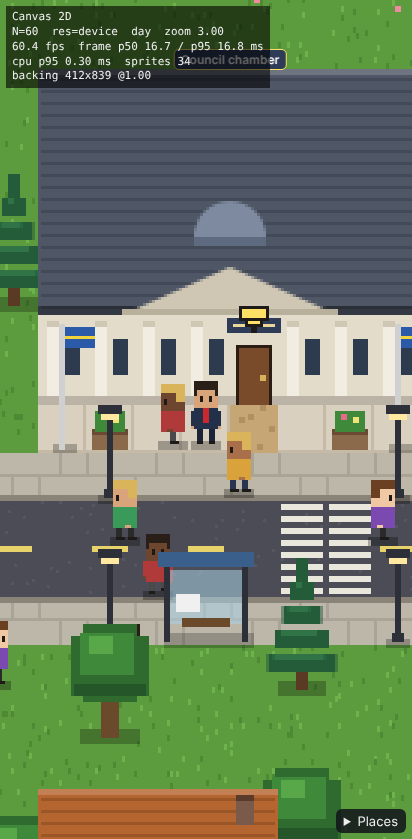
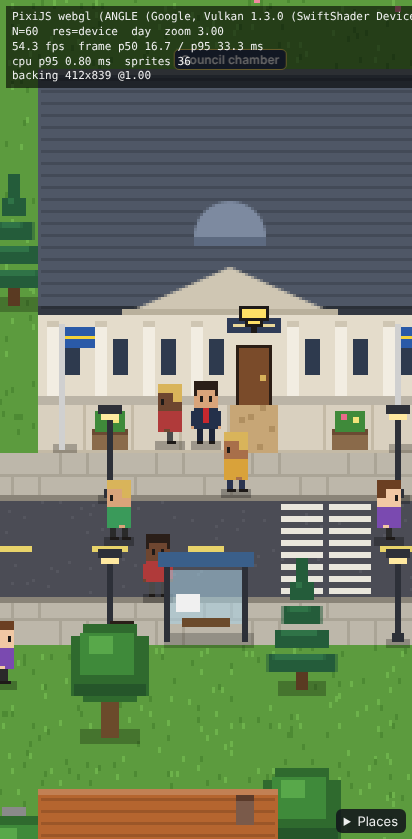
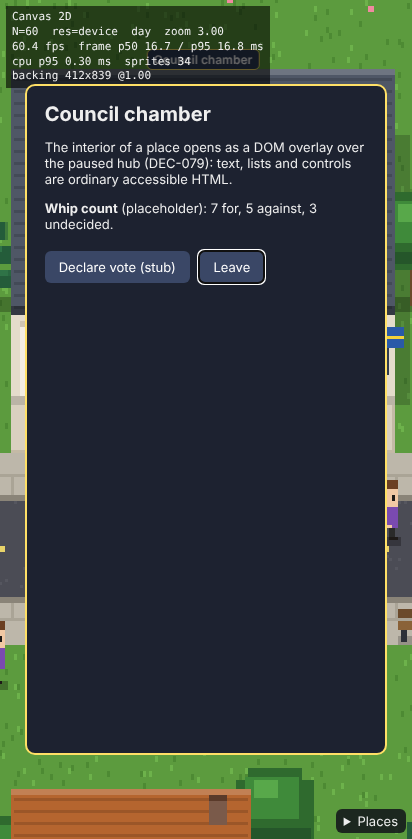

# Hub rendering spike: results

Generated by `web/spikes/hub/measure.mjs` on 2026-11-18 (headless Chromium via Playwright, Pixel 7 emulation
412×839 CSS px at DPR 2.625 unless noted, CDP `Emulation.setCPUThrottlingRate`). Each run: 1 s warm-up, then 10 s of a scripted
route (player walks an A* route; camera follows, pinch-zooms 1.4–4.6×, drag-pans a circle, then widens to 2×). FPS median/p5 are over sliding
0.5 s windows. "JS/frame" is the main-thread time of one frame (walker step + cull/sort + renderer submit + DOM labels);
"render()" is the renderer's share of it. Long tasks are those > 50 ms during
the measured window (load-time long tasks are in `results.json`).

Renderers seen: `Canvas 2D`, `PixiJS webgl (ANGLE (Google, Vulkan 1.3.0 (SwiftShader Device (Subzero) (0x0000C0DE)), SwiftShader driver))`.

## Main matrix (portrait, full device resolution)

| Renderer | N | CPU throttle | Layout | Backing px | FPS median | FPS p5 | FPS avg | Frame p50 ms | Frame p95 ms | JS/frame p50 ms | JS/frame p95 ms | of which render() p95 ms | Long tasks in run | JS heap MB | First frame ms | Sprites p50/max |
|---|---|---|---|---|---|---|---|---|---|---|---|---|---|---|---|---|
| canvas | 20 | x4 | portrait | 1082×2202 | 48 | 40 | 48.4 | 16.7 | 33.4 | 0.5 | 1.3 | 1.1 | 0 (0 ms) | 2.8 | 281 | 27/58 |
| canvas | 60 | x4 | portrait | 1082×2202 | 46 | 40 | 46.3 | 16.7 | 33.4 | 0.6 | 1.3 | 1.0 | 0 (0 ms) | 3.2 | 251 | 31/71 |
| canvas | 150 | x4 | portrait | 1082×2202 | 42 | 34 | 42.3 | 16.7 | 33.4 | 0.9 | 1.8 | 1.2 | 0 (0 ms) | 2.5 | 239 | 47/119 |
| pixi | 20 | x4 | portrait | 1082×2202 | 6 | 6 | 6.9 | 133.4 | 199.9 | 1.9 | 4.9 | 3.1 | 69 (9964 ms) | 4.8 | 509 | 29/57 |
| pixi | 60 | x4 | portrait | 1082×2202 | 6 | 4 | 5.5 | 166.7 | 266.6 | 2.3 | 7.0 | 4.7 | 55 (9906 ms) | 4.9 | 603 | 32/75 |
| pixi | 150 | x4 | portrait | 1082×2202 | 6 | 6 | 6.3 | 166.6 | 183.4 | 2.4 | 5.9 | 4.5 | 65 (10202 ms) | 5.3 | 634 | 55/119 |
| canvas | 20 | x6 | portrait | 1082×2202 | 26 | 18 | 24.2 | 33.4 | 66.6 | 1.1 | 2.2 | 1.5 | 44 (2498 ms) | 3.0 | 421 | 27/59 |
| canvas | 60 | x6 | portrait | 1082×2202 | 20 | 16 | 21.1 | 50.0 | 66.8 | 1.2 | 2.9 | 2.5 | 76 (4590 ms) | 3.2 | 458 | 32/75 |
| canvas | 150 | x6 | portrait | 1082×2202 | 22 | 16 | 22.3 | 50.0 | 66.7 | 1.4 | 3.2 | 2.6 | 68 (3853 ms) | 2.5 | 398 | 49/118 |
| pixi | 20 | x6 | portrait | 1082×2202 | 4 | 2 | 4.2 | 233.3 | 316.7 | 3.9 | 11.5 | 7.9 | 42 (9904 ms) | 4.7 | 990 | 30/63 |
| pixi | 60 | x6 | portrait | 1082×2202 | 4 | 2 | 5.0 | 200.0 | 316.7 | 3.3 | 9.9 | 8.7 | 50 (9890 ms) | 5.0 | 900 | 34/75 |
| pixi | 150 | x6 | portrait | 1082×2202 | 6 | 4 | 6.0 | 166.6 | 200.0 | 4.3 | 9.1 | 7.5 | 60 (9913 ms) | 5.2 | 840 | 52/122 |
| canvas | 60 | none | portrait | 1082×2202 | 60 | 60 | 60.0 | 16.7 | 16.8 | 0.1 | 0.2 | 0.2 | 0 (0 ms) | 2.3 | 70 | 31/71 |
| pixi | 60 | none | portrait | 1082×2202 | 10 | 8 | 9.3 | 100.1 | 133.4 | 0.4 | 1.1 | 0.7 | 93 (9907 ms) | 5.0 | 177 | 33/75 |

## Extra runs

`res=css`: backing store at CSS resolution (DPR 1), upscaled by the compositor with `image-rendering: pixelated`.
`res=low`: backing store at 1/3 of CSS px (≈ one backing pixel per art pixel at the default zoom), upscaled the same way.
`x1 (phone, unthrottled)`: Pixel 7 viewport and DPR with no CPU throttle.
`dusk`: day-part lighting (full-screen multiply tint + additive lamp glows). `landscape`: Pixel 7 rotated. `desktop`: 1280×800 at DPR 1, no throttle.

| Renderer | N | CPU throttle | Layout | Backing px | FPS median | FPS p5 | FPS avg | Frame p50 ms | Frame p95 ms | JS/frame p50 ms | JS/frame p95 ms | of which render() p95 ms | Long tasks in run | JS heap MB | First frame ms | Sprites p50/max |
|---|---|---|---|---|---|---|---|---|---|---|---|---|---|---|---|---|
| canvas | 60 | x4 | portrait, res=css | 412×839 | 60 | 60 | 60.0 | 16.7 | 16.7 | 0.4 | 1.0 | 0.8 | 0 (0 ms) | 2.3 | 226 | 32/73 |
| pixi | 60 | x4 | portrait, res=css | 412×839 | 40 | 34 | 41.0 | 16.7 | 33.4 | 1.2 | 2.7 | 2.4 | 0 (0 ms) | 5.3 | 533 | 31/73 |
| canvas | 60 | x6 | portrait, res=css | 412×839 | 60 | 60 | 60.0 | 16.7 | 16.7 | 0.2 | 1.3 | 1.1 | 0 (0 ms) | 3.0 | 355 | 32/74 |
| pixi | 60 | x6 | portrait, res=css | 412×839 | 42 | 32 | 40.3 | 16.7 | 33.4 | 1.7 | 3.3 | 3.0 | 0 (0 ms) | 5.7 | 753 | 31/71 |
| canvas | 150 | x6 | portrait, res=low | 137×280 | 60 | 58 | 59.9 | 16.7 | 16.7 | 0.6 | 1.7 | 1.5 | 0 (0 ms) | 2.9 | 342 | 50/118 |
| pixi | 150 | x6 | portrait, res=low | 137×280 | 60 | 60 | 60.0 | 16.7 | 16.7 | 1.5 | 2.9 | 2.5 | 0 (0 ms) | 6.4 | 717 | 49/119 |
| canvas | 60 | x4 | portrait, dusk | 1082×2202 | 24 | 18 | 23.2 | 33.4 | 66.7 | 1.0 | 1.7 | 1.3 | 35 (2028 ms) | 2.4 | 278 | 32/75 |
| pixi | 60 | x4 | portrait, dusk | 1082×2202 | 4 | 4 | 4.2 | 233.3 | 283.3 | 3.2 | 7.2 | 5.1 | 42 (9909 ms) | 4.9 | 616 | 33/80 |
| canvas | 60 | x4 | landscape | 2202×1082 | 44 | 30 | 44.0 | 16.7 | 33.4 | 0.7 | 1.4 | 1.1 | 1 (57 ms) | 3.2 | 379 | 42/126 |
| pixi | 60 | x4 | landscape | 2202×1082 | 8 | 6 | 7.3 | 133.3 | 166.7 | 2.0 | 4.2 | 3.7 | 73 (9993 ms) | 4.9 | 721 | 45/112 |
| canvas | 150 | none | desktop | 1280×800 | 60 | 60 | 60.0 | 16.7 | 16.8 | 0.3 | 0.6 | 0.5 | 0 (0 ms) | 2.4 | 115 | 134/259 |
| pixi | 150 | none | desktop | 1280×800 | 20 | 12 | 19.9 | 50.0 | 66.7 | 0.5 | 1.0 | 0.7 | 89 (5176 ms) | 5.0 | 147 | 137/259 |

## Bundle cost (gzip -9 of the JS chunks each renderer actually loads)

| | gzipped |
|---|---|
| Shared spike code (scene, art, loop, UI) | 10.0 KB |
| Canvas 2D renderer adds | 0.6 KB (assets/canvasRenderer-B_t2J2oG.js) |
| PixiJS renderer adds (pixi.js 8.22.0 + adapter) | 145.3 KB (9 chunks) |

For comparison the app's main bundle is ~122 KB gzipped (`npm run build`) and the WASM engine ~3.4 MB raw.

  

<!-- interpretation -->

## Interpretation

**Read this first: the test machine has no GPU.** `chrome://gpu` in this Chromium (153) reports *Canvas: software only*,
*Compositing: software only*, and WebGL runs on SwiftShader (`ANGLE … SwiftShader Device (Subzero)`), a CPU emulation of a GPU.
That splits the two renderers unevenly:

- **Canvas 2D** is rasterized by Skia on the CPU, on the page's main thread, which CDP throttles. Its numbers are a
  *pessimistic, CPU-only* bound. On a real phone Chrome GPU-accelerates any canvas of this size.
- **PixiJS** sends GL commands to SwiftShader in the GPU process. CDP does not throttle that process, but SwiftShader's fill
  rate is very low, and the page's main thread blocks waiting for it (the long tasks). Pixi is at 9–10 fps on the unthrottled
  phone viewport, with only 1.1 ms of JS per frame, and at 60 fps at `res=low` with 150 NPCs and a 6× throttle. So the
  Pixi frame rates above measure **SwiftShader fill rate, not PixiJS and not a phone GPU**. They are not evidence against
  Pixi on hardware.

What does transfer from this machine:

1. **Main-thread JS per frame is small for both renderers.** The work is walker step, cull and y-sort, draw submit and DOM
   labels.
   - Canvas `render()` p95: 1.0–2.6 ms.
   - Pixi `render()` p95: 2.4–3.0 ms where fill does not dominate (`res=css`, `res=low`). The 5–9 ms device-resolution
     figures include GL blocking.
   - Even with 150 townsfolk at a 6× throttle, both stay under 3.5 ms. The budget is 33 ms for ≥30 fps, or 16.7 ms for 60 fps.
   - At this scene size (≤ ~260 sprites, ~120 visible at the widest zoom) the CPU is not the constraint, and Pixi's batching
     has nothing to win.
2. **The number of pixels pushed per frame decides performance, not the API.**
   - Pixel 7 at full DPR: 1082×2202 = 2.4 MPix per frame. At CSS resolution: 0.35 MPix (6.9× less). At `res=low`: 38 kPix.
   - CPU-rasterized Canvas 2D:
     - full DPR: 42–48 fps at 4× throttle, which meets the ≥30 fps mid-phone budget; 20–26 fps at 6×, which misses the
       low-phone target;
     - `res=css`: a locked 60 fps at both 4× and 6×;
     - `res=low`: 60 fps with N=150 at 6×.
   - For integer-scaled pixel art, a low-resolution backing store upscaled with `image-rendering: pixelated` looks the same at
     integer zoom (nearest-neighbour either way). Text stays sharp because it is DOM (see below).
3. **Full-screen lighting is a fill cost.** Dusk (one multiply pass plus additive lamp glows) halves CPU-rasterized Canvas at
   full DPR (46 → 24 fps at 4×). On a GPU this is cheap. In Canvas 2D it must be done at low resolution or baked per day-part.
4. **Start-up and memory favour Canvas.**
   - Time to first frame: 230–460 ms for Canvas against 510–990 ms for Pixi under throttle. Pixi pays for module load,
     WebGL context creation and shader compilation.
   - JS heap: 2.3–3.2 MB against 4.7–6.4 MB. GPU texture memory is not visible here; both upload the same 1024² atlas plus
     768×512 ground.
5. **Bundle size.**
   - Canvas 2D adds 0.6 KB gzipped (the shared scene code, 10 KB, would exist with either renderer).
   - pixi.js 8.22.0 adds **145 KB gzipped** across 9 lazily loaded chunks. That is more than the whole app's main bundle
     (~122 KB). About 11 KB of it is `browserAll` (Pixi's own events and accessibility), which `skipExtensionImports` could drop.

### Recommendation for the M6 hub: Canvas 2D, rendered at low resolution, with DOM overlays

- **Rendering:**
  - Keep the approach `WorldMap.tsx` already uses: bake static layers into offscreen canvases, then each frame draw one
    ground blit plus a culled, y-sorted sprite list from one atlas.
  - Render the scene at CSS or art resolution (backing store ≤ 1× CSS px) and let the compositor upscale it.
  - Snap zoom to integer art-pixel scales so pixels stay even.
  - Use a full redraw. Dirty rectangles gain nothing: the camera follows the player, so most frames scroll the whole view,
    and townsfolk are spread over the screen.
- **Why not PixiJS now:**
  - The measured CPU cost is already tiny.
  - The dependency costs 145 KB gzipped, a slower first frame and twice the JS heap.
  - It adds WebGL context-loss handling, which matters for a backgrounded mobile PWA.
  - It would give the app a second rendering stack next to the strategic map.
  - The dependency policy (OVERVIEW §9) asks every dependency to justify itself, and this one does not yet.
- **When to revisit:** if M6 needs many full-screen effects (lightmaps, weather, water shaders, filters), more than about
  1,000 moving sprites, or if a real phone misses 30 fps with Canvas at low resolution. The renderer sits behind one small
  interface (`HubRenderer`: `resize` + `render(list)`), so swapping it later is a contained change.
- **This changes a provisional default.** OVERVIEW §10 and DEC-009 name PixiJS as the provisional default (benchmark-gated),
  so the switch needs an owner decision. It should not be applied silently.
- **Battery and heat:**
  - Energy scales with pixels × frames, whichever API draws them.
  - Low-resolution rendering is the main saving.
  - Also pause the loop when nothing moves, when an interior or panel is open (this spike does that), and when the page is
    hidden.
  - Consider a 30 fps cap for the ambient scene on battery.
  - A GPU path (Pixi, or GPU-accelerated Canvas) is more efficient per pixel for heavy effects, but at this scene size the
    difference is small.
- **Text, UI overlays and accessibility:**
  - Labels, the place list, the interior panel and toasts are ordinary DOM over the canvas. They are crisp at any backing
    resolution, localizable with Fluent, and readable by screen readers. This works the same for either renderer.
  - The canvas is `role="img"` and is never the only way to act: a "Places" list offers every place with auto-routing
    (DEC-079 convenience rule 2, fairness and accessibility).
  - Pixi's built-in `Text` and `AccessibilitySystem` are not needed.
  - Per-frame DOM transform updates are fine for the ~7 labels here. Many NPC name tags would need pooling, or drawing on
    the canvas with a DOM fallback list.

### Gaps and risks

- **No real-device data.** DEC-050 asks for a mid-range Android phone; this machine cannot measure GPU work. Before M6
  commits, open the page on a phone and read the on-screen HUD:
  - run `npx vite --config spikes/hub/vite.config.ts --host` in `web/`;
  - open `http://<lan-ip>:5199/compare.html?r=canvas&n=60`, then `?r=pixi&n=60`;
  - also try `&res=css`, `&res=low` and `&light=dusk`.
- **Fractional zoom** (pinch) at non-integer scales gives uneven pixel columns. M6 should snap the zoom.
- **A 1/3-resolution backing store** makes the sprites move in whole art pixels. That is authentic for pixel art but less
  smooth. `res=css` is the safe middle ground.
- **Lighting in Canvas 2D** must be designed for low resolution, or baked per day-part.
- **Run-to-run noise.** Headless `requestAnimationFrame` is vsync-locked at 60 Hz. Each configuration ran once for 10 s, so
  treat differences under ~10% as noise.

### How to run

```text
cd web
npx vite --config spikes/hub/vite.config.ts          # dev server: town at http://localhost:5199/, comparison at /compare.html?r=canvas&n=60
node spikes/hub/measure.mjs                           # full matrix (~13 min), rewrites the tables above
```

URL parameters: `r=canvas|pixi`, `n=<townsfolk>`, `res=device|css|low`, `light=day|dusk`, `seed=<int>`.

## Town prototype (`index.html`, M6 groundwork, 2026-11-19)

The spike's main page is now the walkable town on the real engine (DEC-080 status, DEC-085 proposed). It starts the
engine worker as the app does, generates a world for `?seed=` (default 4242), lays out the player's town from the
engine's `town` view (`web/src/hub/townLayout.ts`), draws it with the chunked Canvas 2D renderer and placeholder art
(`web/src/hub/render/`) under a continuous day cycle (`web/src/hub/dayCycle.ts`), and lets you walk it: tap a building
or its label, tap the ground, or use the place list; pinch, drag and wheel move the camera. Reaching a place moves the
player there in the engine and opens what the place offers. The bar runs the clock (play/pause, speed, a scrubber) and
takes another seed.

**The renderer comparison is kept, not retired**, at `compare.html` (`?r=canvas|pixi&n=…` as before; `measure.mjs`
now opens it there). It is the evidence for DEC-080 and costs nothing in the app; it can be deleted once M6 ships.
Its PixiJS chunks are only loaded by that page.

URL parameters: `seed=<text>`, `t=<minutes after midnight>`, `speed=<game minutes per second, 0 stops the clock>`,
`n=<townsfolk>`, `res=css|device`, `hud=1` (frame stats).

Measured by `node spikes/hub/measure-town.mjs` (headless Chromium 153 on this GPU-less machine, software
rasterization; the phone is Pixel 7 emulation at CSS resolution with the CPU slowed 4×). Each run: the player walks to
the farthest named place for 8 s with 30 townsfolk and the clock running at 12 game minutes per second. "Layout" is the
player's town; "capital layout" is the largest committed fixture (205×131 tiles, 22 neighbourhoods, 323 buildings),
best of 3. "Ready" includes generating the world in the engine worker (not throttled). Draw times are main-thread
JavaScript only (rasterization is not counted, as in the tables above).

| Device | Seed | Town (tiles) | Layout ms | Capital layout ms | First frame ms | Ready ms | FPS median | FPS p5 | Draw p50 ms | Draw p95 ms | Base/shadow bakes |
|---|---|---|---|---|---|---|---|---|---|---|---|
| phone (Pixel 7, CSS px) | 4242 | Larkobridge 122×64 | 63.0 | 76.6 | 146.5 | 1920 | 60 | 30 | 0.40 | 1.60 | 4/10 |
| phone (Pixel 7, CSS px) | 2026 | Strathowick 111×61 | 56.4 | 46.9 | 117.9 | 1985 | 60 | 60 | 0.60 | 2.00 | 5/5 |
| desktop 1280×720 | 4242 | Larkobridge 122×64 | 16.0 | 22.5 | 38.3 | 1739 | 60 | 60 | 0.10 | 0.30 | 6/10 |
| desktop 1280×720 | 2026 | Strathowick 111×61 | 13.5 | 25.0 | 34.1 | 1761 | 60 | 60 | 0.20 | 0.40 | 5/5 |

Notes:
- The first frame bakes only the visible chunks (512×512 art px each; 4–6 here), so it does not grow with the town.
  Memory follows the view: at most 24 chunks are kept (about 25 MB at worst), however large the town.
- Shadows are re-baked only when the sun moves to the next of 28 buckets, and only for visible chunks; the phone's p5
  of 30 fps in one run lines up with those re-bakes while walking. Idle frames are skipped entirely (tested).
- Still to check on a real phone: the full-view grading (three composites per frame) at dusk and night, and battery.
